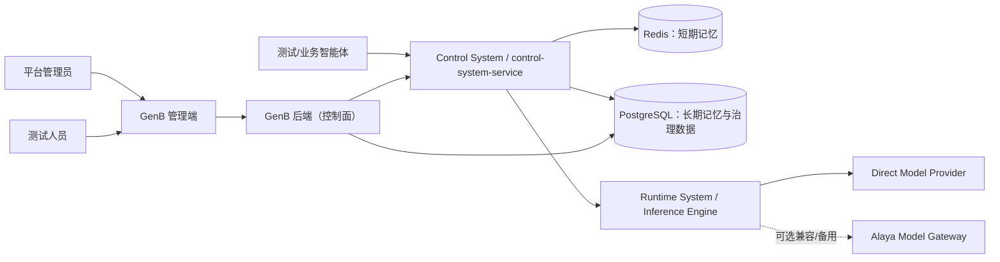
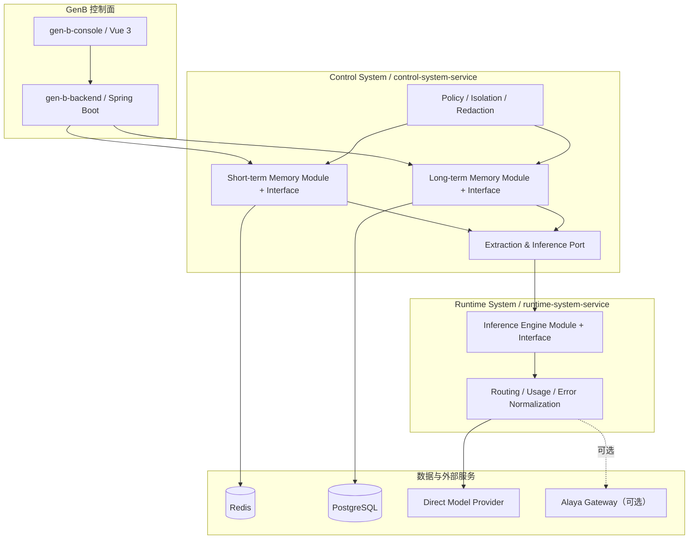
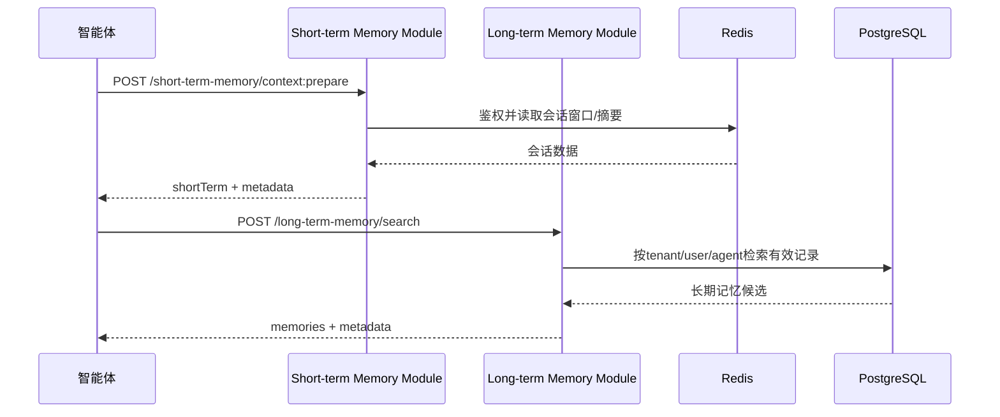
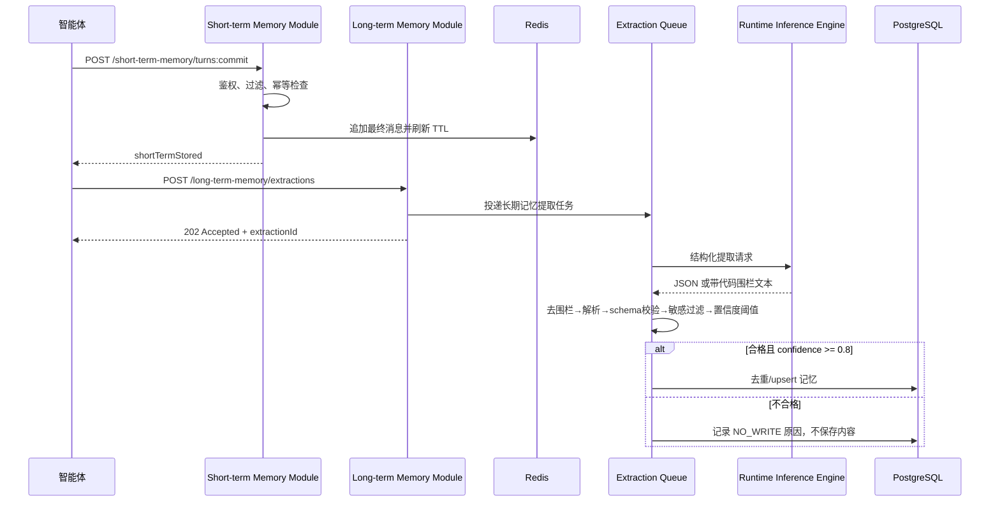
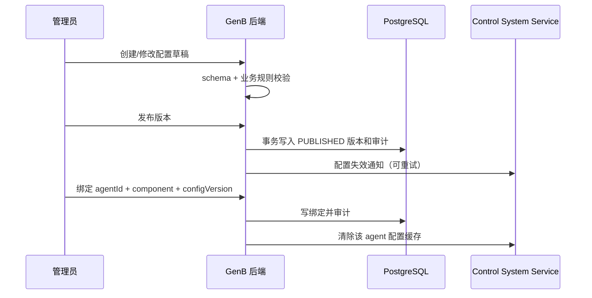
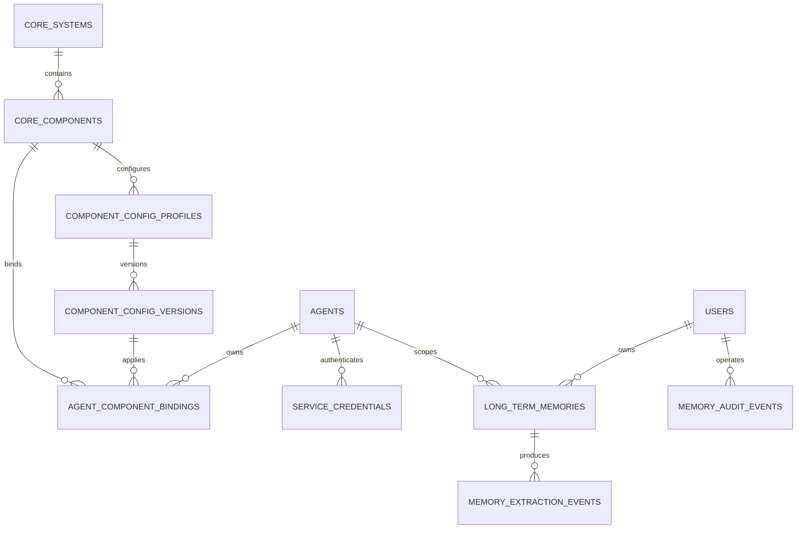
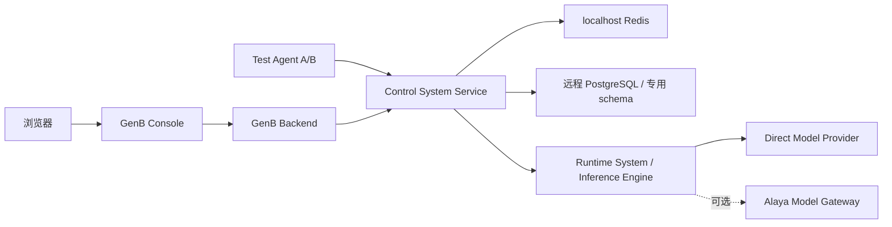

# GenB 五大系统与14个核心组件总体设计暨一期记忆组件详细设计

> 文档状态：评审稿（Draft）  
> 版本：v1.2  
> 更新时间：2026-07-23  
> 适用范围：GenB 管理端、GenB 后端、五大系统、14个核心组件、核心组件测试智能体  
> 当前有效决策：`records/decisions/20260723-ADR-control-system-component-service.md`、`records/decisions/20260723-ADR-self-hosted-inference-engine.md`  
> 统一术语：`CONTEXT.md`

## 0. 文档使用说明

### 0.1 设计结论先行

一期建设三个固定核心组件：

1. **短期记忆/工作台**：保存一次会话内的消息、摘要和临时工作上下文，默认以 `tenantId + userId + agentId + sessionId` 隔离。
2. **用户长期记忆**：保存用户偏好、稳定事实和用户约束，默认以 `tenantId + userId + agentId` 隔离；一期不是完整 RAG 知识库。
3. **推理引擎服务**：由Runtime System提供统一模型调用Interface，最小实现覆盖非流式对话、结构化输出、流式调用、Embedding、模型能力和健康；模型厂商及Alaya协议隐藏在Adapter之后。

总体业务架构统一为“系统直接提供所属核心组件Interface”。一期实现为：

```text
Control System / control-system-service
├─ Short-term Memory Module + Interface
└─ Long-term Memory Module + Interface

Runtime System / runtime-system-service
└─ Inference Engine Module + Interface
   ├─ Direct Provider Adapter
   ├─ Alaya Gateway Adapter（可选兼容/备用）
   └─ Fake Model Adapter（测试）
```

GenB 核心组件模块是跨五大系统的管理控制面，负责注册、配置、绑定、凭证、权限、审计和测试入口；智能体通过绑定获得调用资格和服务凭证，再调用对应系统提供的核心组件 Interface。

一期部署`control-system-service`和最小`runtime-system-service`。前者内部实现两个记忆深Module，不设置Memory Runtime Service中间层；后者实现Inference Engine深Module，统一承接模型调用。未来出现容量、SLO、安全隔离或团队边界差异时，可以拆分部署，但不改变`Core System → Core Component`的领域层级。

管理端必须展示五大系统和全部14张核心组件卡片。其中Short-term Memory、Long-term Memory、Inference Engine Service为一期真实可用卡片，其余11张统一标记为`PLANNED/规划中`，只展示架构说明，不提供虚假的配置、绑定、接口版本或健康状态。

### 0.2 模板来源和取舍

本文不是照搬单一模板，而是采用三套成熟模板的组合：

| 来源 | 本文采用内容 | 原因 |
|---|---|---|
| [arc42](https://docs.arc42.org/home/) | 目标、约束、上下文、策略、构建块、运行时、部署、横切概念、决策、质量、风险、术语 | 适合完整软件架构说明，是正文主骨架。 |
| [C4 Model](https://c4model.com/diagrams) | System Context、Container、Deployment 视图 | 用少量图解释系统边界和责任，不陷入类图细节。 |
| [Kubernetes KEP Template](https://github.com/kubernetes/enhancements/blob/master/keps/NNNN-kep-template/README.md) | Goals/Non-Goals、Test Plan、Production Readiness、Rollout/Rollback、Risks、Alternatives | 补足“能否安全上线和回滚”的工程问题。 |

本文同时沿用仓库内 `GENESIS_GENC_UNIFIED_AUTHORIZATION_DESIGN.md` 的落地写法：结论优先、接口与数据落到字段、权限落到矩阵、验收落到用例。

### 0.3 审阅顺序

| 角色 | 优先章节 |
|---|---|
| 项目经理/产品 | 1、2、4、9、23、27 |
| 架构/后端 | 5—8、10—18、21—22 |
| 前端 | 9、10、15、16 |
| 测试 | 19、23、27 |
| 运维/安全 | 15—22 |

---

## 1. 背景、问题与目标

### 1.1 背景

需求资料《第十五章：企业级智能体架构：五大系统与 14 个核心组件》把企业级智能体拆为五大系统、14 个固定核心组件。GenB 当前主要管理智能体、部署、授权和运行状态，尚缺少统一的核心组件资产、配置、绑定、机器凭证和运行数据治理能力。

现有 Runtime SDK 已包含部分 Memory 实现，但若把完整 SDK 分别放入每个智能体，会产生版本分散、升级困难、隔离策略不一致、配置和数据难以集中治理等问题。因此一期明确不使用现有 Runtime SDK 作为依赖或运行底座，只阅读参考其中的算法、数据结构、行为和测试经验。

### 1.2 要解决的问题

| 编号 | 问题 | 解决方式 |
|---|---|---|
| P1 | 记忆能力分散在各智能体，难统一升级 | 由 Control System Service 内两个独立 Module 集中实现。 |
| P2 | 核心组件、实现、服务和实例概念混用 | 建立固定组件目录、实现和绑定模型。 |
| P3 | 不能独立验证组件效果 | 建立与真实组件Interface共用的测试台和测试智能体。 |
| P4 | 用户、智能体和会话数据隔离没有统一规范 | 四维身份键和服务端强制授权。 |
| P5 | 保存多久、保存什么、谁能看不明确 | 版本化配置、TTL、敏感信息过滤和管理员权限。 |
| P6 | GenB 当前权限点未真实落地 | 菜单、路由、API 三层权限和审计。 |
| P7 | Alaya模型网关与向量能力暂不完整 | 自建最小Inference Engine；直接Provider、Alaya兼容和Fake Adapter可替换，用户长期记忆一期不依赖向量检索。 |

### 1.3 总体建设目标

- 建成五大系统和 14 个核心组件的真实能力体系，而不只是管理页面和占位卡。
- 每个核心组件都有稳定 Interface、至少一个可运行 Implementation、版本、配置、权限、测试和运维证据。
- GenB 统一完成组件注册、发现、配置、智能体绑定、机器凭证、RBAC、审计、健康和调用治理。
- 智能体可以按需组合多个核心组件，不依赖具体部署地址和内部实现。
- 五大系统可以独立开发、部署和演进，但遵循统一组件契约和治理规范。
- 全部 14 个组件从 `PLANNED` 转为 `AVAILABLE` 并通过第27章总体验收后，项目才算整体完成。

### 1.4 一期交付目标

- 在 GenB 管理端展示五大系统和全部 14 张固定核心组件卡片。
- 交付短期记忆、用户长期记忆和最小Inference Engine三个可用组件。
- 将其他11个未实施组件明确展示为`PLANNED/规划中`，不伪造可用状态。
- 支持组件配置版本、发布、智能体绑定、启停和调用状态查看。
- 支持 GenB 生成每个逻辑智能体的服务凭证。
- 支持独立测试台演示连续对话、跨会话长期记忆和隔离效果。
- 支持业务智能体通过稳定 API 调用，而不是嵌入完整 SDK。
- 支持Control System通过Runtime System统一模型Interface完成摘要和长期记忆提取，不直接依赖Alaya或模型厂商协议。
- 支持 TTL、敏感信息拦截、管理员查询/删除、审计和可观测性。

### 1.5 总体质量目标

按优先级排序：

1. **接口一致性**：14个组件均通过相同的注册、绑定、鉴权、版本和错误规范接入GenB。
2. **隔离正确性**：任何跨租户、跨用户、跨智能体越权均视为 P0。
3. **秘密安全**：密码及凭证等敏感信息不得写入长期记忆或日志。
4. **可治理性**：配置、绑定、凭证、数据操作均可追溯。
5. **可演示性**：每个组件都具备可重复的独立测试入口和绑定智能体后的集成证明。
6. **可演进性**：替换组件Implementation或拆分服务时不修改智能体的业务流程。
7. **可用性**：单个组件故障可隔离和降级，不拖垮智能体及其他组件。

---

## 2. 范围、非目标和约束

### 2.1 总体范围

总体范围包含五大系统、14个核心组件的真实Implementation，以及GenB统一注册、配置、绑定、凭证、权限、测试、审计和运维治理。完整RAG、多模态、遗留系统连接、模型路由、动作执行、全链路追踪、安全过滤和反馈闭环均属于总体目标，只是不在一期同时实施。

### 2.2 一期范围

| 范围 | 包含内容 |
|---|---|
| 目录 | 五大系统、全部14张固定组件卡片；两个记忆组件和Inference Engine可配置，其他11张为只读规划卡。 |
| 短期记忆 | 消息保存、最近窗口、摘要、TTL、按会话清除。 |
| 长期记忆 | 用户偏好、稳定事实、用户约束；自动提取、检索、过期、删除。 |
| 控制面 | 配置版本、绑定、凭证、权限、测试台、数据管理、审计。 |
| 数据面 | 上下文准备、回合提交、短期/长期数据处理。 |
| 测试智能体 | 一个代码产物，多逻辑实例，用不同 `agentId` 和凭证测试隔离。 |
| 推理引擎 | 非流式、结构化JSON、流式、Embedding、模型能力、健康、统一错误、超时和基础用量。 |
| 模型 | Runtime System通过Direct Provider Adapter调用选定模型；Alaya只作为可选兼容/备用Adapter。 |

### 2.3 一期非目标

- 一期不建设文档上传、解析、切分、向量索引、引用溯源等完整RAG；Inference Engine提供通用Embedding Interface用于能力验证，但用户长期记忆一期不依赖向量检索。
- 一期不建设模型训练、模型托管、复杂计费、自动调参或完整模型运营平台。
- 不保存模型内部思维链（CoT）；只保存用户消息、最终回答、工具结果摘要和业务状态。
- 不把核心组件开放为用户任意新增的第 15 个“类别”。
- 不要求一期把 14 个组件拆成 14 个微服务。
- 不导入、不打包、不部署、不调用现有 Runtime SDK；它只作为阅读参考。CLI 也不在一期改造范围内。
- 未来如提供薄客户端，应新建仅封装 HTTP、类型、超时、重试和错误码的客户端，不得把现有完整 Runtime SDK 换名后继续使用。
- 不把 GenC 的平台角色菜单权限直接当作 GenB 核心组件权限。
- 不把当前本地 Redis/PostgreSQL 配置原样视为生产标准。

### 2.4 已知约束

| 约束 | 影响 |
|---|---|
| Alaya Model Gateway的Zhipu依赖和Embedding契约当前不可用/不一致，短期不修复 | Alaya不再是必选依赖；自建Inference Engine通过Direct Provider Adapter提供模型能力。 |
| 直接模型Provider和Embedding Provider尚未最终确认 | 先用Fake Model Adapter完成Interface开发；真实Adapter联调前必须完成凭证、数据合规和付费调用测试。 |
| PostgreSQL 15.15 当前未安装且不提供 pgvector | 一期使用结构化字段和关键词过滤，不承诺语义检索。 |
| Redis 5.0.14.1，AOF 关闭、`maxmemory=0`、`noeviction` | 可用于本地 MVP；生产前必须单独评审容量和持久化。 |
| GenB 管理 API 仍有较多 `permitAll` | 核心组件 API 上线前必须完成后端强制授权。 |
| 当前远程 PostgreSQL 连接未启用 SSL | 生产前必须启用 SSL，并改为独立最小权限账号。 |

### 2.5 关键假设

- `tenantId`、`userId` 来源于可信登录态或服务端映射，不接受智能体任意伪造。
- 一个服务凭证只属于一个逻辑 `agentId`。
- 每个逻辑 `agentId` 最多一份当前有效服务凭证；默认长期有效，直到轮换或吊销。
- 服务凭证只证明智能体机器身份，不固化组件权限；GenB 根据当前已启用绑定动态签发短期 Actor Token，新增绑定不要求重新签发服务凭证。
- GenB 是配置和授权的唯一来源，各系统服务只缓存已发布配置。
- 一期只有管理员可查看和删除真实记忆数据。

---

## 3. 五大系统与 14 个核心组件定位

### 3.1 固定目录

| 核心系统 | 核心组件 |
|---|---|
| 策略控制系统（Control System） | 规划与推理引擎、短期记忆/工作台、长期记忆/知识库、工具注册表、策略护栏 |
| 环境感知系统（Perception System） | 数据连接器与适配器、上下文编码器 |
| 交互体验系统（Interaction System） | 多模态接口、会话管理器 |
| 运行环境系统（Runtime System） | 推理引擎服务、动作执行器 |
| 操作运维系统（Operations System） | 全链路追踪仪、安全过滤器、反馈闭环控制器 |

### 3.2 固定与可变边界

| 对象 | 是否允许页面新增 | 说明 |
|---|---:|---|
| 核心系统 | 否 | 属于企业架构标准，代码/种子数据维护。 |
| 核心组件 | 否 | 固定 14 项；允许启用、配置和升级，不允许业务用户创建新类别。 |
| 组件实现 | 后续可允许管理员注册 | 例如用户长期记忆实现、未来 RAG 实现。 |
| 配置方案/版本 | 是 | 管理员可新建草稿、发布、停用。 |
| 智能体绑定 | 是 | 将智能体绑定到已发布配置。 |
| 系统服务实例 | 由部署系统管理 | 不等同于组件卡片。 |

### 3.3 系统、组件和实现的规范层级

```text
Control System / control-system-service
├─ Short-term Memory Module            核心组件Implementation
│  └─ Short-term Memory Interface      注册和调用表面
└─ Long-term Memory Module             核心组件Implementation
   └─ Long-term Memory Interface       注册和调用表面
```

对外产品、菜单、卡片、需求和架构统一使用 `Control System` 表示系统；技术部署名称为 `control-system-service`。不再设置或使用 `Memory Runtime Service` 这一层。

### 3.4 一期能力切片

长期记忆组件按演进切片：

```text
一期：用户长期记忆
  ├─ 用户偏好
  ├─ 稳定事实
  └─ 用户约束

后续：完整 RAG 知识库
  ├─ 文档摄取与治理
  ├─ Embedding / Vector DB
  ├─ 检索重排与引用
  └─ 既有同事知识库系统 Adapter
```

“完整 RAG”不是重新定义一个核心组件，而是“长期记忆/知识库”核心组件下的另一项实现能力。

### 3.5 总体完成形态

| 核心系统 | 建议系统服务 | 最终必须提供的核心组件Interface |
|---|---|---|
| Control System | `control-system-service` | Planner & Reasoner、Short-term Memory、Long-term Memory、Tool Registry、Policy Guardrails |
| Perception System | `perception-system-service` | Data Connectors & Adapters、Context Encoder |
| Interaction System | `interaction-system-service` | Multimodal Interface、Session Manager |
| Runtime System | `runtime-system-service` | Inference Engine Service、Action Executor |
| Operations System | `operations-system-service` | Observability Tracer、Security Filter、Feedback Loop Controller |

表中的五个系统服务是总体目标的逻辑部署基线，不要求永远保持五个进程。某个核心组件可以因容量或安全要求拆为独立服务，但GenB中的系统归属、组件code和Interface保持稳定。

---

## 4. 利益相关者和典型用户故事

| 角色 | 关注点 | 一期主要操作 |
|---|---|---|
| 平台管理员 | 统一治理和安全 | 配置、发布、绑定、发凭证、查询/删除数据、看审计。 |
| 智能体开发者 | 简单接入和稳定契约 | 使用凭证调用准备/提交 API，处理降级。 |
| 测试人员 | 可重复验证隔离和效果 | 切换用户、会话、智能体实例，检查命中和过期。 |
| 运维人员 | 可部署、可观测、可回滚 | 看健康、指标、错误、容量和版本。 |
| 业务用户 | 连续、个性化且不泄露 | 在授权智能体中获得连续对话体验。 |
| 审计/安全人员 | 最小权限和可追溯 | 查询管理操作、访问事件和删除原因。 |

典型故事：

- 管理员发布“默认用户记忆 180 天”配置并绑定测试智能体。
- 测试用户在会话 A 表达“我偏好稳健型产品”，系统以高置信度保存。
- 同一用户在会话 B 询问建议，长期记忆被召回；会话 A 的临时消息不会原样跨会话出现。
- 切换到另一个用户或智能体后，原记忆不被召回。
- 用户说出登录密码，系统不得保存到长期记忆，日志中也必须脱敏。
- 管理员轮换凭证，旧凭证在宽限期后失效并留下审计记录。

---

## 5. 架构上下文（C4 Level 1）



### 5.1 系统责任

| 系统 | 负责 | 不负责 |
|---|---|---|
| GenB 管理端 | 可视化目录、配置、绑定、凭证、测试和数据治理 | 不直接读 Redis/业务库，不在浏览器持有机器秘密。 |
| GenB 后端 | 控制面 API、RBAC、配置版本、绑定、凭证生命周期、审计 | 不处理每轮高频记忆读写。 |
| Control System | 对外提供策略控制类核心组件；一期由 `control-system-service` 实现 Short-term Memory 和 Long-term Memory | 不自行决定谁是管理员，不维护GenB页面角色。 |
| Runtime System | 一期实现最小Inference Engine，统一模型调用、结构化输出、流式、Embedding、超时、错误和基础用量 | 不保存GenB记忆，不决定智能体组件绑定，不训练或托管模型。 |
| 智能体 | 组织业务对话、调用组件、传递会话上下文 | 不直接连接Redis/PostgreSQL，不自行拼隔离键，不持有模型厂商凭证。 |
| 直接模型Provider | 提供实际对话或Embedding能力 | 不理解GenB组件、智能体绑定和记忆语义。 |
| Alaya Model Gateway | 可选兼容/备用模型Adapter目标 | 不再是一期必选依赖，不保存GenB记忆，不作为身份授权源。 |

---

## 6. 容器与部署单元（C4 Level 2）



### 6.1 实现语言建议（待评审决策）

建议 `control-system-service` 一期使用 **Python 3.11 + FastAPI + Pydantic**：

- 现有智能体和 Runtime SDK 为 Python，可阅读参考其概念、测试样本和 LLM 处理经验，但新服务不得依赖或导入现有 SDK。
- Pydantic 适合严格校验模型提取 JSON。
- GenB 后端继续保持 Java/Spring Boot，避免把高频数据面塞入控制面。

替代方案是 Java/Spring Boot 独立服务，优点是技术栈统一，缺点是与现有智能体/LLM 代码复用较少。评审必须在进入实现前确定，API 和数据契约不随语言变化。

---

## 7. 模块、接口、接缝与 Adapter

本文用“深模块”原则组织：对外接口少而稳定，复杂的隔离、TTL、提取和存储隐藏在模块内部。

| Module | 对外 Interface（Port） | 内部职责 | Adapter/Seam |
|---|---|---|---|
| Component Catalog | 管理组件目录 | 固定五大系统/14 组件、状态和版本元数据 | PostgreSQL Adapter |
| Configuration | 发布/读取有效配置 | 草稿、校验、版本、发布、回滚 | GenB DB Adapter、System Service Cache Adapter |
| Binding | 绑定/解绑智能体 | 校验组件、配置、智能体、有效期 | Agent Registry Adapter |
| Credential | 签发/轮换/吊销 | 一次展示 secret、只存 hash、作用域和过期 | Hash/KMS Adapter |
| Short-term Memory | `appendTurn`、`loadWindow`、`clearSession` | 消息窗口、摘要、TTL | Redis Adapter |
| Long-term Memory | `upsertMemory`、`searchMemory`、`deleteMemory` | 去重、版本、检索、过期 | PostgreSQL Adapter |
| Extraction | `extractMemories` | Prompt、清洗、JSON校验、阈值 | Runtime Inference Adapter；测试用Fake Inference Adapter |
| Inference Engine | `infer`、`stream`、`embed`、`listCapabilities` | Provider路由、协议归一、结构化输出、超时、重试、用量和错误 | Direct Provider、Alaya Gateway（可选）、Fake Model Adapter |
| Policy | `authorizeIdentity`、`redact` | 隔离、敏感过滤、数据最小化 | JWT/API Key Adapter |
| Audit/Telemetry | `recordEvent` | 审计、指标、追踪、脱敏日志 | DB/Metrics Adapter |

关键接缝：

- 存储由对应远端 Module 拥有 Port，Redis/PostgreSQL 只是 Adapter。
- Inference Engine及底层模型返回均不可信，必须经过`Extraction`的清洗与schema校验。
- 智能体只依赖各核心组件Interface；未来薄客户端只能封装 HTTP、重试和类型，不得复制组件业务逻辑。

---

## 8. 核心运行流程

### 8.1 上下文准备



规则：

- `agentId` 以凭证绑定值为准；请求体传入时必须一致。
- `tenantId`、`userId` 必须由可信身份映射获得。
- 返回的是可注入 Prompt 的事实和摘要，不包含内部 CoT。
- 长期记忆按类型、置信度、最近使用时间排序，并受 `topK` 限制。

### 8.2 回合提交和自动提取



两个提交动作分别属于两个核心组件。短期提交优先快速确认，长期提取异步执行；长期提取失败不会让短期记忆或用户本轮对话失败。

### 8.3 配置发布与绑定



系统服务拉取不到新配置时继续使用最后一个已知有效版本，并告警；从未加载过配置时拒绝调用，不能猜默认值。

### 8.4 凭证轮换

1. 管理员请求轮换，GenB 生成新 secret。
2. secret 仅在创建响应中展示一次；数据库只保存 hash 和前缀。
3. 当前一期采用单活轮换：新凭证生成成功后旧凭证立即失效。
4. 智能体替换 Secret 后验证新凭证；生产如确需宽限期，必须另行设计双槽状态，不能同时标记两份为当前有效。
6. 每一步写入审计，审计不得记录 secret。

### 8.5 管理员查看和删除

- 查询必须带明确的租户、用户或智能体过滤条件，不允许默认全表导出。
- 详情查看写审计事件 `MEMORY_DATA_VIEWED`。
- 删除必须填写原因，建议软删除后由定时任务物理清理。
- 批量删除、历史 TTL 重算属于高风险操作，需要二次确认和独立权限。

---

## 9. 管理端信息架构和交互设计

### 9.1 菜单

```text
智能体中心
├─ 智能体列表
└─ 核心组件
   ├─ 组件目录
   ├─ 组件测试台
   └─ 运行数据（管理员）

系统管理
├─ 用户管理
├─ 角色管理
├─ 权限管理
├─ 服务凭证
└─ 审计日志
```

### 9.2 组件目录页

- 顶部按五大系统切换或筛选。
- 固定显示 14 张组件卡，不使用“新增核心组件”按钮。
- 卡片字段：名称、系统、一期状态、当前实现版本、绑定智能体数、健康状态、最近更新时间。
- 状态建议：`PLANNED`、`DEVELOPING`、`AVAILABLE`、`DEGRADED`、`DISABLED`。
- `Control System`下的Short-term Memory、Long-term Memory和`Runtime System`下的Inference Engine Service三张卡为一期真实功能入口，可进入配置、绑定、测试和运行数据。
- 其余11张卡统一显示“规划中”，可进入只读介绍页或弹出能力说明，但配置、绑定、调用、版本和健康操作必须禁用。
- 规划卡不得生成假的实现版本、假的接口地址、假的健康状态或假的绑定数量；对应字段显示 `—`，绑定数量可以显示真实的 `0`。

一期卡片状态矩阵：

| 核心系统 | 核心组件 | 一期状态 | 可操作范围 |
|---|---|---|---|
| Control System | Planner & Reasoner | `PLANNED` | 只读说明 |
| Control System | Short-term Memory | `AVAILABLE` | 详情、配置、绑定、测试、运行数据 |
| Control System | Long-term Memory | `AVAILABLE` | 详情、配置、绑定、测试、运行数据 |
| Control System | Tool Registry | `PLANNED` | 只读说明 |
| Control System | Policy Guardrails | `PLANNED` | 只读说明 |
| Perception System | Data Connectors & Adapters | `PLANNED` | 只读说明 |
| Perception System | Context Encoder | `PLANNED` | 只读说明 |
| Interaction System | Multimodal Interface | `PLANNED` | 只读说明 |
| Interaction System | Session Manager | `PLANNED` | 只读说明 |
| Runtime System | Inference Engine Service | `AVAILABLE` | 详情、Provider配置、绑定、模型能力、测试和运行数据 |
| Runtime System | Action Executor | `PLANNED` | 只读说明 |
| Operations System | Observability Tracer | `PLANNED` | 只读说明 |
| Operations System | Security Filter | `PLANNED` | 只读说明 |
| Operations System | Feedback Loop Controller | `PLANNED` | 只读说明 |

### 9.3 记忆组件详情页

| Tab | 内容 |
|---|---|
| 概览 | 定义、能力、版本、健康、调用量、错误率、绑定数。 |
| 配置 | 配置方案、版本 diff、校验、发布、回滚。 |
| 智能体绑定 | 已绑定列表、绑定/解绑、覆盖参数和生效时间。 |
| 测试台 | 多轮对话、身份切换、记忆命中、提取事件。 |
| 运行数据 | 管理员查看记忆元数据、详情、删除；默认脱敏。 |
| 审计 | 配置、绑定、凭证、查看、删除的操作记录。 |

### 9.4 独立测试台

推荐布局：

| 区域 | 功能 |
|---|---|
| 左侧身份面板 | 选择测试 `tenantId`、`userId`、`agentId`、`sessionId`；一键复制逻辑实例。 |
| 中间对话区 | 与测试智能体多轮交互、开始新会话、重放用例。 |
| 右侧观测区 | 当前短期窗口、长期召回、提取候选、过滤原因、配置版本、延迟。 |
| 底部断言区 | “应命中/不应命中”自动断言和隔离测试结果。 |

测试智能体不复制代码。使用同一镜像/进程模板，以不同环境配置创建逻辑实例：

```text
TEST_AGENT_A → agentId=memory-test-a → credential A
TEST_AGENT_B → agentId=memory-test-b → credential B
```

### 9.5 配置交互规则

- 编辑只能生成新草稿，不原地修改已发布版本。
- 发布前展示变更 diff 和影响的绑定智能体数量。
- 默认“仅影响新写入记录”。如需重算历史 `expiresAt`，必须单独发起后台任务并审计。
- 解绑不自动删除历史数据；删除策略由管理员显式选择。

---

## 10. API 总体规范

### 10.1 路径与版本

| 类别 | 前缀 | 调用方 |
|---|---|---|
| GenB 控制面 | `/api/v1/core-components/**` | GenB 管理端，用户 JWT。 |
| Control System组件Interface | `/api/v1/control-system/**` | 智能体，服务凭证。 |
| 管理数据面 | `/api/v1/admin/memory/**` | GenB后端到Control System Service的受控管理Interface。 |

### 10.2 通用请求头

| Header | 必填 | 说明 |
|---|---:|---|
| `Authorization: Bearer <credential>` | 是 | 运行时服务凭证；管理端使用用户 JWT。 |
| `X-Request-Id` | 建议 | 无则服务端生成并返回。 |
| `Idempotency-Key` | `commit` 必填 | 同一回合重试不产生重复消息/记忆。 |
| `Content-Type: application/json` | 是 | UTF-8 JSON。 |

### 10.3 通用错误模型

```json
{
  "code": "MEMORY_IDENTITY_FORBIDDEN",
  "message": "请求身份与服务凭证不匹配",
  "requestId": "req_01...",
  "details": []
}
```

| HTTP | code 示例 | 含义 |
|---:|---|---|
| 400 | `MEMORY_REQUEST_INVALID` | 字段或配置不合法。 |
| 401 | `CREDENTIAL_INVALID` | 凭证无效、过期或已吊销。 |
| 403 | `MEMORY_IDENTITY_FORBIDDEN` | 身份或权限不匹配。 |
| 404 | `BINDING_NOT_FOUND` | 智能体未绑定组件。 |
| 409 | `CONFIG_VERSION_CONFLICT` | 版本冲突或非法状态转换。 |
| 422 | `EXTRACTION_SCHEMA_INVALID` | 模型结果无法通过 schema；通常只记录内部事件。 |
| 429 | `RATE_LIMITED` | 超过凭证/智能体限流。 |
| 503 | `CONTROL_SYSTEM_UNAVAILABLE` | Control System Service或存储不可用。 |

错误响应不得包含密钥、数据库连接、Prompt 全文或敏感记忆正文。

---

## 11. Control System组件Interface详细契约

### 11.1 准备上下文

`POST /api/v1/control-system/short-term-memory/context:prepare`

请求：

```json
{
  "tenantId": "tenant-demo",
  "userId": "user-001",
  "agentId": "memory-test-a",
  "sessionId": "session-001",
  "query": "请继续给我推荐",
  "budget": {
    "maxTokens": 2000
  }
}
```

响应：

```json
{
  "requestId": "req_01...",
  "configVersion": 3,
  "shortTerm": {
    "summary": "用户正在比较稳健型理财产品。",
    "messages": [
      {"role": "user", "content": "我更看重本金稳定", "createdAt": "2026-07-23T10:00:00Z"}
    ]
  },
  "metadata": {
    "shortTermHit": true,
    "degraded": false
  }
}
```

### 11.2 提交回合

`POST /api/v1/control-system/short-term-memory/turns:commit`

请求：

```json
{
  "tenantId": "tenant-demo",
  "userId": "user-001",
  "agentId": "memory-test-a",
  "sessionId": "session-001",
  "turnId": "turn-0008",
  "userMessage": "以后优先推荐低风险产品，我的登录密码是[已省略]。",
  "assistantMessage": "好的，我会优先考虑与你风险偏好匹配的产品。",
  "toolResultSummaries": [],
  "occurredAt": "2026-07-23T10:02:00Z"
}
```

响应：

```json
{
  "requestId": "req_01...",
  "turnId": "turn-0008",
  "shortTermStored": true,
  "duplicate": false
}
```

注意：示例中的密码正文不得由前端、智能体或服务写入日志。提交前和服务端都要脱敏。

### 11.3 清除会话短期记忆

`DELETE /api/v1/control-system/short-term-memory/sessions/{sessionId}`

- 只能删除当前凭证对应智能体、当前用户范围内的会话。
- 用户侧“新会话”默认只创建新 `sessionId`，不必立即删除旧会话。
- 管理员强制清除走管理接口并写审计。

### 11.4 检索用户长期记忆

`POST /api/v1/control-system/long-term-memory/search`

请求：

```json
{
  "tenantId": "tenant-demo",
  "userId": "user-001",
  "agentId": "memory-test-a",
  "query": "请继续给我推荐",
  "types": ["USER_PREFERENCE", "USER_CONSTRAINT"],
  "topK": 5
}
```

响应：

```json
{
  "requestId": "req_01...",
  "configVersion": 2,
  "memories": [
    {
      "memoryId": "mem_01...",
      "type": "USER_PREFERENCE",
      "content": "用户偏好稳健、低波动的产品。",
      "confidence": 0.94,
      "source": "CONVERSATION",
      "expiresAt": "2027-01-19T10:00:00Z"
    }
  ],
  "degraded": false
}
```

### 11.5 提交长期记忆提取任务

`POST /api/v1/control-system/long-term-memory/extractions`

请求包含与短期回合相同的可信身份、`turnId`、脱敏后的用户消息和最终回答。成功返回 `202 Accepted + extractionId + QUEUED`。模型提取、schema校验、敏感过滤和置信度判断由Long-term Memory Module内部完成。

短期记忆和长期记忆分别注册、绑定和鉴权。智能体同时绑定两个组件时，标准调用顺序为：短期上下文准备 → 长期记忆检索 → 大模型回答 → 短期回合提交 → 长期提取任务提交。

### 11.6 健康和就绪

| API | 用途 |
|---|---|
| `GET /health/live` | 进程存活，不检查外部依赖。 |
| `GET /health/ready` | 配置、Redis、PostgreSQL就绪；Runtime Inference Engine失败可标记degraded。 |
| `GET /version` | 服务版本、API 版本、配置 schema 版本，不返回秘密。 |

---

## 12. GenB 控制面 API

### 12.1 组件和配置

| 方法 | 路径 | 权限 | 说明 |
|---|---|---|---|
| GET | `/api/v1/core-components` | `component.read` | 查询固定目录。 |
| GET | `/api/v1/core-components/{code}` | `component.read` | 详情、实现、健康和统计。 |
| GET | `/api/v1/core-components/{code}/configs` | `component.read` | 配置方案/版本列表。 |
| POST | `/api/v1/core-components/{code}/configs` | `component.configure` | 创建配置草稿。 |
| PUT | `/api/v1/core-components/{code}/configs/{id}` | `component.configure` | 修改草稿，使用乐观锁。 |
| POST | `.../configs/{id}:publish` | `component.configure` | 发布不可变版本。 |
| POST | `.../configs/{id}:rollback` | `component.configure` | 以旧版本内容生成新发布版本。 |

### 12.2 绑定

| 方法 | 路径 | 权限 | 说明 |
|---|---|---|---|
| GET | `/api/v1/core-components/{code}/bindings` | `component.read` | 查询绑定。 |
| POST | `/api/v1/core-components/{code}/bindings` | `component.bind` | 绑定智能体和配置版本。 |
| DELETE | `/api/v1/core-components/{code}/bindings/{id}` | `component.bind` | 解绑，不默认删数据。 |
| POST | `/api/v1/core-components/{code}/bindings/{id}:enable` | `component.bind` | 启用。 |
| POST | `/api/v1/core-components/{code}/bindings/{id}:disable` | `component.bind` | 停用。 |

### 12.3 凭证

| 方法 | 路径 | 权限 | 说明 |
|---|---|---|---|
| POST | `/api/v1/service-credentials` | `credential.issue` | 为 `agentId` 生成凭证，secret 只返回一次。 |
| GET | `/api/v1/service-credentials` | `credential.issue` | 只返回元数据和前缀。 |
| POST | `/api/v1/service-credentials/{id}:rotate` | `credential.rotate` | 创建新凭证并设置旧凭证宽限期。 |
| POST | `/api/v1/service-credentials/{id}:revoke` | `credential.revoke` | 立即吊销。 |

### 12.4 记忆数据管理

| 方法 | 路径 | 权限 | 说明 |
|---|---|---|---|
| GET | `/api/v1/admin/memory/records` | `memory.data.read` | 按租户/用户/智能体/类型查询。 |
| GET | `/api/v1/admin/memory/records/{id}` | `memory.data.read` | 查看详情并审计。 |
| DELETE | `/api/v1/admin/memory/records/{id}` | `memory.data.delete` | 软删除，必填原因。 |
| POST | `/api/v1/admin/memory/retention-jobs` | `memory.retention.adjust` | 重算历史过期时间。 |
| GET | `/api/v1/admin/memory/extraction-events` | `audit.read` | 查看提取成功/拒绝原因，不默认展示敏感原文。 |

---

## 13. 数据模型

### 13.1 ER 关系



### 13.2 控制面表

#### `core_systems`

| 字段 | 类型 | 约束/说明 |
|---|---|---|
| `id` | bigint | PK |
| `code` | varchar(64) | UK，例如 `CONTROL_SYSTEM` |
| `name_zh` / `name_en` | varchar(128) | 双语名称 |
| `sort_order` | int | 固定排序 |
| `enabled` | boolean | 目录状态 |

#### `core_components`

| 字段 | 类型 | 约束/说明 |
|---|---|---|
| `id` | bigint | PK |
| `system_id` | bigint | FK `core_systems` |
| `code` | varchar(64) | UK，例如 `SHORT_TERM_MEMORY` |
| `name_zh` / `name_en` | varchar(128) | 固定名称 |
| `status` | varchar(32) | `PLANNED/DEVELOPING/AVAILABLE/DEGRADED/DISABLED` |
| `contract_version` | varchar(32) | API/配置契约版本 |
| `description_zh/en` | text | 说明 |
| `created_at/updated_at` | timestamptz | 审计时间 |

#### `component_config_profiles`

| 字段 | 类型 | 说明 |
|---|---|---|
| `id` | uuid | PK |
| `component_id` | bigint | FK |
| `profile_code` | varchar(64) | 组件内唯一 |
| `name_zh/en` | varchar(128) | 显示名 |
| `description` | text | 用途 |
| `created_by` | bigint | 用户 FK |

#### `component_config_versions`

| 字段 | 类型 | 说明 |
|---|---|---|
| `id` | uuid | PK |
| `profile_id` | uuid | FK |
| `version` | int | `(profile_id, version)` UK |
| `status` | varchar(16) | `DRAFT/PUBLISHED/RETIRED` |
| `schema_version` | varchar(16) | 配置 schema |
| `config_json` | jsonb | 已校验参数，不存 secret |
| `change_summary` | text | 发布说明 |
| `row_version` | bigint | 乐观锁 |
| `published_by/at` | bigint/timestamptz | 发布审计 |

#### `agent_component_bindings`

| 字段 | 类型 | 说明 |
|---|---|---|
| `id` | uuid | PK |
| `agent_id` | varchar(128) | FK/逻辑关联 `agents.agent_id` |
| `component_id` | bigint | FK |
| `config_version_id` | uuid | 必须指向 `PUBLISHED` |
| `status` | varchar(16) | `ENABLED/DISABLED` |
| `override_json` | jsonb | 只允许 schema 白名单字段 |
| `effective_from/to` | timestamptz | 可空 |
| `created_by/at` | bigint/timestamptz | 审计 |

唯一约束建议：同一 `agent_id + component_id` 同时最多一个有效绑定。

#### `service_credentials`

| 字段 | 类型 | 说明 |
|---|---|---|
| `id` | uuid | PK |
| `agent_id` | varchar(128) | 机器身份归属 |
| `credential_prefix` | varchar(24) | 页面识别，不可用于认证 |
| `secret_hash` | varchar(255) | 仅存强哈希，不存明文 |
| `scopes` | jsonb | 兼容历史字段；当前智能体级凭证不靠它授权组件 |
| `status` | varchar(16) | `ACTIVE/REVOKED`；每个agent最多一条ACTIVE |
| `expires_at` | timestamptz | 默认NULL；显式临时凭证可配置 |
| `last_used_at` | timestamptz | 使用追踪 |
| `created_by/at` | bigint/timestamptz | 审计 |

数据库使用`agent_id WHERE status='ACTIVE'`部分唯一索引保证单活；轮换保留旧记录并标记`REVOKED`，不删除审计历史。

### 13.3 长期记忆表

#### `long_term_memories`

| 字段 | 类型 | 说明 |
|---|---|---|
| `id` | uuid/ULID | PK |
| `tenant_id` | varchar(128) | 必填隔离键 |
| `user_id` | varchar(128) | 必填隔离键 |
| `agent_id` | varchar(128) | 必填隔离键 |
| `memory_type` | varchar(32) | `USER_PREFERENCE/STABLE_FACT/USER_CONSTRAINT` |
| `content` | text | 脱敏后的规范化陈述 |
| `content_hash` | char(64) | 同范围近似去重的基础键 |
| `structured_value` | jsonb | 可选结构化值 |
| `confidence` | numeric(4,3) | `0..1`，一期写入阈值 `>=0.8` |
| `source_type` | varchar(32) | `CONVERSATION/ADMIN/IMPORT` |
| `source_ref` | varchar(128) | turn/event 引用，不存 secret |
| `status` | varchar(16) | `ACTIVE/SUPERSEDED/DELETED/EXPIRED` |
| `first_seen_at/last_confirmed_at` | timestamptz | 事实演进 |
| `last_accessed_at` | timestamptz | 排序与治理 |
| `expires_at` | timestamptz | 默认写入时间 + 180 天 |
| `deleted_at/deleted_by/delete_reason` | nullable | 管理删除审计 |
| `created_at/updated_at` | timestamptz | 时间 |

索引：

```sql
CREATE INDEX idx_ltm_scope_active
ON long_term_memories (tenant_id, user_id, agent_id, status, expires_at);

CREATE INDEX idx_ltm_scope_type_recent
ON long_term_memories (tenant_id, user_id, agent_id, memory_type, last_confirmed_at DESC);

CREATE UNIQUE INDEX uk_ltm_exact_active
ON long_term_memories (tenant_id, user_id, agent_id, memory_type, content_hash)
WHERE status = 'ACTIVE';
```

### 13.4 事件与审计表

| 表 | 用途 | 正文保存原则 |
|---|---|---|
| `memory_extraction_events` | 提取任务状态、模型、耗时、拒绝原因、产生的 memoryId | 默认不保存原始 Prompt/响应；必要时保存脱敏摘要。 |
| `component_invocation_logs` | API 级调用、延迟、状态、配置版本 | 不保存完整消息正文。 |
| `memory_audit_events` | 查看、删除、TTL 重算、导出等高风险操作 | 保存操作者、对象、原因、时间和 requestId。 |

---

## 14. Redis 短期记忆设计

### 14.1 Key 规范

所有动态片段先进行长度限制和安全编码，禁止把原始用户输入拼入 key。

```text
genb:mem:v1:session:{tenantHash}:{userHash}:{agentHash}:{sessionHash}:messages
genb:mem:v1:session:{tenantHash}:{userHash}:{agentHash}:{sessionHash}:summary
genb:mem:v1:idem:{agentHash}:{idempotencyHash}
genb:mem:v1:config:{agentHash}
```

### 14.2 数据结构

| Key | Redis 类型 | 内容 |
|---|---|---|
| `messages` | List | 脱敏后的最近消息 JSON；只保留最终可见消息。 |
| `summary` | String/Hash | 会话摘要、覆盖到的 turn 序号、更新时间。 |
| `idem` | String | 提交结果摘要，防止重复处理。 |
| `config` | String | 已发布配置缓存，短 TTL。 |

### 14.3 写入原子性

提交回合使用 Redis Transaction 或 Lua：

1. 检查 `Idempotency-Key`。
2. 追加 user/assistant 消息。
3. 裁剪最大消息数。
4. 同时刷新消息、摘要、幂等 key 的 TTL。
5. 返回是否首次提交。

### 14.4 默认策略

| 参数 | 默认值 | 可配置范围 |
|---|---:|---|
| `ttlSeconds` | 86400（24 小时） | 3600—1209600 |
| `maxTurns` | 50 | 5—200 |
| `maxContextTokens` | 16000 | 1000—模型上限内 |
| `summaryTriggerTurns` | 20 | 5—100 |
| `idempotencyTtlSeconds` | 86400 | 不小于会话 TTL |

业务要求跨数天续办时，可为特定配置提高 TTL，但必须显式评估容量和隐私；一期默认不是“永久工作台”。

### 14.5 Redis 生产门禁

- 设置 `maxmemory`，容量由并发会话 × 平均消息大小 × TTL 估算。
- 选择与 TTL 数据匹配的 eviction 策略，例如 `volatile-lru`；不能继续使用无限内存假设。
- 明确 RDB/AOF 取舍。短期记忆允许一定丢失时可偏向性能，但配置和长期记忆不能只存在 Redis。
- 启用网络隔离、独立账号/ACL（升级 Redis 后）、监控内存碎片和 evicted keys。

---

## 15. 用户长期记忆设计

### 15.1 记忆类型

| 类型 | 可保存示例 | 不应保存示例 |
|---|---|---|
| `USER_PREFERENCE` | 偏好稳健型产品；偏好中文沟通 | 一次性临时选择；密码 |
| `STABLE_FACT` | 用户所在城市；长期职业类型（在合规范围内） | 未证实猜测；短期余额 |
| `USER_CONSTRAINT` | 不接受高波动产品；只在工作日联系 | 违法规避要求；认证秘密 |

### 15.2 提取结果 schema

```json
{
  "memories": [
    {
      "type": "USER_PREFERENCE",
      "content": "用户偏好稳健、低波动的产品。",
      "confidence": 0.94,
      "evidence": "用户明确表示以后优先推荐低风险产品",
      "action": "UPSERT"
    }
  ]
}
```

`evidence` 只用于当次判定，默认不持久化原句；若包含敏感信息必须在解析前后各过滤一次。

### 15.3 模型返回处理管线

当前 MiniMax 实测可能把 JSON 包在 Markdown 代码围栏中，因此处理顺序固定：

```text
限制响应长度
→ 去除 Markdown JSON 代码围栏
→ 严格 JSON 解析
→ Pydantic/JSON Schema 校验
→ 类型白名单
→ 敏感信息过滤
→ confidence >= 0.8
→ 范围内去重/冲突处理
→ 写入
```

首次解析失败可使用更严格 Prompt 重试一次；再次失败则 `NO_WRITE`，不得用正则猜测内容后入库。

### 15.4 去重与冲突

- 完全相同：更新 `last_confirmed_at` 和置信度，不新增记录。
- 同义内容：一期可由规范化文本 + hash + 简单规则合并；不承诺向量语义去重。
- 新事实替代旧事实：旧记录标记 `SUPERSEDED`，保留审计链。
- 矛盾且无法判断：不自动覆盖，创建冲突事件供后续策略处理。

### 15.5 检索

一期检索顺序：

1. 强制匹配 `tenantId + userId + agentId + ACTIVE + expiresAt > now()`。
2. 按 `memoryType` 和 query 关键词做候选过滤。
3. 按置信度、最近确认、最近访问排序。
4. 返回 `topK`，默认 5。

由于没有 pgvector/Embedding，一期不声称“语义召回”。中文关键词质量不足时优先以类型和最近性保证可解释性。未来 RAG Adapter 接入后保持Long-term Memory Interface不变。

### 15.6 保存时间

- 默认 `retentionDays=180`，管理员可在允许范围内配置。
- 配置变化默认只作用于新记录。
- 历史记录调整通过后台 `retention job`，展示预计影响条数、可取消状态和审计。
- 到期记录先标记 `EXPIRED`，再由清理任务批量物理删除。

---

## 16. 配置模型

### 16.1 短期记忆配置示例

```json
{
  "schemaVersion": "1.0",
  "ttlSeconds": 86400,
  "maxTurns": 50,
  "maxContextTokens": 16000,
  "summaryEnabled": true,
  "summaryTriggerTurns": 20,
  "includeToolResultSummaries": true
}
```

### 16.2 长期记忆配置示例

```json
{
  "schemaVersion": "1.0",
  "enabledTypes": ["USER_PREFERENCE", "STABLE_FACT", "USER_CONSTRAINT"],
  "autoExtractionEnabled": true,
  "confidenceThreshold": 0.8,
  "retentionDays": 180,
  "topK": 5,
  "isolationScope": "TENANT_USER_AGENT",
  "inferenceCapability": "MEMORY_EXTRACTION",
  "modelAlias": "memory-extraction-default",
  "failOpen": true
}
```

### 16.3 平台硬约束

以下参数不能由普通配置绕过：

- 隔离范围不得弱于 `TENANT_USER_AGENT`。
- 密码、OTP、API key、access token、secret key、数据库/Redis 密码不得进入长期记忆。
- `confidenceThreshold` 不得低于平台安全下限。
- 管理数据查看、删除必须鉴权并审计。
- 模型失败时不得将未校验文本写入长期记忆。

---

## 17. 身份、隔离和授权

### 17.1 身份字段来源

| 字段 | 来源 | 服务端规则 |
|---|---|---|
| `tenantId` | 用户登录态/平台映射 | 不接受仅凭请求体信任。 |
| `userId` | 用户登录态或受信服务声明 | 必须属于 tenant。 |
| `agentId` | 服务凭证 | 请求体可省略；存在时必须一致。 |
| `sessionId` | 智能体生成 | 长度、字符集校验；只能访问同一身份范围。 |
| `requestId` | 调用方或服务端生成 | 全链路唯一。 |

### 17.2 隔离验收矩阵

| 场景 | 短期记忆 | 长期记忆 |
|---|---|---|
| 同 tenant/user/agent，不同 session | 隔离 | 共享 |
| 同 tenant/agent，不同 user | 隔离 | 隔离 |
| 同 tenant/user，不同 agent | 隔离 | 默认隔离 |
| 不同 tenant | 强隔离 | 强隔离 |

### 17.3 GenB 权限码

#### 菜单权限

```text
menu.core-components
menu.core-components.memory
menu.system.users
menu.system.roles
menu.system.permissions
menu.system.credentials
menu.system.audit
```

#### 操作/API 权限

```text
component.read
component.configure
component.bind
component.test
memory.data.read
memory.data.delete
memory.retention.adjust
credential.issue
credential.rotate
credential.revoke
audit.read
rbac.manage
```

### 17.4 角色矩阵

| 能力 | ADMIN | USER | TEST_USER（按需授权） |
|---|---:|---:|---:|
| 查看组件目录 | 是 | 否 | 可选 |
| 修改/发布配置 | 是 | 否 | 否 |
| 绑定智能体 | 是 | 否 | 否 |
| 使用测试台 | 是 | 否 | 是 |
| 查看真实记忆数据 | 是 | 否 | 否 |
| 删除/调整 TTL | 是 | 否 | 否 |
| 发放/轮换凭证 | 是 | 否 | 否 |
| 管理角色权限 | 是 | 否 | 否 |

当前阶段只有管理员查看/删除记忆，但仍拆分权限码，避免未来角色扩展时改 API。

### 17.5 强制执行层

1. 前端菜单按 permissions 渲染。
2. 路由 `meta.permission` 守卫，防止直接输入 URL。
3. 后端 API 使用统一权限注解/Authorization Service；禁止仅依赖前端隐藏。
4. Repository 查询始终显式带隔离条件；禁止先查 ID 再在内存判断归属。

---

## 18. 安全与隐私设计

### 18.1 服务凭证

一期使用每智能体 API Key：

- GenB 使用加密安全随机数生成，建议 secret 至少 256 bit 熵。
- 格式包含可识别前缀和随机主体，例如 `gmb_live_<random>`；文档和日志只显示前缀。
- 只在签发时展示一次，数据库只存 Argon2id/bcrypt 等强哈希。
- 支持作用域、过期、轮换、吊销、最近使用和限流。
- 每个逻辑 `agentId` 使用独立凭证；测试 A/B 实例不得共用。
- 每个智能体最多一份`ACTIVE`凭证；凭证默认无到期时间，重新签发等价于轮换并立即吊销旧凭证。
- 服务凭证负责`agentId`机器身份；Actor Token负责tenant/user/session、已绑定组件和本次动作scope。
- 一期通过TLS头`X-Agent-Credential`把API Key直接交换为5—15分钟组件会话；bcrypt哈希不能用于HMAC验签，因此不得为了请求签名而可逆保存secret。
- 组件Actor Token必须使用与GenB登录Token隔离的签名用途/密钥，数据面校验密钥不能签发管理登录Token。
- 后续多系统接入可升级 OAuth2 Client Credentials/JWT；高安全环境可加 mTLS。

### 18.2 敏感信息规则

用户已明确“密码”为敏感信息。平台按更安全的同类秘密集合处理：

- 登录/交易/支付密码。
- OTP、短信验证码、动态口令。
- API Key、Access Token、Refresh Token、Secret Key。
- 数据库、Redis、消息队列密码和连接串中的秘密。

处理点：智能体提交前、Control System Service接入、模型提取结果、持久化前、日志输出前。任一层命中都不得保存原文。

### 18.3 Prompt Injection 与模型不可信

- 记忆正文作为“数据”放入固定模板，不允许覆盖系统指令。
- 长期记忆不能存“忽略之前规则”等控制指令；检测后标记拒绝原因。
- 模型输出只作为候选，必须经过 schema、类型、敏感和阈值验证。
- 不把数据库字段名、凭证或内部错误栈暴露给模型。

### 18.4 数据库与传输

- 生产 PostgreSQL 使用独立 schema 和最小权限账号，禁止继续使用具备建库/建 schema 的宽权限账号。
- 生产连接启用 TLS/SSL，凭证通过环境变量或 Secret Manager 注入。
- Redis 仅内网访问并启用认证；密码不得写入设计文档或源码。
- 管理端到后端、智能体到各系统服务均使用HTTPS。

### 18.5 审计

必须审计：配置发布/回滚、绑定/解绑、凭证签发/轮换/吊销、记忆查看/删除、历史 TTL 调整、批量导出、权限变化。

审计记录不可包含 secret 和未脱敏正文，至少保存操作者、角色/服务身份、动作、资源、结果、原因、时间、来源 IP、requestId。

---

## 19. 自建Inference Engine与模型Adapter

### 19.1 决策和边界

一期提前交付`Runtime System / Inference Engine Service`的最小Implementation。它是14个固定核心组件之一，也是Control System摘要和长期记忆提取的基础依赖。Control System、智能体和其他组件只依赖统一Inference Interface，不直接调用Alaya或具体模型厂商。

一期自建的是模型调用与治理层，不包括模型训练、权重托管和完整模型运营平台。内部形成真实Seam：

```text
Inference Engine Interface
└─ Inference Engine Module
   ├─ Direct Provider Adapter      # 一期主路径
   ├─ Alaya Gateway Adapter        # 可选兼容/备用
   └─ Fake Model Adapter           # 自动化测试
```

### 19.2 现状依据

2026-07-23 前置验证结论：

- 网关模型列表可返回 MiniMax 和 Zhipu。
- MiniMax Chat 可完成偏好提取，但可能返回 Markdown 代码围栏。
- Zhipu Chat 当前因网关缺少 PyJWT 失败。
- Zhipu Embedding 当前因网关缺少 `zhipuai` 依赖失败。
- 现有 SDK 的 Alaya Embedding 路径/字段与当前网关文档不一致，不能原样复用。

因此一期：

- 不再把Alaya Model Gateway作为必选上游或单点依赖。
- 选择至少一个可直接调用的Chat/结构化输出Provider；Embedding可以使用相同或独立Provider。
- Inference Engine必须提供Embedding Interface并完成真实能力验证，但用户长期记忆一期仍采用结构化字段和关键词检索。
- Alaya Adapter保留为可选兼容/备用；未通过契约测试时不得进入生产路由。
- 真实Provider未确认前，使用Fake Model Adapter开发Control System和契约测试，不得把Fake结果当验收证据。

### 19.3 最小Inference Interface

| Interface | 用途 | 一期要求 |
|---|---|---|
| `POST /api/v1/runtime-system/inference` | 非流式对话、摘要和结构化提取 | 必须 |
| `POST /api/v1/runtime-system/inference:stream` | 流式对话 | 必须完成协议和中止测试；记忆提取不使用流式 |
| `POST /api/v1/runtime-system/embeddings` | 文本向量化 | 必须完成至少一个真实Provider能力验证 |
| `GET /api/v1/runtime-system/models` | 返回当前调用方有权使用的能力和模型 | 必须 |
| `GET /internal/health/models` | Provider健康、延迟和降级状态 | 必须，仅内网/管理面 |

请求必须支持`messages`、`responseFormat`、`temperature`、`maxOutputTokens`、`timeoutMs`和可选模型提示；响应统一返回`content/model/provider/usage/finishReason`。结构化输出必须同时指定JSON Schema并在Inference Engine与Control Extraction两层校验。

### 19.4 GenB、Runtime和Control责任

| 模块 | 拥有的责任 |
|---|---|
| GenB | 模型能力目录、智能体/组件授权、配额和配置版本、Provider凭证`secretRef`、管理权限和审计入口。 |
| Runtime System | 实际模型凭证读取、Provider路由、协议转换、超时、限流、重试、熔断、流式、用量、统一错误和模型健康。 |
| Control System | 定义摘要/提取业务Prompt，验证记忆Schema，执行敏感过滤、置信度和持久化决策。 |
| 智能体 | 按组件绑定调用Inference Engine或其他组件；不持有模型厂商凭证，不理解Provider协议。 |

### 19.5 凭证和数据安全

- 模型厂商API Key只保存在Runtime System部署环境或Secrets Manager，GenB只保存`secretRef`。
- Control System和智能体使用GenB发放的服务身份/组件会话调用Inference Engine，不获得上游密钥。
- 每个Provider必须声明数据出境、训练使用、日志保留和删除政策；未通过合规确认不得发送真实用户数据。
- 日志只记录Provider、model、latency、usage、resultCode和traceId，不记录完整敏感Prompt、响应、token或密钥。

### 19.6 超时、重试和降级

| 场景 | 策略 |
|---|---|
| 模型超时/5xx | 指数退避重试最多 1 次；提取任务可延后重试。 |
| 返回非 JSON | 清理围栏后解析；失败严格重试 1 次；然后 `NO_WRITE`。 |
| 摘要失败 | 保留最近窗口，减少历史消息，不阻断对话。 |
| 长期提取失败 | 不写长期记忆，短期提交仍成功。 |
| 主Provider整体不可用 | 只在兼容且获批的备用Adapter间切换；否则`prepare`返回已有记忆并标记degraded，长期提取延后。 |
| Alaya不可用 | 若未进入当前路由则无影响；若作为备用则移出路由并告警。 |
| Embedding不可用 | 一期用户长期记忆继续关键词检索；Embedding能力标记degraded，不伪造向量。 |

---

## 20. 一致性、并发和失败语义

### 20.1 一致性边界

- 配置发布、绑定和凭证状态：PostgreSQL 强一致事务。
- 短期消息：单会话 Redis 原子更新。
- 回合提交到长期提取：最终一致。
- GenB配置到系统服务缓存：最终一致，有版本号和最后有效版本兜底。

### 20.2 并发

- 同一会话的 `turnId` 必须唯一；允许客户端重试，不允许重复追加。
- 乱序回合按 `occurredAt + turnId` 检测；默认拒绝明显倒序提交并返回 409。
- 配置草稿使用 `row_version` 乐观锁。
- 同一记忆 hash 的 upsert 使用唯一索引和事务处理竞态。

### 20.3 Fail-open 与 Fail-closed

| 场景 | 策略 |
|---|---|
| 身份/凭证校验失败 | Fail-closed，拒绝。 |
| 隔离范围不确定 | Fail-closed，拒绝。 |
| 敏感检测不确定 | 长期写入 Fail-closed；对话可继续。 |
| 模型提取失败 | Fail-open 对话，Fail-closed 写入。 |
| Redis 不可用 | 智能体可降级无短期记忆；提交返回明确 degraded。 |
| PostgreSQL 长期检索不可用 | 返回空长期记忆并 degraded；管理写操作拒绝。 |

---

## 21. 可观测性与运行目标

### 21.1 指标

| 类别 | 指标 |
|---|---|
| API | 请求量、p50/p95/p99、4xx/5xx、限流数、幂等重复数。 |
| 短期记忆 | 活跃会话、平均消息数、Redis 内存、key 过期/淘汰、摘要成功率。 |
| 长期记忆 | 活跃记录数、提取成功/拒绝/失败率、命中率、过期清理量。 |
| 模型 | 调用量、延迟、超时、解析失败、token 使用、按模型错误率。 |
| 安全 | 凭证失败、越权拒绝、敏感过滤命中、管理员数据查看/删除。 |
| 配置 | 系统服务配置版本落后数、缓存刷新失败、未绑定调用。 |

### 21.2 建议一期 SLO（评审后确认）

| 目标 | 指标 |
|---|---|
| `control-system-service`可用性 | 月度99.5%（本地演示不纳入）。 |
| `context:prepare` | 不含外部 LLM 时 p95 < 200 ms。 |
| `turns:commit` 接收 | p95 < 300 ms，提取异步。 |
| 身份隔离错误 | 0。 |
| 敏感秘密长期入库 | 0。 |
| 配置版本收敛 | 发布后 60 秒内或显式刷新完成。 |

### 21.3 日志与追踪

- JSON 结构化日志，统一 `requestId/traceId/agentIdHash/sessionIdHash/configVersion`。
- 禁止记录 Authorization、cookie、数据库连接串和完整消息正文。
- 从智能体→Control System Service→Runtime Inference Engine→模型Provider传递追踪ID。
- 管理审计与运行日志分开保存，权限和留存策略不同。

### 21.4 告警

- 5 分钟 5xx > 5%。
- 身份越权拒绝异常增长。
- Redis 内存 > 80% 或出现 evicted keys。
- PostgreSQL 连接池 > 80%。
- 模型解析失败率 > 10%。
- 系统服务配置版本持续落后 > 5 分钟。
- 过期清理任务连续两次失败。

---

## 22. 部署设计

### 22.1 本地开发/测试



配置只使用占位符：

```yaml
redis:
  host: ${REDIS_HOST}
  port: ${REDIS_PORT:6379}
  password: ${REDIS_PASSWORD}
postgres:
  url: ${MEMORY_DB_URL}
  username: ${MEMORY_DB_USERNAME}
  password: ${MEMORY_DB_PASSWORD}
inferenceEngine:
  baseUrl: ${INFERENCE_ENGINE_BASE_URL}
  credential: ${CONTROL_TO_RUNTIME_CREDENTIAL}
```

### 22.2 服务器部署

建议部署单元：

- `gen-b-console` 静态产物。
- `gen-b-backend` Java 服务。
- Control System 一期部署 `control-system-service` 容器，至少 2 副本（生产）。
- Runtime System一期部署最小`runtime-system-service`容器，至少2副本（生产）；其Inference Engine配置直接Provider和可选Alaya Adapter。
- `memory-extraction-worker`：一期可与`control-system-service`同镜像、不同进程角色。
- Redis：生产受管/高可用实例。
- PostgreSQL：独立 schema、最小权限账号、SSL。
- Nginx/API Gateway：HTTPS、限流、请求体上限和Control System Service内网路由。

### 22.3 网络边界

- 浏览器不能直接访问Control System Service管理Interface。
- Control System Service数据面只允许已授权智能体网段/网关访问。
- GenB后端到Control System Service使用单独控制面服务身份。
- PostgreSQL、Redis 不对公网开放。
- 模型Provider和可选Alaya Gateway仅由Runtime System访问，Control System及智能体不得管理上游模型凭证。

### 22.4 容量初估公式

```text
Redis 容量 ≈ 并发活跃会话 × 每会话平均消息数 × 平均消息字节 × 1.5 开销系数
长期库日增量 ≈ 日活用户 × 每用户日有效记忆条数 × 单条平均字节
提取 QPS ≈ 对话回合 QPS × 自动提取采样率
```

上线前必须用真实对话大小和并发替换公式变量，不以默认值直接采购容量。

---

## 23. 测试策略和验收用例

### 23.1 测试层次

| 层次 | 重点 |
|---|---|
| 单元测试 | key 生成、TTL、去重、敏感过滤、JSON 清理、schema、权限判断。 |
| Adapter 契约测试 | Redis/PostgreSQL/Runtime Inference Interface及每个启用Provider Adapter的真实请求响应和错误。 |
| API 契约测试 | 请求/响应 schema、版本兼容、错误码、幂等。 |
| 集成测试 | prepare→模型→commit→提取→下次召回完整闭环。 |
| 隔离测试 | tenant/user/agent/session 全矩阵。 |
| 安全测试 | 凭证猜测、过期/吊销、越权 ID、Prompt Injection、秘密泄漏。 |
| 性能测试 | prepare/commit 延迟、Redis 内存、数据库索引、提取队列堆积。 |
| 故障测试 | Redis/DB/网关超时、配置缓存陈旧、worker 重启。 |
| UI E2E | 权限菜单、配置发布、绑定、测试台、数据查看/删除审计。 |

### 23.2 必过场景

| ID | 场景 | 预期 |
|---|---|---|
| ST-01 | 同一会话连续三轮 | 第三轮可召回前两轮短期上下文。 |
| ST-02 | 新建 `sessionId` | 不返回旧会话原始短期消息。 |
| ST-03 | TTL 到期 | 会话 key 过期，不再召回。 |
| LT-01 | 明确说“偏好低风险” | 提取为 `USER_PREFERENCE`，confidence≥0.8 后保存。 |
| LT-02 | 新会话同用户同智能体 | 能召回 LT-01。 |
| LT-03 | 更换用户 | 不召回 LT-01。 |
| LT-04 | 更换智能体 | 默认不召回 LT-01。 |
| LT-05 | 提供密码/Token | 长期库、事件正文和日志均无秘密。 |
| LT-06 | 模型返回代码围栏 JSON | 清理后正常解析。 |
| LT-07 | 模型连续返回非法 JSON | 对话成功，长期记忆 `NO_WRITE`。 |
| ID-01 | 同一 `Idempotency-Key` 重试 | 只写一次短期消息、只投递一次提取。 |
| AUTH-01 | 凭证 A 请求 agent B | 403，且无任何数据泄漏。 |
| AUTH-02 | 已吊销凭证 | 401。 |
| RBAC-01 | TEST_USER 查看记忆数据 | 菜单不可见，直接 API 403。 |
| RBAC-02 | ADMIN 删除记忆 | 必填原因，记录审计。 |
| CFG-01 | 发布新 TTL | 新记录使用新 TTL，旧记录不自动改变。 |
| CFG-02 | Control System Service未收到通知 | 下次缓存过期后收敛；期间使用最后有效版本并可观测。 |
| DEG-01 | Inference Engine或主Provider不可用 | 对话/短期提交可用，长期提取延后且标记degraded；不得绕过Runtime System直连Provider。 |

### 23.3 测试数据规则

- 只使用虚构用户和虚构密码样本。
- 每个自动化用例生成独立 `tenant/user/agent/session` 前缀。
- 测试结束按前缀清理，并验证无跨用例残留。
- 生产数据不可复制到本地测试台。

---

## 24. 上线、迁移和回滚

### 24.1 发布阶段

1. **阶段 A：基础设施和契约**——建表、Redis key、Control System Service健康、Inference Engine最小Interface与Fake Adapter、控制面只读目录。
2. **阶段 B：影子模式**——测试智能体调用；长期提取只记录候选，不正式写入。
3. **阶段 C：小范围写入**——仅 TEST_USER/测试智能体开启正式记忆。
4. **阶段 D：管理员验收**——通过隔离、安全、性能和删除审计。
5. **阶段 E：业务智能体试点**——按 agent binding 灰度启用。

### 24.2 数据库迁移

- 使用版本化迁移工具，DDL 与应用版本同仓审查。
- 先新增表/索引，不修改既有智能体核心表语义。
- 种子数据写入五大系统和 14 个组件，使用稳定 code 并保证幂等。
- 大索引在生产采用并发创建或维护窗口，避免长锁。

### 24.3 回滚

| 故障 | 回滚动作 |
|---|---|
| Control System Service新版本故障 | 切回上一镜像，Interface版本保持兼容。 |
| 新配置错误 | 发布一个基于旧配置的新版本并重新绑定，不篡改历史版本。 |
| 长期提取异常 | 关闭 `autoExtractionEnabled`，保留短期记忆。 |
| 记忆召回影响回答 | 关闭对应 agent binding 或 `prepare` 长期召回。 |
| Redis 容量异常 | 缩短新会话 TTL/限制 maxTurns，扩容后恢复；不直接删除未知 key。 |
| 数据污染 | 停止提取 worker，按 extraction event 批次软删除并审计。 |

回滚不得恢复已经吊销的凭证，不得跳过审计，不得以删除整库作为常规手段。

### 24.4 版本兼容

- Control System组件Interface v1 在一期内保持向后兼容；新增字段必须可选。
- 配置带`schemaVersion`，目标系统服务至少支持当前和前一版本。
- GenB 不允许把目标系统服务不支持的配置schema发布给绑定智能体。
- 数据库先向前兼容迁移，再发布应用；回滚应用时旧字段仍可读。

---

## 25. 开发拆分与所有权建议

### 25.1 工作包

| WP | 内容 | 主要产物 | 前置 |
|---|---|---|---|
| WP1 | 契约与脚手架 | OpenAPI、配置JSON Schema、Control System Service skeleton | 设计评审 |
| WP1A | Inference Engine最小能力 | runtime-system-service skeleton、统一Interface、Fake/Direct Provider Adapter、模型健康 | WP1 |
| WP2 | 控制面目录/配置 | 表、迁移、Java API、配置发布 | WP1 |
| WP3 | 凭证与 RBAC | 权限种子、后端校验、凭证生命周期 | WP1 |
| WP4 | 短期记忆 | Redis Adapter、窗口、摘要、TTL、幂等 | WP1/WP1A |
| WP5 | 用户长期记忆 | PostgreSQL、提取、过滤、检索、过期 | WP1/WP1A |
| WP6 | 管理端 | 目录、详情、配置、绑定、凭证、数据页 | WP2/WP3 |
| WP7 | 测试智能体/测试台 | 单代码多实例、身份矩阵、断言面板 | WP4/WP5 |
| WP8 | 可观测与部署 | 指标、日志、容器、Nginx、告警 | WP4/WP5 |
| WP9 | 安全/性能/灰度 | 攻击、隔离、压测、影子模式、回滚演练 | 全部 |

### 25.2 多开发者协作边界

- 平台组拥有控制面 API、配置 schema、RBAC 和凭证。
- Control System 组件实现组拥有Short-term Memory、Long-term Memory Interface及对应深 Module。
- 前端组只依赖 OpenAPI 和权限码，不直接依赖数据库结构。
- 测试组维护跨实现的契约/隔离用例。
- 未来其他核心组件团队遵循同一控制面注册、绑定、凭证和审计规范，但数据面可独立服务。

---

## 26. 风险、技术债和待评审决策

### 26.1 风险清单

| 风险 | 概率/影响 | 缓解 |
|---|---|---|
| 模型提取不稳定 | 中/高 | 严格 schema、一次重试、低于阈值不写、影子模式。 |
| 秘密进入记忆 | 中/极高 | 多层过滤、负向用例、管理员审计、最小化正文日志。 |
| 身份由请求体伪造 | 中/极高 | tenant/user 可信映射，agent 从凭证派生，Repository 强制范围。 |
| Redis 无限增长 | 高/高 | TTL、maxTurns、maxmemory、容量告警和压测。 |
| PostgreSQL 权限过大/无 SSL | 已存在/高 | 专用账号/schema、TLS、Secret 注入。 |
| 没有向量能力导致召回弱 | 高/中 | 明确一期只做结构化用户记忆；未来 RAG Adapter。 |
| 控制面与数据面版本不一致 | 中/高 | schema 兼容矩阵、版本门禁、最后有效配置。 |
| 把 14 个组件一次性做成微服务 | 中/高 | 组件与服务解耦，按容量/团队/SLO 再拆。 |

### 26.2 实现前必须确认

| ID | 决策 | 本文建议 | 决策人 |
|---|---|---|---|
| D1 | `control-system-service` 技术栈 | Python 3.11 + FastAPI | 技术负责人 |
| D2 | 新服务放现有仓库还是独立仓库 | 一期放 `genb` 同级独立目录，稳定后再评估拆仓 | 技术负责人 |
| D3 | 生产 PostgreSQL schema/账号 | 独立 `control_system` schema + 最小权限账号 | DBA/运维 |
| D4 | 生产 Redis 高可用和持久化 | 根据可接受短期数据丢失量选择 | 运维/业务 |
| D5 | 管理员角色范围 | ADMIN 首期全量；是否纳入 SUPER_ADMIN/OPS 需与现有角色统一 | 产品/安全 |
| D6 | 中文关键词检索质量门槛 | 一期以结构化类型和最近性为主，不作语义承诺 | 产品/测试 |
| D7 | 测试智能体部署端口/域名 | 实现时纳入本地及服务器部署清单 | 运维 |

这些决策不影响核心 API 和隔离模型，但会影响实现计划和上线准备。

---

## 27. 总体验收与分期完成定义（Definition of Done）

本文区分两种验收：

- **一期验收**：两个记忆组件和最小Inference Engine真实可用，其他11个组件为明确规划卡；它只代表一期完成。
- **总体验收**：五大系统和14个核心组件全部真实可用并完成跨系统集成；只有总体验收通过，整个核心组件项目才算完成。

### 27.1 总体验收前置门禁

- [ ] 五大系统、14个核心组件都有固定且唯一的`systemCode/componentCode`。
- [ ] 14张卡片全部为`AVAILABLE`，不存在`PLANNED`、假接口、假版本、假健康状态。
- [ ] 每个核心组件至少有一个生产级Implementation和稳定版本化Interface。
- [ ] 每个组件均可在GenB独立注册、配置、发布、绑定、停用和查看健康状态。
- [ ] 每个组件均可在独立测试台演示，并有至少一个智能体绑定后的端到端调用证据。
- [ ] 每个组件均落实服务凭证、权限码、限流、超时、错误码、审计、指标、告警和回滚。
- [ ] 替换Implementation或拆分部署服务时，智能体不需要修改业务流程。
- [ ] 现有Runtime SDK未作为任何系统服务或智能体的运行依赖。

### 27.2 14个核心组件逐项验收矩阵

| 系统 | 核心组件 | 最终必须证明的真实能力 | 最低验收证据 |
|---|---|---|---|
| Control System | Planner & Reasoner | 能把目标拆为可执行计划，维护步骤状态，依据执行结果重规划；不向外暴露隐藏CoT | 标准任务、异常重规划和中止用例；计划状态审计；绑定智能体演示 |
| Control System | Short-term Memory | 同一会话连续召回，跨session隔离，支持摘要、TTL、清除、幂等和预算裁剪 | 会话连续/隔离/过期/故障降级自动化用例及Redis容量报告 |
| Control System | Long-term Memory | 支持用户长期记忆和完整RAG知识库；具有权限过滤、检索、引用、更新、删除和留存治理 | 用户记忆跨会话用例；文档摄取—检索—引用闭环；权限隔离和删除审计 |
| Control System | Tool Registry | 注册工具schema、版本、权限、示例和健康信息；智能体只能发现已授权工具 | 工具注册/升级/下线/发现契约测试；未授权工具不可见；绑定智能体调用 |
| Control System | Policy Guardrails | 在规划、模型和动作执行前后实施强制策略；命中硬规则时不可绕过 | 适当性、强授权、越权和提示词注入阻断用例；策略版本与审计证据 |
| Perception System | Data Connectors & Adapters | 对接至少一种内部遗留数据源和一种外部数据源，转换为统一上下文且故障隔离 | 两种真实/仿真连接器契约测试；字段映射、超时、重试、脱敏和断路证据 |
| Perception System | Context Encoder | 对结构化与非结构化输入完成清洗、压缩、编码和上下文预算控制 | 多源输入结果一致性、信息保真、token预算和性能报告 |
| Interaction System | Multimodal Interface | 文本之外至少完成语音或图像一种输入链路和一种非纯文本输出，并统一为标准事件 | ASR/OCR/CV或TTS/图表端到端演示；错误和无障碍降级用例 |
| Interaction System | Session Manager | 维护跨渠道、跨时间的会话身份、状态、摘要和断点续传 | 手机到柜面/测试渠道切换用例；并发、过期、合并冲突和权限隔离测试 |
| Runtime System | Inference Engine Service | 支持模型注册、路由、限流、超时、流式输出、用量计量和至少两个模型的故障切换 | 双模型路由/降级演示；并发压测；成本、延迟和错误指标 |
| Runtime System | Action Executor | 按授权执行工具动作，具备幂等、超时、重试、状态查询和必要的补偿/人工介入 | 成功、重复、超时、部分失败、补偿和高风险人工确认用例 |
| Operations System | Observability Tracer | 串联智能体、组件、模型、工具和数据访问的全链路追踪；不记录秘密或隐藏CoT | 单次业务回放、跨服务trace、脱敏检查、日志留存和查询性能证据 |
| Operations System | Security Filter | 输入侧防注入/越狱，输出侧防敏感数据和不合规内容，并支持规则版本和人工复核 | 攻击语料集、安全回归、误报/漏报评估、秘密零泄漏和阻断审计 |
| Operations System | Feedback Loop Controller | 收集反馈和业务结果，形成可治理数据集，支持评估、版本比较、灰度和回退 | 点赞/点踩/修正闭环；数据集版本；离线评估；灰度提升及回滚证据 |

任何一项只有页面、mock或静态成功响应，没有真实Implementation、真实失败路径和绑定智能体证据，都不得从`PLANNED/DEVELOPING`标记为`AVAILABLE`。

### 27.3 五大系统跨系统验收

至少选择两个银行业务场景完成全链路验收，其中一个必须包含高风险动作。例如：

```text
用户多模态输入
→ Interaction System建立/恢复会话
→ Perception System读取并编码业务上下文
→ Control System召回记忆、规划、选工具并执行护栏
→ Runtime System选择模型并安全执行动作
→ Operations System完成追踪、安全过滤和反馈闭环
```

每个场景必须通过：正常链路、依赖超时、组件停用、凭证吊销、用户越权、重复请求、人工接管和版本回滚。全链路trace必须能关联所有组件调用，但不得保存密码、Token和隐藏CoT。

### 27.4 总体安全与治理验收

- [ ] 所有管理和调用Interface默认鉴权，后端不存在通过前端隐藏代替授权的情况。
- [ ] tenant/user/agent/session及知识权限隔离全部通过，跨系统传递不丢失身份范围。
- [ ] 服务凭证只显示一次、只存hash、可过期、轮换、吊销和按组件授权。
- [ ] 密码、OTP、Token、API Key、数据库秘密在业务库、日志、追踪、反馈数据集中均为零泄漏。
- [ ] 高风险动作具备Policy Guardrails和Human-in-the-loop，不允许模型自行绕过。
- [ ] 配置、绑定、调用、数据查看/删除、策略命中和发布回滚均有不可抵赖审计。
- [ ] 完成渗透测试、依赖漏洞扫描、权限矩阵复核、数据留存评审和灾难恢复演练。

### 27.5 总体工程与生产验收

- [ ] 五个系统均有明确owner、值班责任、版本策略、SLO、容量模型、Dashboard和告警。
- [ ] 所有Interface有OpenAPI/Schema、契约测试、向后兼容策略和版本废弃流程。
- [ ] 所有数据库迁移幂等可追溯，备份恢复和跨版本回滚演练成功。
- [ ] 任一组件停用或故障不会无控制地拖垮其他组件；熔断、降级和恢复符合设计。
- [ ] 完成基准压测、峰值压测、72小时稳定性测试和关键依赖故障演练。
- [ ] 生产灰度、扩缩容、回滚、数据污染处理和凭证泄漏处置均有演练记录。
- [ ] 开发、测试、部署、运维、安全、用户和审计文档与真实实现一致。

### 27.6 一期记忆组件验收

一期完成不等于总体验收。一期必须同时满足：

- [ ] 页面正确呈现五大系统和全部14张固定组件卡片，无“新增第15个组件”入口。
- [ ] 只有Short-term Memory、Long-term Memory、Inference Engine Service为一期可用卡片，其他11张为无虚假运行数据的`PLANNED/规划中`卡片。
- [ ] 三个一期组件分别注册、配置、绑定和鉴权；Control System通过服务身份调用Inference Engine。
- [ ] Inference Engine非流式、结构化JSON、流式、Embedding、模型列表和健康Interface通过契约测试。
- [ ] 至少一个Direct Provider Adapter完成真实调用；Alaya未启用时不影响主链路，启用前必须通过独立契约测试。
- [ ] `short-term-memory/context:prepare`、`turns:commit`、清除Interface契约测试通过。
- [ ] `long-term-memory/search`、`extractions`和管理Interface契约测试通过。
- [ ] 短期记忆TTL、maxTurns、摘要、幂等和四维隔离生效。
- [ ] 三类用户长期记忆提取、过滤、去重、检索、过期和删除生效。
- [ ] 密码及凭证类秘密在数据库、日志、提取事件中均不存在。
- [ ] GenB菜单、路由、后端Interface三层权限一致，后端不再依赖`permitAll`。
- [ ] Redis/PostgreSQL/Inference Engine/主Provider故障降级、压测、灰度和回滚演练通过。
- [ ] OpenAPI、配置schema、部署说明和运维手册同步更新。

---

## 28. 需求—设计—测试追踪矩阵

| 需求 | 设计位置 | 验证 |
|---|---|---|
| 五大系统、14个组件全部真实可用 | 1.3、3.5、27.1—27.2、29 | 14项验收证据包 + 状态全部AVAILABLE |
| 五大系统完成跨系统业务闭环 | 27.3、29.6 | 两个银行业务场景E2E，其中一个含高风险动作 |
| 每个组件可独立注册、绑定和替换Implementation | 3.2、7、12、27.1 | 契约测试 + Implementation替换测试 |
| 总体安全、生产和灾备达标 | 17—24、27.4—27.5 | 安全评审、压测、稳定性、灾备和回滚报告 |
| 独立测试台可演示 | 9.4、23 | ST/LT/UI E2E |
| 五大系统和 14 张卡全部展示 | 3、9.2 | 目录种子数据 + UI E2E |
| 一期其他11个组件仅作规划占位 | 9.2、27.6 | UI状态/禁用操作断言；总体验收前全部转为AVAILABLE |
| 智能体绑定后调用 | 8.3、11、12.2 | API 契约 + 集成测试 |
| 现有Runtime SDK只参考、不使用 | 2.3、6、7、ADR | 依赖扫描、构建产物扫描 + 接入样例 |
| 一个代码测试多智能体隔离 | 9.4、17.2 | LT-03、LT-04、AUTH-01 |
| 可配置保存时间 | 14.4、15.6、16 | ST-03、CFG-01 |
| 自动提取长期记忆 | 8.2、15.2—15.4 | LT-01、LT-06、LT-07 |
| 默认 180 天 | 15.6、16.2 | 数据库 expiresAt 断言 |
| GenB 生成服务凭证 | 12.3、18.1 | AUTH-01、AUTH-02 |
| 管理员查看/删除 | 9.3、12.4、17.4 | RBAC-01、RBAC-02 |
| 密码不得保存 | 16.3、18.2 | LT-05 |
| 网关当前可用能力 | 19 | Adapter 契约测试、DEG-01 |
| GenB 用户角色菜单权限 | 17.3—17.5 | RBAC/UI/API 测试 |

---

## 29. 分期路线与总体验收路径

分期是交付顺序，不是缩小总体目标。每一期完成后保留未完成组件的`PLANNED`状态，直到第27章总体验收全部通过。

### 29.1 阶段0：统一治理与推理底座

- 固化五大系统、14个核心组件code和卡片目录。
- 完成GenB组件注册、配置版本、绑定、服务凭证、RBAC、审计、测试台和健康模型。
- 发布所有系统必须遵守的Interface、错误、身份、版本、可观测和安全规范。
- 提前交付Runtime System最小Inference Engine：统一非流式、结构化输出、流式、Embedding、模型能力和健康Interface，以及Fake/Direct Provider Adapter。

### 29.2 阶段1：Control System记忆组件

- 交付Short-term Memory和用户长期记忆。
- 独立测试台和测试智能体完成隔离、TTL、敏感信息和降级验收。
- Control System只通过Inference Engine调用模型，完成摘要和长期提取的真实Provider联调。
- 其他11个组件保持真实的`PLANNED`状态。

### 29.3 阶段2：Control System完整化

- 交付Planner & Reasoner、Tool Registry、Policy Guardrails。
- 接入同事已有RAG系统作为`KnowledgeBaseAdapter`，补齐摄取、向量/图谱、权限、重排和引用，使Long-term Memory达到总体验收标准。
- 完成Control System五个组件的组合测试和高风险决策护栏。

### 29.4 阶段3：Perception与Interaction System

- 交付Data Connectors & Adapters、Context Encoder。
- 交付Multimodal Interface、Session Manager。
- 完成跨渠道断点续传、多源上下文、隐私和预算控制验收。

### 29.5 阶段4：Runtime完整化与Operations System

- 将一期Inference Engine从最小能力扩展为双模型路由、完整配额、成本治理、缓存和生产级故障切换，并交付Action Executor。
- 交付Observability Tracer、Security Filter、Feedback Loop Controller。
- 完成双模型路由、动作补偿、全链路追踪、安全攻击集和反馈闭环验收。

### 29.6 阶段5：全系统验收

- 14张卡片全部转为`AVAILABLE`。
- 完成至少两个银行业务场景的五大系统全链路测试，其中一个包含高风险动作和人工介入。
- 完成安全、性能、稳定性、灾备、灰度、回滚和文档一致性审计。
- 第27章所有总体门禁和逐项验收通过后，项目状态才能标记为“整体完成”。

### 29.7 不应脱离阶段证据提前建设

- 通用组件市场和任意第三方插件安装。
- 复杂跨租户共享记忆。
- 自动永久保存所有对话。
- 未有业务验收的知识图谱/向量库大规模建设。
- 为形式上的“微服务化”把紧密关联模块强行拆开。

---

## 30. 参考资料

### 30.1 外部模板

- [arc42 Documentation](https://docs.arc42.org/home/)
- [arc42 Context and Scope](https://docs.arc42.org/section-3/)
- [arc42 Building Block View](https://docs.arc42.org/section-5/)
- [arc42 Architecture Decisions](https://docs.arc42.org/section-9/)
- [C4 Model Diagrams](https://c4model.com/diagrams)
- [C4 Model FAQ：与 arc42 的映射](https://c4model.com/faq)
- [Kubernetes Enhancement Proposal Template](https://github.com/kubernetes/enhancements/blob/master/keps/NNNN-kep-template/README.md)

### 30.2 项目资料

- 《第十五章：企业级智能体架构：五大系统与 14 个核心组件》
- `docs/design/GENESIS_GENC_UNIFIED_AUTHORIZATION_DESIGN.md`
- `docs/design/RUNTIME_CLI_DESIGN.md`
- `docs/architecture/GENB_ARCHITECTURE.md`
- `docs/security/PERMISSION_MATRIX.md`
- `docs/architecture/ER_RELATIONSHIP.md`
- `CONTEXT.md`

### 30.3 文档可信度

本文属于设计文档，可信度等级为B。已验证的Redis/PostgreSQL/Alaya Model Gateway状态是2026-07-23的环境快照；自建Inference Engine和Direct Provider尚未实现，实施前必须复核当前代码、真实DDL、依赖版本、Provider官方契约和服务器配置。
