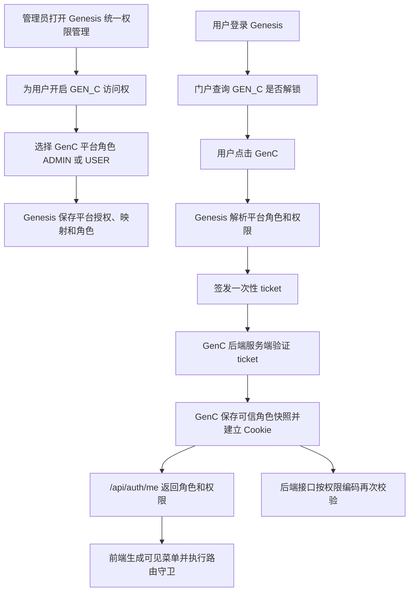

# Genesis 与 GenC 统一用户、角色和菜单权限详细设计

更新时间：2026-07-20

状态：待评审

## 1. 设计结论

Genesis 作为统一权限控制面，集中管理用户、平台访问权、平台角色和权限分配；GenC 作为权限执行面，根据 Genesis 返回的可信授权结果控制菜单、路由和后端接口。

第一阶段只为 GenC 提供两个平台角色：

| 角色编码 | 中文名称 | 权限范围 |
|---|---|---|
| `ADMIN` | 管理员 | GenC 全部菜单和全部受保护功能 |
| `USER` | 普通用户 | AI 旅程首页和旅程编辑器 |

GenC 不新增用户名密码登录，不新增可独立修改角色的管理入口。用户仍然只从 Genesis 登录，角色和权限只在现有统一权限管理页面配置。

## 2. 背景和当前问题

当前已经完成的能力：

- Genesis 能验证用户名和密码。
- Genesis 能控制用户是否可以进入 `GEN_C`。
- Genesis 能签发短时、一次性的 GenC SSO ticket。
- GenC 能验证 ticket、自动建立最小用户记录并写入 `HttpOnly` Cookie。
- GenC 已按 Genesis 用户 ID 隔离画布、聊天、历史会话和私有知识库数据。

当前缺失的能力：

- Genesis 的 ticket 校验结果只返回用户 ID 和用户名，不返回 GenC 角色和权限。
- `genc_users` 只有用户身份和启用状态，没有角色。
- GenC `/api/auth/me` 不返回角色和权限。
- GenC Vue Router 只判断是否登录，不判断是否有页面权限。
- GenC 页面菜单分散写在页面中，没有统一菜单权限来源。
- 当前代码中的 `username == admin` 只用于认领历史数据，不代表管理员权限。
- Genesis 的角色主要从 GenB 同步，不能把 GenB 的 `ADMIN` 直接解释为 GenC 管理员。
- GenC 通过 Genesis 角色继承获得平台访问权时，现有代码不一定会自动建立 GenC 映射，可能出现“有授权但仍锁定”。

如果不改，统一门户只能回答“这个人能不能进入 GenC”，不能回答“进入后能做什么”。

## 3. 设计目标

- 所有用户的平台访问权、平台角色和权限分配都在 Genesis 统一权限管理中设置。
- 同一个用户可以在 GenB、GenC、GenO 拥有不同角色。
- GenC 只消费可信权限结果，不自行猜测或复用 GenB 角色。
- 菜单显示、路由访问和后端接口校验使用同一组稳定权限编码。
- 普通用户即使手工输入管理员地址或直接调用接口，也不能越权。
- 第一阶段保持简单，但数据模型可以继续支持 GenB、GenO 接入统一权限。

## 4. 非目标

- 不给 GenC 增加账号密码登录。
- 不让浏览器提交或修改自己的角色和权限。
- 不直接把 GenB 的角色当成 GenC 角色。
- 第一阶段不支持用户逐项覆盖角色权限。
- 第一阶段不支持自定义创建无限数量的 GenC 角色。
- 第一阶段不实现跨系统实时单点退出。
- 第一阶段不保证 Genesis 权限变更能立即让已经打开的 GenC 页面失效；变更在重新进入 GenC 后生效，实时失效作为后续增强。
- 不把真实菜单组件、页面路径或按钮行为全部搬到 Genesis 动态渲染。

## 5. 权限概念和唯一数据来源

| 概念 | 回答的问题 | 唯一数据来源 |
|---|---|---|
| 用户身份 | 这个人是谁 | `genesis_users` |
| 平台授权 | 能不能进入 GenC | `genesis_platform_grants` |
| 用户映射 | Genesis 用户对应哪个 GenC 用户 | `genesis_user_platform_mappings` |
| 平台角色 | 进入 GenC 后是什么角色 | 新增平台角色相关表 |
| 权限分配 | 角色能操作什么 | 新增平台权限相关表 |
| 页面和接口执行 | 请求是否真正放行 | GenC 路由和后端 |

关键规则：

1. Genesis 决定“谁拥有什么权限编码”。
2. GenC 决定“权限编码对应哪个菜单、路由和接口”。
3. 前端隐藏菜单只是体验控制，后端接口校验才是安全控制。
4. 业务系统不能根据用户名、显示名或浏览器参数推断管理员。

## 6. 总体链路



## 7. 数据模型

### 7.1 保留现有表

| 表 | 继续承担的职责 |
|---|---|
| `genesis_users` | Genesis 用户身份 |
| `genesis_roles` | Genesis 全局角色和现有 GenB 同步角色 |
| `genesis_user_roles` | 用户与 Genesis 全局角色关系 |
| `genesis_platforms` | 平台目录和入口配置 |
| `genesis_platform_grants` | 用户或全局角色是否能进入平台 |
| `genesis_user_platform_mappings` | Genesis 用户与目标系统用户映射 |
| `genesis_sso_tickets` | 短时、一次性 ticket |

`genesis_roles` 不改造成平台内部角色，避免与现有 GenB 同步行为混淆。

### 7.2 新增平台角色表

表名：`genesis_platform_roles`

| 字段 | 含义 |
|---|---|
| `id` | 主键 |
| `platform_code` | `GEN_C`、`GEN_B`、`GEN_O` |
| `role_code` | `ADMIN`、`USER` |
| `role_name` | 展示名称 |
| `description` | 角色说明 |
| `enabled` | 是否可分配 |
| `system_built_in` | 是否为系统内置角色 |
| `create_time` / `update_time` | 审计时间 |

约束：`platform_code + role_code` 唯一。

### 7.3 新增平台权限表

表名：`genesis_platform_permissions`

| 字段 | 含义 |
|---|---|
| `id` | 主键 |
| `platform_code` | 权限所属平台 |
| `permission_code` | 稳定权限编码 |
| `permission_name` | 展示名称 |
| `permission_type` | `MENU`、`BUTTON`、`API` |
| `description` | 权限说明 |
| `enabled` | 是否有效 |
| `create_time` / `update_time` | 审计时间 |

约束：`platform_code + permission_code` 唯一。

### 7.4 新增平台角色权限表

表名：`genesis_platform_role_permissions`

| 字段 | 含义 |
|---|---|
| `platform_role_id` | 平台角色 ID |
| `platform_permission_id` | 平台权限 ID |

联合唯一约束防止重复授权。

### 7.5 新增用户平台角色表

表名：`genesis_user_platform_roles`

| 字段 | 含义 |
|---|---|
| `id` | 主键 |
| `genesis_user_id` | Genesis 用户 ID |
| `platform_role_id` | 平台角色 ID |
| `status` | `ACTIVE`、`REVOKED` |
| `granted_by` | 操作人 |
| `start_time` / `end_time` | 生效时间范围 |
| `remark` | 备注 |
| `create_time` / `update_time` | 审计时间 |

第一阶段管理界面只允许为一个 GenC 用户选择一个有效角色，但表结构允许未来扩展为多角色并集。

### 7.6 GenC 本地用户扩展

`genc_users` 增加：

| 字段 | 含义 |
|---|---|
| `role_code` | 最近一次 Genesis 验证得到的平台角色 |
| `permissions_json` | 最近一次验证得到的权限编码快照 |
| `authorization_updated_at` | 权限快照更新时间 |

本地字段是执行快照，不是可独立编辑的权威来源。

## 8. 第一阶段 GenC 权限矩阵

| 权限编码 | 页面或功能 | `ADMIN` | `USER` |
|---|---|---:|---:|
| `journey.home` | AI 旅程首页 `/` | 是 | 是 |
| `journey.editor` | 旅程编辑器 `/editor` | 是 | 是 |
| `processon.home` | ProcessOn 文件页 `/processon-home` | 是 | 否 |
| `admin.users.read` | 查看 GenC 用户状态 | 是 | 否 |

说明：

- 第一阶段普通用户只开放两个真实可用页面。
- 收藏、设置、协作等尚未完成的页面入口不登记为独立权限。
- `ADMIN` 通过角色权限关系获得全部当前权限，不在前端硬编码用户名白名单。

## 9. 统一授权解析模块

Genesis 后端新增一个集中解析模块，向 ticket、管理页面和测试提供同一个小接口：

```text
resolveAuthorization(genesisUserId, platformCode)
    → PlatformAuthorizationSnapshot
```

返回对象：

```json
{
  "platformCode": "GEN_C",
  "genesisUserId": "1",
  "roleCodes": ["USER"],
  "permissionCodes": ["journey.home", "journey.editor"]
}
```

这个模块内部负责：

- 校验平台是否启用。
- 校验用户级和角色继承的平台访问权。
- 解析用户的平台角色。
- 合并、去重并排序角色权限。
- 拒绝已禁用角色和权限。
- 为测试提供稳定的验证接口。

其他调用方不再各自查询多张表、重复解释授权规则。

## 10. 管理端交互设计

继续使用：

```text
http://localhost:9100/genb/genesis-access
```

编辑 GenC 权限时展示：

1. 用户基本信息。
2. GenC 平台是否启用。
3. 用户直接访问权开关。
4. 是否存在角色继承的平台访问权。
5. GenC 角色选择：管理员、普通用户。
6. 根据角色只读展示最终权限。

保存规则：

- 开启 GenC 直接访问权但未选择角色时，默认 `USER`。
- 选择 `ADMIN` 必须由当前具备 Genesis 权限管理能力的管理员操作。
- 关闭用户直接访问权时，如果仍有角色继承访问权，明确提示用户仍可进入。
- 只要用户最终拥有 GenC 访问权，GenC 映射使用稳定 Genesis 用户 ID 自动建立。
- 用户完全失去 GenC 访问权后，不删除历史映射和审计记录，只把状态改为无效。

## 11. 管理接口调整

扩展现有接口：

```http
GET /api/v1/genesis/admin/access-users
PUT /api/v1/genesis/admin/access-users/{userId}/platforms/{platformCode}
```

更新请求增加：

```json
{
  "directAccessEnabled": true,
  "mappingEnabled": true,
  "platformRoleCodes": ["USER"]
}
```

平台响应增加：

```json
{
  "platformCode": "GEN_C",
  "mappingActive": true,
  "directGranted": true,
  "roleGranted": false,
  "effectiveGranted": true,
  "platformRoleCodes": ["USER"],
  "permissionCodes": ["journey.home", "journey.editor"],
  "unlocked": true
}
```

后端必须校验角色确实属于请求中的 `platformCode`，不能给 GenC 分配 GenO 角色。

## 12. SSO ticket 契约调整

ticket 明文仍然只保存随机值，不把长期 token 放入 URL。Genesis 服务端验证 ticket 后增加授权快照：

```json
{
  "platformCode": "GEN_C",
  "genesisUser": {
    "id": 1,
    "username": "admin"
  },
  "externalUser": {
    "externalUserId": "1",
    "externalUsername": "admin"
  },
  "authorization": {
    "roleCodes": ["ADMIN"],
    "permissionCodes": [
      "journey.home",
      "journey.editor",
      "processon.home",
      "admin.users.read"
    ]
  }
}
```

GenC 只接受 Genesis 后端经 `clientId + clientSecret` 返回的授权数据，不接受浏览器自己提交 `roleCodes` 或 `permissionCodes`。

## 13. GenC 后端执行设计

### 13.1 登录交换

`POST /api/auth/sso/exchange`：

1. 读取浏览器转交的一次性 ticket。
2. GenC 后端向 Genesis 验证 ticket。
3. 校验 `platformCode == GEN_C`。
4. 校验至少有一个有效角色。
5. 自动创建或更新 `genc_users`。
6. 保存可信角色和权限快照。
7. 建立签名 `HttpOnly` Cookie。

### 13.2 当前用户

`GET /api/auth/me` 返回：

```json
{
  "user": {
    "id": "1",
    "genesisUserId": "1",
    "username": "admin",
    "displayName": "admin",
    "roleCodes": ["ADMIN"],
    "permissionCodes": ["journey.home", "journey.editor", "processon.home", "admin.users.read"]
  }
}
```

### 13.3 权限检查接口

GenC 后端集中提供：

```text
current_user()
current_user_id()
has_permission(code)
require_permission(code)
```

路由只声明所需权限，不自行解析角色。

## 14. GenC 前端执行设计

### 14.1 单一状态来源

`useAuthSession` 只保存 `/api/auth/me` 返回的用户、角色和权限。所有菜单和路由从这份状态派生，不在多个页面重复判断 `username === 'admin'`。

### 14.2 路由元信息

```ts
meta: {
  permission: 'processon.home'
}
```

全局守卫执行顺序：

1. 公共路由直接放行。
2. 恢复服务器会话。
3. 未登录跳转 `/auth-required`。
4. 已登录但缺少权限跳转 `/forbidden`。
5. 有权限放行。

### 14.3 菜单来源

建立一个 GenC 菜单定义表，菜单与路由共用权限编码：

```ts
[
  { label: 'AI 旅程', routeName: 'Home', permission: 'journey.home' },
  { label: '旅程编辑器', routeName: 'Editor', permission: 'journey.editor' },
  { label: 'ProcessOn 文件', routeName: 'ProcessOnHome', permission: 'processon.home' }
]
```

可见菜单使用 `computed` 从权限集合推导，避免写死两套角色菜单。

## 15. 错误处理

| 场景 | HTTP 状态 | 用户行为 |
|---|---:|---|
| 未登录 | `401` | 提示从 Genesis 进入 |
| 已登录但无权限 | `403` | 展示无权限页，不跳回登录页 |
| ticket 过期或重复使用 | `401` | 返回 Genesis 重新进入 |
| 没有分配 GenC 角色 | `403` | 提示联系管理员配置角色 |
| 平台授权已撤销 | `403` | 无法申请新 ticket |
| 角色或权限配置损坏 | `403` | 失败关闭并记录服务端错误 |

## 16. 权限变更生效规则

第一阶段：

- 新角色在用户下一次从 Genesis 进入 GenC 时生效。
- 平台访问权撤销后不能再申请新 ticket。
- 已经建立的 GenC Cookie 不承诺立即失效。

后续增强：

- 给授权快照增加 `authorizationVersion`。
- 增加受服务端密钥保护的权限查询或失效通知接口。
- GenC 检测版本变化后清理旧会话或刷新本地权限快照。

## 17. 迁移和初始化

1. 新建四张通用平台权限表。
2. 初始化 `GEN_C / ADMIN` 和 `GEN_C / USER`。
3. 初始化第一阶段四个 GenC 权限编码。
4. 建立角色权限关系。
5. 当前 Genesis `admin` 的 GenC 角色初始化为 `ADMIN`。
6. 其他已有 GenC 授权用户初始化为 `USER`。
7. GenC `genc_users` 增加角色和权限快照字段，已有用户默认空权限，下一次 SSO 时刷新。
8. 迁移必须可重复执行，不能重复插入内置角色和权限。

## 18. 安全约束

- 角色和权限只能来自 Genesis 服务端验证结果。
- 浏览器不能决定自己的用户 ID、角色或权限。
- GenC 管理权限不能根据用户名字符串判断。
- 平台角色必须带 `platform_code`，防止跨平台误授权。
- 真实共享密钥只放环境变量，不进入数据库响应、前端或 Git。
- 管理操作记录操作人和时间，撤销使用状态变更而不是物理删除。
- 管理接口继续只允许 GenB `ADMIN` 或 `SUPER_ADMIN` 操作。
- 菜单隐藏不能替代后端 `403`。

## 19. 组件和模块边界

| 模块 | 单一职责 |
|---|---|
| Genesis `PlatformAuthorizationResolver` | 根据用户和平台解析最终角色与权限 |
| Genesis access management | 保存平台访问权、映射和平台角色 |
| Genesis ticket module | 把可信授权快照绑定到一次性 ticket |
| GenC authentication adapter | 验证 ticket 并建立本地 Cookie |
| GenC authorization guard | 根据权限编码保护路由和接口 |
| GenC menu registry | 把权限编码映射为本地菜单和路由 |

权限解析复杂度集中在 `PlatformAuthorizationResolver` 后面，ticket 和管理页面只依赖一个稳定接口。

## 20. 验收要点

- Genesis `admin` 可以进入 GenC 并看到全部菜单。
- 普通用户只能看到并进入 AI 旅程首页和旅程编辑器。
- 普通用户直接输入 `/processon-home` 得到无权限页面。
- 普通用户直接调用管理员接口得到 `403`。
- GenB 管理员身份不会自动成为 GenC 管理员，除非统一权限管理明确分配。
- 角色继承平台访问权的用户能自动建立 GenC 映射。
- ticket 不能跨平台、重复或过期使用。
- GenB、GenO 现有统一登录链路不受影响。
