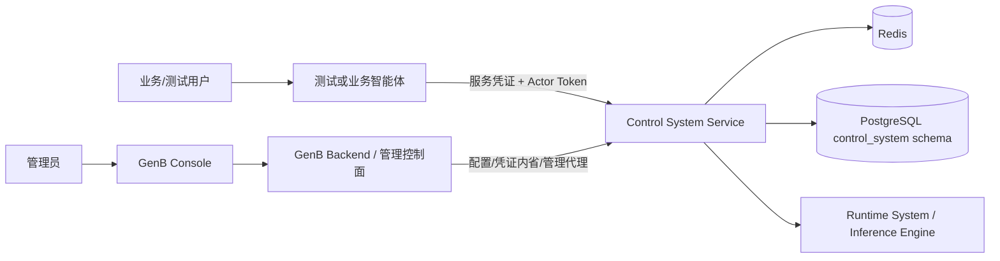
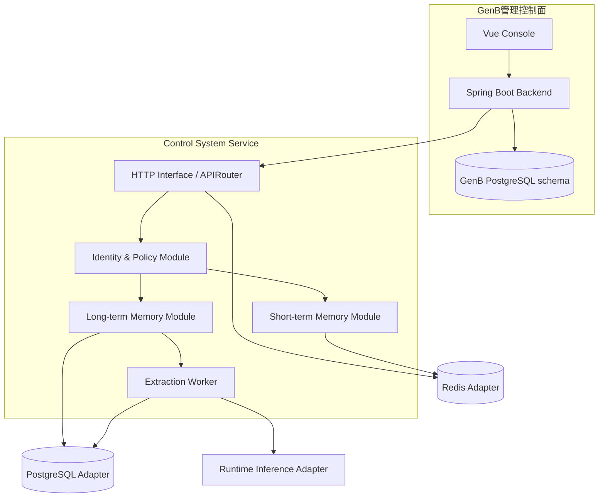
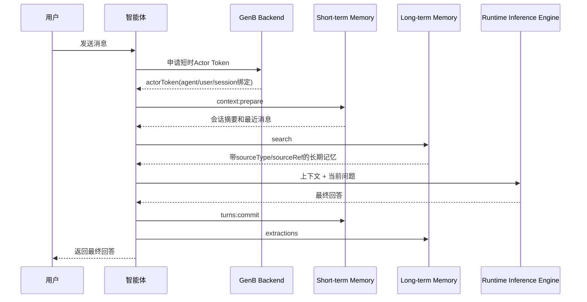
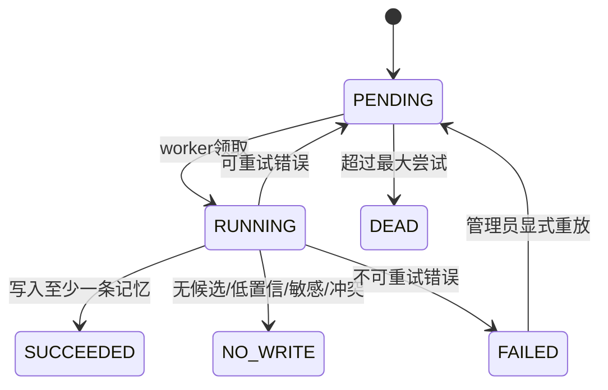

# Control System长短记忆核心组件开发实施指南

> 文档类型：开发实施文档（Implementation Guide）  
> 状态：编码前评审稿  
> 版本：v1.1  
> 更新时间：2026-07-23  
> 上位开发总纲：`docs/development/CORE_COMPONENT_PLATFORM_DEVELOPMENT_GUIDE.md`  
> 总体设计：`docs/design/GENB_CORE_MEMORY_COMPONENTS_DETAILED_DESIGN.md`  
> 当前有效ADR：`records/decisions/20260723-ADR-control-system-component-service.md`  
> 模型调用ADR：`records/decisions/20260723-ADR-self-hosted-inference-engine.md`  
> 统一术语：`CONTEXT.md`

## 0. 如何使用本文

本文只负责Control System一期的Short-term Memory和Long-term Memory实现，不是五大系统、14个组件和全部智能体接入的开发总纲。跨系统注册、绑定、组件会话、五个系统工程和智能体标准接入以平台级开发总纲为准；若两者出现冲突，先按总纲执行并补充ADR。

### 0.1 本文回答的问题

总体设计回答“为什么、边界是什么、最终验收是什么”；本文回答：

- 代码放在哪个仓库和目录。
- 每个Module拥有什么Interface。
- GenB、Control System Service、管理端和测试智能体分别改什么。
- Interface、DTO、数据库、Redis、身份、权限和错误如何落地。
- 开发按什么顺序推进，每一步如何测试。
- 如何构建、联调、灰度、回滚和证明完成。

本文不是现状代码说明。标记为“基准实现”的内容是建议的编码基线，进入编码前必须通过第5章启动门禁。

### 0.2 模板来源

本文使用组合模板，不机械照抄单一规范：

| 来源 | 采用内容 | 在本文中的位置 |
|---|---|---|
| [OpenAPI Specification 3.1](https://spec.openapis.org/oas/v3.1.1.html) | paths、schemas、securitySchemes、examples、版本化Interface | 第14章 |
| [RFC 9457 Problem Details](https://datatracker.ietf.org/doc/html/rfc9457) | 统一HTTP错误正文，避免泄露内部实现 | 第15章 |
| [FastAPI Bigger Applications](https://fastapi.tiangolo.com/tutorial/bigger-applications/) | 多文件、APIRouter、依赖注入和路由级鉴权 | 第8、14章 |
| [The Twelve-Factor App](https://12factor.net/) | 环境配置、显式依赖、构建/发布/运行分离、日志事件流 | 第5、20、25章 |
| [Kubernetes KEP Template](https://www.kubernetes.dev/resources/keps/5468/) | Test Plan、Production Readiness、Rollout/Rollback | 第22、25、26章 |
| [Google SRE Books](https://sre.google/books/) | SLI/SLO、监控、容量、故障和生产责任 | 第20、22、29章 |

### 0.3 规范用词

- **MUST/必须**：违反即不能合并或上线。
- **SHOULD/应该**：默认遵守，偏离时必须在评审中写明理由。
- **MAY/可以**：实现可选，不影响契约。
- **Module**：有一个Interface和内部Implementation的深模块。
- **Interface**：调用方和测试必须知道的完整表面，包含参数、约束、错误、顺序和性能语义。
- **Adapter**：位于Seam并满足Interface的具体实现，例如Redis Adapter。

---

## 1. 开发结论与一期产物

### 1.1 最终代码形态

```text
GenB管理控制面
├─ gen-b-backend                    Java/Spring Boot
│  ├─ 核心系统与组件目录
│  ├─ 配置版本与发布
│  ├─ 智能体绑定
│  ├─ 服务凭证与Actor Token
│  ├─ RBAC与审计
│  └─ 受控记忆管理代理
└─ gen-b-console                    Vue 3/Element Plus
   ├─ 五大系统/14张卡片
   ├─ 两个记忆组件详情
   ├─ 配置、绑定、凭证
   ├─ 测试台
   └─ 记忆数据与审计

Control System执行面
└─ control-system-service           Python 3.11/FastAPI
   ├─ Short-term Memory Module
   ├─ Long-term Memory Module
   ├─ Identity & Policy Module
   ├─ Extraction Worker
   ├─ Redis/PostgreSQL/Runtime Inference Adapters
   └─ Health/Telemetry

测试调用方
└─ control-system-test-agent        同一代码、多agentId配置
```

不存在`Memory Runtime Service`层。现有`bank-agent-runtime`只允许阅读参考，不能成为任何新项目的依赖。

### 1.2 一期必须交付

| 交付物 | 数量/范围 | 完成证据 |
|---|---|---|
| 系统/组件种子数据 | 5个系统、14个组件 | 数据库查询、管理端截图、幂等迁移测试 |
| 可用组件 | Short-term Memory、Long-term Memory | 独立Interface与E2E测试 |
| 一期平台组件 | 3个 | 本文实现两个记忆组件；Inference Engine由Runtime System专项实现 |
| 规划组件 | 其他11个 | 卡片为`PLANNED`且操作禁用，无假数据 |
| GenB控制面 | 配置、绑定、凭证、Actor Token、权限、审计 | Controller/Service测试和管理端E2E |
| Control System Service | 两个深Module及Adapter | 单元、契约、集成、故障、性能测试 |
| 测试智能体 | 一个代码产物，至少A/B两个逻辑实例 | 隔离矩阵自动化报告 |
| 文档 | OpenAPI、迁移、配置、部署、运维、测试 | 与构建产物和实际Interface一致 |

### 1.3 明确不做

- 不实现其余12个组件的假Interface或mock成功返回。
- 本期只实现Conversation Memory；不伪造尚未接入的Knowledge Base Memory Adapter、完整RAG、Embedding和向量检索能力。
- 不保存或展示模型隐藏CoT。
- 不信任请求体中的`tenantId/userId/agentId`作为授权依据。
- 不允许智能体直连Redis或PostgreSQL。
- 不引用、打包、启动或部署现有Runtime SDK。
- 不把Control System业务执行写进GenB后端。

---

## 2. 架构视图

### 2.1 Context视图



### 2.2 Container视图



### 2.3 依赖方向

```text
Router/Controller
    ↓ 调用Interface
Application Module
    ↓ 拥有Port
Domain Model / Policy
    ↑ 由Adapter满足Port
Redis / PostgreSQL / Runtime Inference / GenB Adapter
```

必须遵守：

- Domain/Application Module不得导入FastAPI、Redis、SQLAlchemy或HTTP客户端类型。
- Adapter可以依赖Module定义的Port，Module不得反向依赖Adapter。
- Router只完成协议转换、依赖注入和响应映射，不包含记忆业务逻辑。
- Interface是调用方和测试共同使用的表面；不得为测试新增生产Interface。

### 2.4 关键运行链路



---

## 3. 仓库与目录基线

### 3.1 推荐仓库布局

```text
D:\code\opencode\genb\
├─ gen-b\
│  ├─ gen-b-backend\
│  └─ gen-b-console\
├─ control-system-service\             # 新服务，编码前确认是否独立Git仓库
├─ control-system-test-agent\           # 测试智能体，可后置创建
├─ docs\
├─ records\
└─ CONTEXT.md
```

如果公司要求独立仓库，`control-system-service`可以迁出，但包结构、Interface、迁移和测试路径保持不变。

### 3.2 Control System Service目录

```text
control-system-service/
├─ pyproject.toml
├─ uv.lock或requirements.lock           # 二选一，必须锁版本
├─ alembic.ini
├─ Dockerfile
├─ .env.example                         # 只含占位符
├─ README.md
├─ openapi/
│  └─ control-system-v1.yaml
├─ migrations/
│  ├─ env.py
│  └─ versions/
├─ src/control_system/
│  ├─ main.py
│  ├─ bootstrap.py
│  ├─ settings.py
│  ├─ shared/
│  │  ├─ clock.py
│  │  ├─ ids.py
│  │  ├─ errors.py
│  │  ├─ pagination.py
│  │  └─ telemetry.py
│  ├─ identity/
│  │  ├─ models.py
│  │  ├─ ports.py
│  │  ├─ service.py
│  │  └─ adapters/
│  │     ├─ genb_introspection.py
│  │     └─ actor_jwt.py
│  ├─ short_term_memory/
│  │  ├─ models.py
│  │  ├─ ports.py
│  │  ├─ service.py
│  │  ├─ router.py
│  │  └─ adapters/redis_store.py
│  ├─ long_term_memory/
│  │  ├─ models.py
│  │  ├─ ports.py
│  │  ├─ service.py
│  │  ├─ router.py
│  │  └─ adapters/postgres_store.py
│  ├─ extraction/
│  │  ├─ models.py
│  │  ├─ ports.py
│  │  ├─ service.py
│  │  ├─ worker.py
│  │  └─ adapters/runtime_inference.py
│  ├─ admin/
│  │  └─ router.py
│  └─ health/
│     └─ router.py
└─ tests/
   ├─ unit/
   ├─ contract/
   ├─ integration/
   ├─ security/
   ├─ performance/
   └─ fixtures/
```

### 3.3 GenB后端包布局

```text
gen-b-backend/src/main/java/com/genb/console/
├─ corecomponent/
│  ├─ controller/
│  ├─ dto/
│  ├─ entity/
│  ├─ repository/
│  ├─ service/
│  └─ security/
├─ servicecredential/
├─ actortoken/
├─ memoryadmin/
└─ audit/
```

不得把所有类直接塞入现有`agent`包；组件目录、绑定和机器身份是独立领域。

### 3.4 GenB管理端目录

```text
gen-b-console/src/
├─ api/
│  ├─ coreComponents.js
│  ├─ componentBindings.js
│  ├─ serviceCredentials.js
│  └─ memoryAdmin.js
├─ views/core-components/
│  ├─ Index.vue
│  ├─ ComponentCard.vue
│  ├─ ComponentDetail.vue
│  ├─ ConfigVersions.vue
│  ├─ AgentBindings.vue
│  ├─ MemoryWorkbench.vue
│  ├─ MemoryData.vue
│  └─ AuditEvents.vue
├─ router/modules/coreComponents.js
└─ stores/coreComponents.js             # 只有确有跨页状态时才创建
```

---

## 4. 技术基线与依赖规则

### 4.1 基准版本

| 部分 | 基准 | 说明 |
|---|---|---|
| GenB Backend | 当前项目Java/Spring Boot版本 | 不为本任务单独升级大版本 |
| GenB Console | 当前Vue 3/Vite/Element Plus版本 | 沿用现有构建和双语机制 |
| Control System | Python 3.11 | 编码前确认服务器可用版本 |
| HTTP | FastAPI + Uvicorn/Gunicorn worker | Router按Module拆分 |
| 模型校验 | Pydantic v2 | 请求、配置、模型输出严格校验 |
| PostgreSQL | 15.x | 独立`control_system` schema |
| Redis | 本地现有5.0用于开发 | 生产版本、ACL和高可用另审 |
| 迁移 | Alembic（Control System）+ 项目现有方式（GenB） | 两个服务各自拥有迁移 |
| HTTP Client | httpx | 统一超时、连接池和重试 |
| 测试 | pytest/pytest-asyncio/testcontainers或受控测试实例 | 不使用生产数据 |

### 4.2 禁止依赖

`control-system-service`的依赖清单、源码和构建产物中不得出现：

```text
bank-agent-runtime
bank_agent_runtime
bank-agent-cli
```

CI必须执行：

```powershell
rg -n "bank_agent_runtime|bank-agent-runtime" src pyproject.toml requirements*.txt
```

预期结果为无匹配。阅读旧SDK得到的算法若被重新实现，必须：

- 使用新Module的术语和Interface。
- 补充独立测试，不复制旧测试的环境假设。
- 在代码评审中说明参考来源和差异。
- 遵守原项目许可和公司代码归属规则。

### 4.3 依赖锁定

- 直接依赖必须显式声明并锁定。
- 开发和生产依赖分组。
- CI从空缓存安装并构建，防止依赖本机环境。
- 每次升级生成依赖diff并运行契约、安全和回归测试。
- 禁止在运行时自动`pip install`。

---

## 5. 编码启动门禁与配置

### 5.1 必须确认的决策

| 门禁 | 默认基线 | 确认人 | 未确认时 |
|---|---|---|---|
| 服务语言 | Python 3.11/FastAPI | 技术负责人 | 只写OpenAPI和迁移，不写业务代码 |
| 仓库位置 | `genb/control-system-service`独立目录 | 技术负责人 | 不创建仓库 |
| PostgreSQL | 独立`control_system` schema/最小权限账号 | DBA/运维 | 不执行迁移 |
| Redis生产方案 | 独立实例/逻辑库、maxmemory、持久化 | 运维 | 仅本地测试 |
| GenB Actor Token签名 | 非对称JWT，Control System只持公钥 | 安全/后端 | 不开放用户数据Interface |
| Runtime Inference Engine | 最小v1 Interface已部署或可用Fake Adapter | Runtime组/模型平台负责人 | 只使用Fake Adapter开发，不联调真实数据 |
| Direct Provider | Chat/结构化输出和Embedding Provider、凭证、费用、合规 | Runtime组/安全负责人 | Control System不直连Provider |

### 5.2 环境变量模板

```dotenv
APP_NAME=control-system-service
APP_ENV=local
HTTP_HOST=127.0.0.1
HTTP_PORT=8701
LOG_LEVEL=INFO

POSTGRES_DSN=${CONTROL_SYSTEM_POSTGRES_DSN}
POSTGRES_POOL_MIN=2
POSTGRES_POOL_MAX=10

REDIS_HOST=localhost
REDIS_PORT=6379
REDIS_PASSWORD=${REDIS_PASSWORD}
REDIS_DB=0

GENB_BASE_URL=http://localhost:8581
GENB_INTERNAL_CREDENTIAL=${GENB_INTERNAL_CREDENTIAL}
GENB_ACTOR_JWT_ISSUER=genb
GENB_ACTOR_JWT_AUDIENCE=control-system
GENB_ACTOR_JWT_PUBLIC_KEY_PATH=${GENB_ACTOR_JWT_PUBLIC_KEY_PATH}

INFERENCE_ENGINE_BASE_URL=${INFERENCE_ENGINE_BASE_URL}
CONTROL_TO_RUNTIME_CREDENTIAL=${CONTROL_TO_RUNTIME_CREDENTIAL}
INFERENCE_MODEL_CAPABILITY=MEMORY_EXTRACTION
INFERENCE_CONNECT_TIMEOUT_SECONDS=3
INFERENCE_READ_TIMEOUT_SECONDS=30

SHORT_TERM_DEFAULT_TTL_SECONDS=86400
LONG_TERM_DEFAULT_RETENTION_DAYS=180
LONG_TERM_CONFIDENCE_THRESHOLD=0.8
```

`.env.example`只保留变量名和无秘密默认值。真实`.env`、私钥、数据库密码、Redis密码、API Key必须在`.gitignore`中，并由部署环境注入。

### 5.3 配置校验

启动时必须Fail-fast校验：

- DSN格式但不输出完整DSN。
- TTL、连接池和阈值范围。
- JWT issuer/audience/public key存在。
- 生产环境禁止`sslmode=disable`。
- 生产环境禁止空Redis密码和调试日志。
- 生产环境禁止Actor Token对称共享密钥。

---

## 6. GenB控制面开发

### 6.1 Module职责

| Module | Interface | 核心职责 |
|---|---|---|
| Core Component Catalog | 查询系统/组件、更新实现状态 | 五大系统和14组件固定目录 |
| Component Configuration | 创建草稿、校验、发布、回滚 | 不可变已发布版本 |
| Agent Component Binding | 绑定、启停、解析有效绑定 | 组件级授权和配置版本 |
| Service Credential | 签发、内省、轮换、吊销 | 每agent机器身份，只存hash |
| Actor Token | 为当前用户和agent签发短时JWT | 绑定tenant/user/agent/session |
| Memory Admin Proxy | 查询/删除记忆、TTL任务 | 只允许管理员，隐藏系统内部凭证 |
| Audit | 写入不可抵赖操作事件 | 不记录secret和敏感正文 |

### 6.2 建议类清单

| 类 | 关键方法 | 约束 |
|---|---|---|
| `CoreComponentCatalogService` | `listSystems()`、`getComponent(code)` | 只读固定目录，不允许页面新增系统/组件 |
| `ComponentConfigService` | `createDraft()`、`publish()`、`rollback()` | 发布版本不可修改，乐观锁 |
| `AgentComponentBindingService` | `bind()`、`enable()`、`disable()`、`resolve()` | 只绑定PUBLISHED配置 |
| `ServiceCredentialService` | `issue()`、`introspect()`、`rotate()`、`revoke()` | secret只返回一次，hash比较恒定时间 |
| `ActorTokenService` | `issueForCurrentUser()` | 校验用户可使用agent且组件已绑定 |
| `MemoryAdminService` | `search()`、`delete()`、`adjustRetention()` | 每次查看/删除写审计 |

### 6.3 Actor Token签发流程

`POST /api/v1/client/agents/{agentId}/component-session`

该Interface保留现有Component Session响应结构，其中`actorToken`升级为RS256；调用时除用户JWT外还必须提供`X-Agent-Credential`。

前置条件：

1. 当前用户JWT有效。
2. 当前用户对`agentId`有使用授权。
3. `agentId`已绑定请求中的组件。
4. sessionId格式合法，且由调用方新建或延续。

请求：

```json
{
  "sessionId": "session-001",
  "requestedComponents": ["SHORT_TERM_MEMORY", "LONG_TERM_MEMORY"]
}
```

响应：

```json
{
  "componentSessionId": "cs_01...",
  "actorToken": "<shown-to-caller-only>",
  "expiresAt": "2026-07-23T12:05:00",
  "components": [
    {"componentCode": "SHORT_TERM_MEMORY", "scopes": ["component:short-term-memory:read"]}
  ]
}
```

JWT claims：

```json
{
  "iss": "genb",
  "aud": "control-system",
  "sub": "user-001",
  "tenantId": "tenant-demo",
  "userId": "user-001",
  "agentId": "memory-test-a",
  "sessionId": "session-001",
  "components": ["SHORT_TERM_MEMORY", "LONG_TERM_MEMORY"],
  "jti": "actor_01...",
  "iat": 1784772000,
  "exp": 1784772300
}
```

Token默认5分钟有效。正文中的tenant/user/agent只用于一致性检查，Control System必须以已验证claims为授权事实。

GenB同时发布`GET /api/.well-known/jwks.json`。Token Header必须带`kid`，Control System固定`alg=RS256`并按`kid`选择公钥；JWKS不得包含`d/p/q`等私钥参数。

### 6.4 服务凭证内省

Control System收到`Authorization: Bearer <serviceCredential>`后调用内部Interface：

`POST /api/v1/internal/service-credentials:introspect`

请求使用独立内部调用凭证`Authorization: Bearer <control-system-internal-token>`，待内省的agent凭证放在`X-Agent-Credential`。内部调用凭证不能复用用户JWT或agent凭证。

返回：

```json
{
  "active": true,
  "agentId": "memory-test-a",
  "scopes": [],
  "expiresAt": null,
  "credentialVersion": 2
}
```

`scopes`和`expiresAt`保留用于旧客户端及显式临时凭证兼容。当前长期智能体凭证只提供机器`agentId`；组件和动作scope必须来自GenB根据已启用绑定签发的短时Actor Token。

内省缓存：

- 仅缓存凭证的HMAC摘要，不缓存/记录明文。
- 正向结果最多30秒；负向结果最多5秒。
- 吊销最长传播时间等于正向缓存TTL，生产值必须经过安全确认。
- GenB不可用且缓存无有效结果时Fail-closed。

### 6.5 控制面Interface清单

| 方法 | 路径 | 权限 |
|---|---|---|
| GET | `/api/v1/core-systems` | `component.read` |
| GET | `/api/v1/core-components` | `component.read` |
| GET | `/api/v1/core-components/{code}` | `component.read` |
| POST | `/api/v1/core-components/{code}/configs` | `component.configure` |
| POST | `/api/v1/core-components/{code}/configs/{id}:publish` | `component.configure` |
| POST | `/api/v1/core-components/{code}/bindings` | `component.bind` |
| DELETE | `/api/v1/core-components/{code}/bindings/{id}` | `component.bind` |
| POST | `/api/v1/service-credentials` | `credential.issue` |
| POST | `/api/v1/service-credentials/{id}:rotate` | `credential.rotate` |
| POST | `/api/v1/service-credentials/{id}:revoke` | `credential.revoke` |
| POST | `/api/v1/client/agents/{agentId}/component-actor-token` | 当前用户具有agent使用权 |
| POST | `/api/v1/internal/service-credentials:introspect` | Control System内部身份 |
| GET/DELETE | `/api/v1/admin/memory/**` | `memory.data.read/delete` |

---

## 7. 数据库迁移设计

### 7.1 所有权

| schema/表 | 所有者 | 谁可以直接访问 |
|---|---|---|
| GenB现有schema + 组件控制面表 | GenB Backend | GenB Backend |
| `control_system`记忆表 | Control System Service | Control System数据库账号 |
| Redis短期数据 | Short-term Memory Module | Control System Service |

GenB管理端不得直连数据库。GenB Backend不得使用Control System数据库账号直接查询长期记忆，应通过受控管理Interface代理。

### 7.2 GenB迁移顺序

```text
Vxxx_01__create_core_systems.sql
Vxxx_02__create_core_components.sql
Vxxx_03__seed_five_systems_and_fourteen_components.sql
Vxxx_04__create_component_config_profiles.sql
Vxxx_05__create_component_config_versions.sql
Vxxx_06__create_agent_component_bindings.sql
Vxxx_07__create_service_credentials.sql
Vxxx_08__seed_core_component_permissions.sql
Vxxx_09__grant_admin_core_component_permissions.sql
```

迁移要求：

- 种子数据按code upsert或先判断，不按自增ID假设。
- 14个组件名称、系统归属、排序与总体设计完全一致。
- 已发布配置不可被UPDATE正文；数据库约束和Service共同保护。
- 同一agent/component同时最多一个有效绑定。
- `secret_hash`非空，禁止`secret_plaintext`字段。

### 7.3 Control System迁移顺序

```text
0001_create_long_term_memories.py
0002_create_memory_extraction_jobs.py
0003_create_memory_extraction_events.py
0004_create_component_invocation_logs.py
0005_create_memory_audit_events.py
0006_add_scope_and_expiry_indexes.py
```

### 7.4 长期记忆表最低DDL语义

```sql
CREATE TABLE control_system.long_term_memories (
  id uuid PRIMARY KEY,
  tenant_id varchar(128) NOT NULL,
  user_id varchar(128) NOT NULL,
  agent_id varchar(128) NOT NULL,
  memory_type varchar(32) NOT NULL,
  content text NOT NULL,
  content_hash char(64) NOT NULL,
  structured_value jsonb,
  confidence numeric(4,3) NOT NULL CHECK (confidence >= 0 AND confidence <= 1),
  source_type varchar(32) NOT NULL,
  source_ref varchar(128),
  status varchar(16) NOT NULL,
  first_seen_at timestamptz NOT NULL,
  last_confirmed_at timestamptz NOT NULL,
  last_accessed_at timestamptz,
  expires_at timestamptz NOT NULL,
  deleted_at timestamptz,
  deleted_by varchar(128),
  delete_reason varchar(512),
  created_at timestamptz NOT NULL,
  updated_at timestamptz NOT NULL
);
```

`source_type`是组合组件的强制来源判别字段，当前写入值为`CONVERSATION`，为后续知识库Adapter保留`KNOWLEDGE_BASE`。HTTP检索结果必须同时返回`sourceType`和`sourceRef`；未接入知识库Adapter时，`sourceTypes=[KNOWLEDGE_BASE]`返回空数组，不得回退为对话记忆。

必须建立：

- `(tenant_id,user_id,agent_id,status,expires_at)`范围索引。
- `(tenant_id,user_id,agent_id,memory_type,last_confirmed_at DESC)`检索索引。
- ACTIVE状态下范围+类型+content_hash唯一索引。
- `expires_at`清理索引。

### 7.5 提取任务表

`memory_extraction_jobs`用于可靠异步，不在一期引入额外消息队列：

| 字段 | 说明 |
|---|---|
| `id` | extractionId |
| `tenant_id/user_id/agent_id` | 强制隔离范围 |
| `turn_id` | 幂等业务键 |
| `redacted_user_message` | 已脱敏且限制长度 |
| `redacted_assistant_message` | 已脱敏且限制长度 |
| `status` | PENDING/RUNNING/SUCCEEDED/NO_WRITE/FAILED/DEAD |
| `attempt_count` | 最大次数控制 |
| `next_attempt_at` | 指数退避 |
| `locked_by/locked_at` | worker租约 |
| `config_version` | 重放时使用原版本 |
| `last_error_code` | 结构化错误，不保存栈和秘密 |

唯一约束：`(tenant_id, agent_id, turn_id)`。

Worker通过`FOR UPDATE SKIP LOCKED`领取任务；进程崩溃后超过租约的RUNNING任务可重新领取。

### 7.6 迁移验证

每次迁移PR必须提供：

- 空库向上迁移结果。
- 已有上一版本数据向上迁移结果。
- 重复执行/幂等验证。
- 索引和约束查询结果。
- 应用旧版本是否仍可启动的兼容结论。
- 回滚策略；不可逆迁移必须写前向修复方案。

---

## 8. Control System Service代码架构

### 8.1 Bootstrap

`main.py`只负责创建FastAPI和包含Router；`bootstrap.py`负责装配Adapter：

```python
def create_app(settings: Settings) -> FastAPI:
    container = build_container(settings)
    app = FastAPI(title="Control System", version="1.0.0")
    app.include_router(short_term_router, prefix="/api/v1/control-system")
    app.include_router(long_term_router, prefix="/api/v1/control-system")
    app.include_router(admin_router, prefix="/api/v1/internal")
    app.include_router(health_router)
    app.state.container = container
    return app
```

不得在模块导入时创建数据库连接、Redis连接或HTTP客户端。连接在应用lifespan中建立和关闭。

### 8.2 Module装配

```text
ShortTermMemoryService
├─ SessionStorePort              ← RedisSessionStore
├─ SummaryPort                   ← RuntimeInferenceSummaryAdapter/FakeSummaryAdapter
├─ IdentityPolicy               ← 共享策略Module
├─ Clock                        ← SystemClock/FakeClock
└─ TelemetryPort

LongTermMemoryService
├─ LongTermStorePort             ← PostgresLongTermStore
├─ ExtractionJobPort             ← PostgresExtractionJobStore
├─ IdentityPolicy
├─ Clock
└─ TelemetryPort
```

### 8.3 共享模型

```python
@dataclass(frozen=True)
class InvocationIdentity:
    tenant_id: str
    user_id: str
    agent_id: str
    session_id: str | None
    service_credential_id: str
    allowed_components: frozenset[str]
    request_id: str
```

`InvocationIdentity`只能由已完成服务凭证内省和Actor Token验签的Identity Module创建；Router不得从请求JSON直接构造。

### 8.4 异常层次

```text
ControlSystemError
├─ ValidationError
├─ AuthenticationError
├─ AuthorizationError
├─ BindingNotFoundError
├─ ConfigurationUnavailableError
├─ IdempotencyConflictError
├─ SensitiveContentRejectedError
├─ DependencyUnavailableError
└─ RateLimitError
```

Module抛领域异常，HTTP Adapter统一映射RFC 9457；Module不得抛带数据库SQL、连接串或HTTP响应正文的异常给调用方。

---

## 9. 身份、鉴权和请求上下文

### 9.1 双凭证模型

每次业务调用必须同时证明“哪个智能体”和“哪个用户上下文”：

| 凭证 | Header | 证明 | 签发者 |
|---|---|---|---|
| 服务凭证 | `Authorization: Bearer <api-key>` | 长期agentId机器身份、凭证状态 | GenB |
| Actor Token | `X-GenB-Actor-Token: <jwt>` | tenantId、userId、agentId、sessionId、已绑定组件和动作scope | GenB |

只提供服务凭证不足以访问用户记忆；只提供Actor Token也不足以证明调用服务身份。

### 9.2 验证顺序

1. 读取`X-Request-Id`，无则生成ULID。
2. 限制Header和请求体大小。
3. 内省服务凭证并获取agentId；服务凭证不决定组件权限。
4. 使用固定算法和公钥验证Actor Token签名、`iss/aud/exp/nbf`。
5. 比较两个凭证中的agentId，必须一致。
6. 检查Actor Token允许当前组件。
7. 检查Actor Token中的动态scope允许当前动作。
8. 构造不可变`InvocationIdentity`。
9. 请求DTO中的身份字段如存在，只做一致性检查；建议正式v1不重复接收tenant/user/agent。

### 9.3 禁止行为

- 禁止信任`X-User-Id`一类无签名Header。
- 禁止允许服务凭证自由指定任意userId。
- 禁止日志记录Actor Token和服务凭证明文。
- 禁止使用JWT解码但不验签。
- 禁止接受`alg=none`或调用方指定算法。
- 禁止生产环境共享Actor Token私钥给Control System。

### 9.4 测试模式

本地测试不得增加绕过生产鉴权的`DISABLE_AUTH=true`。应提供：

- 测试专用RSA/EC密钥对。
- Fake GenB Introspection Adapter。
- 测试Fixture签发短期Actor Token。
- E2E环境调用真实GenB签发Interface。

---

## 10. Short-term Memory Module

### 10.1 外部Interface

| 操作 | HTTP | Scope | 幂等 |
|---|---|---|---|
| 准备会话上下文 | `POST /short-term-memory/context:prepare` | `component:short-term-memory:read` | 天然只读 |
| 提交一轮对话 | `POST /short-term-memory/turns:commit` | `component:short-term-memory:write` | `Idempotency-Key`必填 |
| 清除当前会话 | `DELETE /short-term-memory/sessions/{sessionId}` | `component:short-term-memory:delete` | 重复删除成功 |

完整路径前缀：`/api/v1/control-system`。

### 10.2 Module Interface

```python
class ShortTermMemory(Protocol):
    async def prepare_context(
        self,
        identity: InvocationIdentity,
        query: str,
        budget: ContextBudget,
    ) -> PreparedShortTermContext: ...

    async def commit_turn(
        self,
        identity: InvocationIdentity,
        turn: ConversationTurn,
        idempotency_key: str,
    ) -> CommitTurnResult: ...

    async def clear_session(
        self,
        identity: InvocationIdentity,
    ) -> ClearSessionResult: ...
```

### 10.3 输入模型约束

| 字段 | 约束 |
|---|---|
| `sessionId` | 来自Actor Token；1—128字符；允许字母、数字、`-_.` |
| `turnId` | 1—128字符；同agent/session唯一 |
| `query` | 1—16000字符，先做大小门禁再解析 |
| `userMessage` | 1—32000字符，持久化前脱敏 |
| `assistantMessage` | 0—64000字符，只允许最终回答 |
| `occurredAt` | ISO-8601 UTC；允许时钟偏差由配置限定 |
| `Idempotency-Key` | 16—128字符；同agent范围唯一 |

### 10.4 Redis Key

```text
genb:cs:v1:stm:{tenantHash}:{userHash}:{agentHash}:{sessionHash}:messages
genb:cs:v1:stm:{tenantHash}:{userHash}:{agentHash}:{sessionHash}:summary
genb:cs:v1:stm:{tenantHash}:{userHash}:{agentHash}:{sessionHash}:meta
genb:cs:v1:idem:{agentHash}:{idempotencyHash}
```

Hash必须是服务端带pepper的HMAC摘要或不可逆稳定摘要；原始身份和用户输入不得出现在Key中。

### 10.5 Redis数据格式

消息List元素：

```json
{
  "turnId": "turn-0008",
  "role": "user",
  "content": "以后优先推荐低风险产品",
  "occurredAt": "2026-07-23T10:02:00Z",
  "contentVersion": 1
}
```

摘要Hash：

```json
{
  "summary": "用户正在比较稳健型理财产品。",
  "throughTurnId": "turn-0007",
  "model": "minimax",
  "updatedAt": "2026-07-23T10:01:00Z"
}
```

### 10.6 提交原子性

Lua或Redis Transaction必须在一次原子操作中：

1. 检查幂等Key是否存在。
2. 如果存在，返回之前的业务结果，不重复追加。
3. 追加user和assistant最终消息。
4. 按`maxTurns * 2`裁剪List。
5. 更新meta的最后turnId。
6. 同时刷新messages/summary/meta TTL。
7. 写入幂等Key及结果摘要。

不得先写消息再写幂等Key，否则网络超时重试会重复写入。

### 10.7 上下文预算

`prepare_context`顺序：

1. 读取摘要和最近消息。
2. 消除已被摘要覆盖的重复消息。
3. 以最近消息优先计算token预算。
4. 超预算时先裁剪旧消息，不截断最新用户消息。
5. 返回实际估算token、被裁剪条数和配置版本。

一期token估算可以使用模型对应Tokenizer；Tokenizer不可用时使用保守字符估算，并在metadata中标记`estimated=true`。

### 10.8 摘要

- 达到`summaryTriggerTurns`后异步生成。
- 只总结最终可见消息和允许的工具结果摘要，不总结隐藏CoT。
- 摘要失败时保留最近窗口，不能阻塞对话。
- 新摘要写入前检查`throughTurnId`，避免旧任务覆盖新摘要。
- 摘要模型输出必须经过长度、敏感信息和格式检查。

### 10.9 默认配置

```json
{
  "schemaVersion": "1.0",
  "ttlSeconds": 86400,
  "maxTurns": 50,
  "maxContextTokens": 16000,
  "summaryEnabled": true,
  "summaryTriggerTurns": 20,
  "includeToolResultSummaries": true,
  "idempotencyTtlSeconds": 86400
}
```

### 10.10 单元测试最低集合

```text
test_prepare_returns_only_same_session.py
test_prepare_respects_token_budget.py
test_commit_is_idempotent.py
test_commit_refreshes_all_ttls.py
test_commit_redacts_secret.py
test_clear_is_scope_safe.py
test_summary_does_not_overwrite_newer_summary.py
test_redis_failure_returns_degraded_error.py
```

---

## 11. Long-term Memory Module

### 11.1 外部Interface

| 操作 | HTTP | Scope | 说明 |
|---|---|---|---|
| 检索 | `POST /long-term-memory/search` | `long-term:read` | 按tenant/user/agent强制隔离 |
| 提交提取 | `POST /long-term-memory/extractions` | `long-term:write` | 可靠异步，返回202 |
| 查询任务 | `GET /long-term-memory/extractions/{id}` | `long-term:write` | 只能查询同范围任务 |

管理员数据查询和删除不开放给智能体，由GenB受控代理调用内部管理Interface。

### 11.2 Module Interface

```python
class LongTermMemory(Protocol):
    async def search(
        self,
        identity: InvocationIdentity,
        query: str,
        types: set[MemoryType],
        top_k: int,
    ) -> MemorySearchResult: ...

    async def request_extraction(
        self,
        identity: InvocationIdentity,
        turn: ConversationTurn,
        idempotency_key: str,
    ) -> ExtractionAccepted: ...

    async def get_extraction_status(
        self,
        identity: InvocationIdentity,
        extraction_id: str,
    ) -> ExtractionStatus: ...
```

### 11.3 MemoryType

```python
class MemoryType(str, Enum):
    USER_PREFERENCE = "USER_PREFERENCE"
    STABLE_FACT = "STABLE_FACT"
    USER_CONSTRAINT = "USER_CONSTRAINT"
```

一期不得接受模型自造类型。未知类型整个候选项拒绝，不映射为`OTHER`。

### 11.4 检索算法

一期无向量能力，固定流程：

1. SQL强制过滤tenant/user/agent、`ACTIVE`、`expires_at > now()`。
2. 过滤调用方允许的MemoryType。
3. 使用规范化query关键词做候选匹配；无关键词时按类型和最近性取候选。
4. 排序：明确关键词命中、confidence、last_confirmed_at、last_accessed_at。
5. 限制`topK`，服务端上限不得被请求覆盖。
6. 更新last_accessed_at可以异步，不阻塞主查询。

任何Repository方法必须把`MemoryScope`作为必填参数：

```python
@dataclass(frozen=True)
class MemoryScope:
    tenant_id: str
    user_id: str
    agent_id: str
```

禁止提供`get_by_id(id)`；只允许`get_by_id(scope, id)`。

### 11.5 去重和更新

```text
规范化内容
→ 计算scope + type + contentHash
→ 查询ACTIVE精确记录
→ 相同：更新lastConfirmedAt/confidence
→ 明确替代：旧记录SUPERSEDED，新记录ACTIVE
→ 冲突无法判断：不覆盖，写CONFLICT事件
→ 全新：插入ACTIVE
```

规范化可以做Unicode、空白和标点归一化，但不得改变事实含义。没有Embedding时不得宣称语义去重。

### 11.6 留存与删除

- 默认`retentionDays=180`。
- 新配置只影响新记录。
- 到期任务先把状态改为`EXPIRED`，再分批物理清理。
- 管理员删除先软删除，必须记录deleteReason和审计。
- 同步删除Interface不得无限等待大批量物理删除。
- 历史TTL调整作为独立后台Job，支持Dry Run和影响数量预览。

### 11.7 默认配置

```json
{
  "schemaVersion": "1.0",
  "enabledTypes": ["USER_PREFERENCE", "STABLE_FACT", "USER_CONSTRAINT"],
  "autoExtractionEnabled": true,
  "confidenceThreshold": 0.8,
  "retentionDays": 180,
  "topK": 5,
  "maxTopK": 20,
  "isolationScope": "TENANT_USER_AGENT",
  "inferenceCapability": "MEMORY_EXTRACTION",
  "modelAlias": "memory-extraction-default",
  "failOpenForConversation": true
}
```

### 11.8 单元测试最低集合

```text
test_search_always_requires_scope.py
test_search_excludes_expired_deleted_superseded.py
test_search_respects_type_and_topk.py
test_extraction_request_is_idempotent.py
test_low_confidence_is_no_write.py
test_exact_duplicate_updates_confirmation.py
test_conflict_does_not_overwrite.py
test_retention_applies_to_new_record.py
test_admin_delete_requires_reason.py
```

---

## 12. Extraction Worker与可靠异步

### 12.1 为什么不用进程内BackgroundTasks作为唯一方案

进程内任务在重启、扩容和崩溃时可能丢失。长期记忆提取属于可重试的数据写入流程，必须先把任务可靠写入PostgreSQL，再返回202。

### 12.2 状态机



### 12.3 Worker循环

```text
领取到期PENDING任务（SKIP LOCKED）
→ 标记RUNNING和租约
→ 读取任务创建时的配置版本
→ 调用Runtime Inference Adapter
→ 清理代码围栏
→ JSON解析
→ Pydantic schema校验
→ 类型白名单
→ 敏感信息过滤
→ confidence >= threshold
→ 去重/冲突处理
→ 事务写记忆和事件
→ 标记SUCCEEDED或NO_WRITE
```

### 12.4 重试分类

| 错误 | 是否重试 | 策略 |
|---|---:|---|
| Inference Engine连接超时/502/503 | 是 | 指数退避+抖动，最多配置次数 |
| 429 | 是 | 尊重Retry-After，否则退避 |
| 第一次非法JSON | 是 | 使用严格Prompt立即重试一次 |
| 连续非法JSON | 否 | NO_WRITE，记录schema错误码 |
| 敏感信息候选 | 否 | NO_WRITE，不保存候选正文 |
| 未知MemoryType | 否 | NO_WRITE |
| 数据库短暂不可用 | 是 | 释放/超时租约后重领 |
| 唯一键竞态 | 业务处理 | 重新读取并执行幂等合并 |

### 12.5 Worker并发

- 多worker通过`SKIP LOCKED`并行领取。
- 每个任务有租约和心跳或足够短的最大处理时间。
- 单agent可以配置并发上限，避免大量历史回合挤占资源。
- 队列深度、最老任务年龄、成功/NO_WRITE/失败率必须有指标。

---

## 13. Runtime Inference Adapter

### 13.1 Adapter Interface

```python
class MemoryExtractionModel(Protocol):
    async def extract(
        self,
        request: ExtractionModelRequest,
    ) -> ExtractionModelResponse: ...
```

Module不知道Runtime HTTP路径、Provider、模型名、供应商响应结构和流式协议；这些复杂性全部留在Adapter。Runtime Inference Adapter是Control System拥有的远端Port Adapter，调用的是我方Runtime System，不是模型厂商。

### 13.2 依赖契约

- 调用`POST /api/v1/runtime-system/inference`，请求`capability=MEMORY_EXTRACTION`和严格JSON Schema。
- 摘要调用同一Interface但使用`capability=SESSION_SUMMARY`，不允许Control System选择具体Provider。
- 模型名通常使用GenB发布的逻辑别名；Provider路由、上游凭证、流式协议和用量归Runtime System所有。
- 不沿用旧SDK中的Alaya Adapter，不在Control System实现Direct Provider或Alaya协议。
- Runtime System不可用时，Fake Adapter只能用于自动化和本地测试，不能在生产伪造模型结果。

### 13.3 请求映射

| Extraction字段 | Inference字段 | 规则 |
|---|---|---|
| `prompt` | `messages` | 分离system约束与脱敏后的用户/回答内容。 |
| `outputSchema` | `responseFormat.jsonSchema` | 必须传递版本化JSON Schema。 |
| `modelCapability` | `capability` | 使用逻辑能力，不使用Provider名称。 |
| `timeoutMs` | `timeoutMs` | 不得超过组件配置上限。 |
| `traceId/requestId` | 请求头 | 全链路透传。 |

Adapter将Runtime统一响应映射为`ExtractionModelResponse`；即使Runtime已校验JSON，Extraction Module仍须再次执行业务Schema、敏感过滤、置信度和类型校验。

### 13.4 Prompt输出约束

要求模型只返回：

```json
{
  "memories": [
    {
      "type": "USER_PREFERENCE",
      "content": "用户偏好稳健、低波动的产品。",
      "confidence": 0.94,
      "evidence": "用户明确表达长期偏好",
      "action": "UPSERT"
    }
  ]
}
```

Prompt必须明确：

- 不提取密码、验证码、Token、API Key和连接秘密。
- 不把一次性指令当长期事实。
- 不猜测用户未明确表达的敏感属性。
- 不输出CoT，只输出结构化候选。
- 最多返回配置数量的候选。

`evidence`只用于当前任务审查，默认不持久化原句。

### 13.5 HTTP设置

| 项 | 基准 |
|---|---|
| connect timeout | 3秒 |
| read timeout | 30秒 |
| 总尝试 | 首次+一次可控重试 |
| 连接池 | 全应用复用AsyncClient |
| 响应上限 | 在读取和解析前限制 |
| 日志 | logical model、latency、status、token统计；不记Prompt全文、Runtime凭证或Provider信息细节 |

---

## 14. OpenAPI与HTTP Interface

### 14.1 单一事实来源

`openapi/control-system-v1.yaml`是调用契约来源。FastAPI生成的OpenAPI必须在CI中导出并与仓库契约做breaking-change检查。至少包含：

- 所有paths和operationId。
- request/response schema。
- 服务凭证和Actor Token securitySchemes。
- RFC 9457错误schema。
- Header、幂等、分页、限流和Retry-After。
- 成功、校验失败、未授权、越权、限流和依赖失败示例。

### 14.2 Security Schemes

```yaml
components:
  securitySchemes:
    ServiceCredential:
      type: http
      scheme: bearer
    ActorToken:
      type: apiKey
      in: header
      name: X-GenB-Actor-Token
security:
  - ServiceCredential: []
    ActorToken: []
```

两个scheme写在同一个Security Requirement Object中，表示必须同时满足。

### 14.3 路径清单

| operationId | 方法与路径 |
|---|---|
| `prepareShortTermContext` | `POST /api/v1/control-system/short-term-memory/context:prepare` |
| `commitShortTermTurn` | `POST /api/v1/control-system/short-term-memory/turns:commit` |
| `clearShortTermSession` | `DELETE /api/v1/control-system/short-term-memory/sessions/{sessionId}` |
| `searchLongTermMemories` | `POST /api/v1/long-term-memory/memories:search`（独立长期记忆服务） |
| `requestLongTermExtraction` | `POST /api/v1/long-term-memory/extractions`（独立长期记忆服务） |
| `getExtractionStatus` | `GET /api/v1/long-term-memory/extractions/{extractionId}`（独立长期记忆服务） |
| `live` | `GET /health/live` |
| `ready` | `GET /health/ready` |
| `version` | `GET /version` |

### 14.4 Header规范

| Header | 要求 |
|---|---|
| `Authorization` | 必填服务凭证；绝不记录 |
| `X-GenB-Actor-Token` | 业务Interface必填；绝不记录 |
| `X-Request-Id` | 可选，合法则沿用，否则生成 |
| `Idempotency-Key` | 写Interface必填 |
| `Traceparent` | 支持W3C Trace Context |
| `Content-Type` | `application/json` |
| `Accept` | `application/json, application/problem+json` |

### 14.5 兼容性规则

- v1新增可选字段允许。
- 删除字段、改类型、改必填、缩小枚举、改变错误语义属于breaking change。
- 新breaking version使用新路径主版本，不用Header暗切。
- 服务至少支持当前和前一配置schema。
- 弃用必须在OpenAPI标记deprecated、发布说明和指标中观测使用量。
- M3完成切换后，旧`/api/v1/control-system/long-term-memory/**`已直接删除并返回404；本次为尚未对外发布阶段的单版本切换，不保留双版本。

---

## 15. RFC 9457错误规范

### 15.1 正文

```json
{
  "type": "https://genb.example/problems/component-binding-not-found",
  "title": "Component binding not found",
  "status": 404,
  "detail": "The agent has no active binding for LONG_TERM_MEMORY.",
  "instance": "urn:request:req_01...",
  "code": "BINDING_NOT_FOUND",
  "requestId": "req_01..."
}
```

`detail`不得包含栈、SQL、连接地址、Token、原始模型响应或敏感记忆。

### 15.2 映射表

| HTTP | code | 调用方动作 |
|---:|---|---|
| 400 | `REQUEST_INVALID` | 修正请求，不自动重试 |
| 401 | `SERVICE_CREDENTIAL_INVALID` | 刷新/轮换凭证 |
| 401 | `ACTOR_TOKEN_INVALID` | 重新向GenB申请Token |
| 403 | `IDENTITY_MISMATCH` | 停止调用并安全告警 |
| 403 | `COMPONENT_SCOPE_FORBIDDEN` | 申请绑定/权限 |
| 404 | `BINDING_NOT_FOUND` | 不调用该组件 |
| 409 | `IDEMPOTENCY_CONFLICT` | 使用原请求或新Key |
| 413 | `PAYLOAD_TOO_LARGE` | 缩小消息 |
| 422 | `REQUEST_SCHEMA_INVALID` | 修正字段 |
| 429 | `RATE_LIMITED` | 按Retry-After退避 |
| 503 | `DEPENDENCY_UNAVAILABLE` | 按降级策略继续对话 |

---

## 16. 配置版本实现

### 16.1 配置来源

GenB保存配置草稿和不可变发布版本。Control System按`agentId + componentCode`解析有效绑定并缓存配置。

### 16.2 获取方式

推荐拉取+短缓存：

1. 首次调用或缓存过期时，通过GenB内部Interface读取绑定和配置。
2. 缓存键包含agentId和componentCode，值包含configVersion。
3. GenB发布或改绑定后可发送失效通知；通知失败仍由TTL最终收敛。
4. GenB暂时不可用时使用最后有效配置并标记stale；从未获得配置则Fail-closed。

### 16.3 校验

- GenB发布前按JSON Schema校验。
- Control System加载时再次按Pydantic校验。
- 未知schemaVersion拒绝并告警。
- 组件override只能覆盖白名单字段。
- 安全下限不能被override降低。

### 16.4 配置缓存指标

```text
component_config_cache_hit_total
component_config_cache_miss_total
component_config_stale_total
component_config_load_error_total
component_config_active_version{agent,component}
```

---

## 17. GenB管理端开发

### 17.1 页面路由

| 路由 | 页面 | 权限 |
|---|---|---|
| `/core-components` | 五大系统/14卡片 | `menu.core-components` |
| `/core-components/:code` | 组件详情 | `component.read` |
| `/core-components/:code/workbench` | 测试台 | `component.test` |
| `/system/service-credentials` | 服务凭证 | `menu.system.credentials` |
| `/system/memory-data` | 记忆数据 | `memory.data.read` |
| `/system/core-component-audit` | 审计 | `audit.read` |

### 17.2 卡片数据

卡片必须来自后端目录Interface，前端不硬编码14份对象。显示规则：

```text
AVAILABLE  → 显示真实版本、健康、绑定数；允许进入操作
DEGRADED   → 显示真实告警；允许查看，危险操作按策略禁用
DEVELOPING → 显示开发中；只读
PLANNED    → 版本/健康为“—”，绑定数真实为0；只读说明
DISABLED   → 显示停用原因；禁止新绑定
```

平台一期只有Short-term Memory、Long-term Memory、Inference Engine Service三个组件可为AVAILABLE；本文只负责前两个。

### 17.3 组件详情Tab

| Tab | 数据来源 | 权限 |
|---|---|---|
| 概览 | 组件目录和健康聚合 | `component.read` |
| 配置 | 配置版本Interface | `component.configure`写 |
| 智能体绑定 | 绑定Interface | `component.bind`写 |
| 测试台 | Actor Token + 真实组件Interface | `component.test` |
| 运行数据 | GenB管理代理 | `memory.data.read` |
| 审计 | 审计Interface | `audit.read` |

### 17.4 配置发布交互

- 已发布版本只读。
- 编辑从已发布版本复制新草稿。
- 发布前展示字段diff、影响智能体数、安全下限和验证错误。
- 发布按钮防重复提交。
- 回滚实际创建一个内容等于旧版本的新版本，不篡改历史。

### 17.5 凭证交互

- secret只在签发/轮换成功弹窗显示一次。
- 用户关闭弹窗后不能再次查看，只能重新轮换。
- 复制按钮不把secret写入日志、URL或localStorage。
- 每个agent最多一份当前有效凭证；列表显示prefix、agent、状态、有效期和最近使用。
- 无凭证显示“生成服务凭证”；已有凭证显示“轮换服务凭证”和“吊销凭证”。
- 测试台生成成功后自动把新凭证填入本次测试输入框，但不写入localStorage。
- 吊销需要二次确认和原因。

### 17.6 测试台

测试台必须使用与业务智能体相同的Interface，禁止调用开发专用绕过接口。

```text
左栏：tenant测试身份、user、agent、session、组件绑定
中栏：对话和新会话
右栏：短期返回、长期返回、配置版本、requestId、延迟、降级状态
底栏：隔离/命中/不命中断言
```

只有测试数据可以显示正文；任何生产数据默认脱敏，且打开详情写审计。

---

## 18. 测试智能体开发

### 18.1 单代码多实例

```text
control-system-test-agent/
├─ src/
│  ├─ main.py
│  ├─ genb_client.py
│  ├─ control_system_client.py
│  ├─ model_client.py
│  └─ chat_orchestrator.py
├─ tests/
├─ .env.example
└─ Dockerfile
```

实例A/B只通过配置区分：

```dotenv
AGENT_ID=memory-test-a
SERVICE_CREDENTIAL=${TEST_AGENT_A_CREDENTIAL}
```

不得复制代码目录修改agentId，不得共享服务凭证。

### 18.2 标准调用算法

```python
async def chat(user_token: str, session_id: str, message: str) -> str:
    actor = await genb.issue_actor_token(
        user_token=user_token,
        agent_id=settings.agent_id,
        session_id=session_id,
        components=["SHORT_TERM_MEMORY", "LONG_TERM_MEMORY"],
    )
    short_ctx = await control.prepare_short_context(actor, message)
    long_ctx = await control.search_long_memories(actor, message)
    answer = await model.chat(build_prompt(short_ctx, long_ctx, message))
    await control.commit_short_turn(actor, message, answer)
    await control.request_long_extraction(actor, message, answer)
    return answer
```

生产代码必须为每个调用设置超时并实现降级：

- 短期准备失败：继续无短期上下文。
- 长期检索失败：继续无长期上下文。
- 提交失败：回答仍返回，但记录可观测错误；不得无限同步重试。
- 模型失败：不提交伪造assistant回答。

### 18.3 客户端要求

这是新建薄客户端，不是现有Runtime SDK：

- 只封装HTTP、DTO、认证Header、超时、有限重试、错误映射和trace。
- 不包含Redis/PostgreSQL、提取、去重、TTL和业务策略。
- 可以先放测试智能体内部；出现第二个真实调用方后再评估独立包。

---

## 19. RBAC与权限种子

### 19.1 权限码

```text
menu.core-components
menu.core-components.memory
menu.system.credentials
menu.system.audit

component.read
component.configure
component.bind
component.test
memory.data.read
memory.data.delete
memory.retention.adjust
credential.issue
credential.rotate
credential.revoke
audit.read
rbac.manage
```

### 19.2 默认角色

| 权限 | ADMIN | USER | TEST_USER |
|---|---:|---:|---:|
| 组件目录 | 是 | 否 | 可选 |
| 配置发布 | 是 | 否 | 否 |
| 智能体绑定 | 是 | 否 | 否 |
| 测试台 | 是 | 否 | 是（显式授予） |
| 真实记忆数据 | 是 | 否 | 否 |
| 删除/TTL任务 | 是 | 否 | 否 |
| 凭证生命周期 | 是 | 否 | 否 |
| RBAC | 是 | 否 | 否 |

### 19.3 三层执行

1. 菜单按permission隐藏。
2. Vue Router按`meta.permission`拒绝直接URL。
3. Spring后端按permission强制授权。

第三层是安全事实来源。新的核心组件Controller不得加入`permitAll`。推荐统一注解或Authorization Service，不在每个方法散落角色code判断。

### 19.4 权限迁移测试

- 新权限种子幂等。
- ADMIN获得完整一期权限。
- USER不能访问管理Interface。
- TEST_USER只有显式测试权限，无记忆数据、凭证和RBAC权限。
- 页面隐藏和直接HTTP 403同时验证。

---

## 20. 可观测性与SLO实现

### 20.1 结构化日志

每行JSON写stdout：

```json
{
  "timestamp": "2026-07-23T10:02:00Z",
  "level": "INFO",
  "event": "short_term_context_prepared",
  "requestId": "req_01...",
  "traceId": "trace_01...",
  "agentHash": "a1b2...",
  "sessionHash": "s1d2...",
  "component": "SHORT_TERM_MEMORY",
  "configVersion": 3,
  "durationMs": 43,
  "result": "SUCCESS"
}
```

禁止字段：Authorization、Actor Token、原始userId、密码、完整消息、完整Prompt、模型原始响应、数据库DSN。

### 20.2 指标

```text
control_system_http_requests_total{operation,status}
control_system_http_duration_seconds{operation}
service_credential_introspection_total{result}
actor_token_validation_total{result}
short_term_context_hits_total
short_term_commit_total{result}
short_term_active_sessions
long_term_search_total{result}
long_term_search_hits
long_term_records{type,status}
extraction_jobs{status}
extraction_duration_seconds
extraction_no_write_total{reason}
dependency_requests_total{dependency,result}
component_config_active_version{component}
```

标签禁止使用原始userId/sessionId/requestId，避免高基数和隐私泄露。

### 20.3 Trace

- 接受并传播W3C`traceparent`。
- Span：GenB Actor Token、凭证内省、短期prepare/commit、长期search/extract、Redis、PostgreSQL、Runtime Inference。
- Span attribute只放hash和枚举，不放正文与secret。
- 管理操作把traceId写入审计，便于关联但不混合留存策略。

### 20.4 一期建议SLO

| SLI | 目标 |
|---|---|
| `control-system-service`可用性 | 月度99.5% |
| 短期prepare p95 | <200ms，不含外部模型摘要 |
| 短期commit p95 | <300ms |
| 长期search p95 | <300ms（一期结构化检索） |
| extraction接受 p95 | <300ms，处理异步 |
| 隔离错误 | 0 |
| secret长期入库/日志 | 0 |

SLO在压测后由负责人确认；不能因为目标未确认就不采集指标。

### 20.5 告警

| 告警 | 条件示例 | Runbook动作 |
|---|---|---|
| 5xx高 | 5分钟>5% | 看依赖和最近发布，必要时回滚 |
| Redis内存 | >80%或eviction | 降低新会话预算、扩容、检查TTL |
| DB连接池 | >80%持续5分钟 | 查慢SQL/泄漏、限流、扩池评估 |
| extraction堆积 | 最老任务>5分钟 | 查网关/worker，扩worker或停自动提取 |
| Actor Token失败 | 异常增长 | 检查时钟、密钥轮换、攻击 |
| 隔离拒绝 | 异常增长 | 安全告警，检查agent配置和伪造请求 |
| 配置陈旧 | >5分钟 | 查GenB和缓存刷新 |

---

## 21. 安全开发要求

### 21.1 敏感信息分类

一期最低必须识别：

```text
登录/交易/支付密码
OTP/短信验证码/动态口令
API Key/Access Token/Refresh Token
Secret Key/私钥
数据库、Redis、消息队列密码
包含秘密的连接串
```

### 21.2 过滤时点

```text
智能体提交前
→ Control System入口
→ Redis/PostgreSQL写入前
→ 模型Prompt构造前
→ 模型输出解析后
→ 日志/Trace/Audit输出前
```

任何一层命中秘密都不得写长期记忆。短期对话是否保存脱敏版本由策略决定，但原始秘密不得持久化。

### 21.3 Prompt Injection

- 记忆以明确数据区传入Prompt，不拼成系统指令。
- 拒绝把“忽略规则、泄露系统提示”等控制指令写成长期记忆。
- 模型输出只是候选，不具有直接写库权限。
- Tool/Action未来必须另经Policy Guardrails，不因记忆内容直接授权。

### 21.4 输入与资源门禁

- Nginx、ASGI和Pydantic三层限制请求体。
- 限制字符串、数组数量、topK、时间范围和分页。
- 每凭证、每agent限流；管理员批量操作单独限流。
- 数据库查询必须有最大返回量和statement timeout。
- 模型响应在解析前限制字节数和token数。

### 21.5 密钥轮换

| 密钥 | 轮换方式 |
|---|---|
| 服务凭证 | GenB签发新key，短宽限期，验证后吊销旧key |
| Actor Token签名密钥 | `kid`多公钥并行验证，先发布公钥后切签名 |
| GenB内部服务凭证 | 双凭证窗口，审计 |
| 数据库/Redis密码 | Secret更新、连接池重建、旧密码吊销 |

### 21.6 CI安全门禁

- secret扫描。
- 依赖漏洞扫描。
- SAST。
- Runtime SDK禁止依赖扫描。
- OpenAPI未授权operation扫描。
- 数据库迁移检查。
- 日志字段测试。
- 容器非root和最小镜像检查。

---

## 22. 测试架构

### 22.1 测试金字塔

| 层 | 目标 | 外部依赖 |
|---|---|---|
| Unit | Module行为、策略、状态机 | Fake Port、Fake Clock |
| Adapter Contract | Redis/PostgreSQL/Runtime Inference/GenB契约 | 测试实例或录制的脱敏契约 |
| Interface Contract | OpenAPI请求、响应、错误和安全 | 启动Control System |
| Integration | Module+真实Adapter | 测试Redis/PostgreSQL |
| E2E | GenB→测试智能体→Control System→模型 | 完整测试环境 |
| Security | 越权、注入、secret、限流 | 完整或专用环境 |
| Performance | 延迟、吞吐、容量、稳定性 | 类生产环境 |
| Failure | 依赖超时、重启、旧配置、任务租约 | 可故障注入环境 |

### 22.2 Interface是测试表面

每个Module至少提供一个In-memory/Fake Adapter用于单元测试，但不得因此扩大生产Interface。真实Adapter与Fake Adapter必须通过同一Port Contract Suite。

### 22.3 隔离矩阵

| tenant | user | agent | session | 短期预期 | 长期预期 |
|---|---|---|---|---|---|
| 相同 | 相同 | 相同 | 不同 | 隔离 | 共享 |
| 相同 | 不同 | 相同 | 任意 | 隔离 | 隔离 |
| 相同 | 相同 | 不同 | 任意 | 隔离 | 隔离 |
| 不同 | 任意 | 任意 | 任意 | 强隔离 | 强隔离 |

每一行必须同时覆盖：正常查询、按ID猜测、分页、管理员代理、缓存命中和并发。

### 22.4 必过E2E

| ID | 步骤 | 预期 |
|---|---|---|
| E2E-01 | 同session三轮对话 | 第三轮获得前两轮短期上下文 |
| E2E-02 | 新session同user/agent | 无旧短期原文，能召回长期偏好 |
| E2E-03 | 切换user | 不召回原用户任何记忆 |
| E2E-04 | 切换agent | 默认不召回原agent记忆 |
| E2E-05 | 输入密码和Token | DB、Redis持久化内容、日志、Trace无原始秘密 |
| E2E-06 | 重放同Idempotency-Key | 短期和提取任务各只有一份 |
| E2E-07 | 吊销服务凭证 | 缓存窗口后401，无法访问数据 |
| E2E-08 | Actor Token agent不匹配 | 403且无存在性泄漏 |
| E2E-09 | 网关返回围栏JSON | 正常清理、校验和写入 |
| E2E-10 | 网关连续非法JSON | 对话正常，任务NO_WRITE |
| E2E-11 | Redis不可用 | 智能体无短期记忆降级，长期不串扰 |
| E2E-12 | PostgreSQL不可用 | 长期检索降级，短期可用 |
| E2E-13 | 配置发布 | 新调用在收敛窗口内使用新版本 |
| E2E-14 | 管理员删除 | 软删除、不可召回、审计完整 |

### 22.5 性能与稳定性

- 单Interface基准压测。
- 混合读写压测。
- 热点agent和均匀agent两种分布。
- Redis容量和Key过期观察。
- PostgreSQL慢查询、索引命中和连接池观察。
- extraction堆积与恢复。
- 72小时稳定性测试在生产试点前完成。

### 22.6 测试数据

- 全部虚构。
- 用例前缀包含测试runId。
- 测试结束按scope清理并验证无残留。
- secret样本使用明显虚构值且不得复用真实格式。
- 禁止复制生产用户对话到开发/测试环境。

---

## 23. 本地开发与启动

### 23.1 前置

开发人员必须先读：

```text
AGENTS.md
PROJECT_INDEX.md
CONTEXT.md
docs/design/GENB_CORE_MEMORY_COMPONENTS_DETAILED_DESIGN.md
records/decisions/20260723-ADR-control-system-component-service.md
本文
```

### 23.2 本地端口基线

| 服务 | 端口 |
|---|---:|
| GenB Backend | 8581（沿用当前本地基线） |
| GenB Console | 现有Vite端口 |
| Control System Service | 8701（建议，启动前查占用） |
| Test Agent A | 8711 |
| Test Agent B | 8712 |
| Redis | 6379 |

端口不是产品契约，通过环境变量配置。

### 23.3 启动顺序

```text
PostgreSQL/Redis可用性检查
→ GenB数据库迁移
→ Control System数据库迁移
→ GenB Backend
→ Control System Service
→ GenB Console
→ Test Agent A/B
```

### 23.4 健康验证

```powershell
Invoke-RestMethod http://localhost:8581/actuator/health
Invoke-RestMethod http://localhost:8701/health/live
Invoke-RestMethod http://localhost:8701/health/ready
Invoke-RestMethod http://localhost:8701/version
```

ready必须区分：

- Redis/DB不可用：not ready。
- Runtime Inference不可用：记忆读取仍可ready，但`degradedDependencies`包含`runtime-inference`，摘要和提取暂停；策略由一期降级配置决定。
- GenB配置暂时不可用但有有效缓存：ready + degraded。

### 23.5 本地初始化

1. 执行五大系统/14组件种子迁移。
2. 为Short/Long创建并发布默认配置。
3. 创建`memory-test-a`、`memory-test-b`逻辑智能体。
4. 分别绑定两个记忆组件。
5. 分别签发服务凭证并放入本地Secret环境。
6. 创建测试用户，不使用管理员日常账号作为测试数据。

---

## 24. 联调顺序

### 24.1 不从完整页面开始

按以下门禁推进，每一步失败不得跳到下一步：

1. 数据库迁移和种子。
2. OpenAPI静态校验。
3. Control System使用Fake Identity/Fake Model完成Module测试。
4. GenB服务凭证签发与内省。
5. Actor Token签发与本地验签。
6. 短期Interface + Redis。
7. 长期Interface + PostgreSQL + Fake Model。
8. Runtime Inference真实Adapter，并由Runtime System完成Direct Provider真实调用。
9. Test Agent A单实例。
10. Test Agent B隔离。
11. GenB管理端目录、配置、绑定、测试台。
12. 权限、安全、故障和性能。

### 24.2 联调证据模板

每个联调项记录：

```text
时间：
代码版本：
配置版本：
调用方/agentId：
Interface/operationId：
requestId/traceId：
输入摘要（脱敏）：
HTTP状态/业务结果：
数据库或Redis断言：
日志/指标断言：
截图或测试报告：
结论：通过/失败/阻塞
```

不得把服务凭证、Actor Token或真实用户正文放入联调报告。

---

## 25. 构建、发布和运行

### 25.1 构建产物

| 项目 | 构建产物 |
|---|---|
| GenB Backend | 版本化JAR |
| GenB Console | 中文/英文静态产物（遵循当前双构建规则） |
| Control System | 带不可变tag和digest的容器镜像 |
| Test Agent | 单镜像，多配置部署 |

### 25.2 Build/Release/Run分离

- Build只依赖源码和锁定依赖，运行测试并产生产物。
- Release把同一构建产物与环境配置组合，不重新编译。
- Run只启动已经批准的Release，不在线下载依赖。
- 版本页暴露commit、buildTime、schemaVersion和InterfaceVersion，不暴露secret。

### 25.3 Docker要求

- 多阶段构建。
- 非root用户。
- 最小基础镜像。
- 固定依赖版本。
- 不复制`.env`、测试密钥和开发缓存。
- `HEALTHCHECK`与实际部署探针一致。
- SIGTERM优雅停止：停止接新请求、释放连接、Worker归还/超时租约。

### 25.4 进程角色

同一镜像支持：

```text
ROLE=api       → FastAPI HTTP进程
ROLE=worker    → Extraction Worker
```

生产可以独立扩缩容；本地允许分别启动。不要在每个Web worker内部自动启动一个Extraction Worker，否则扩容会产生不可控并发。

---

## 26. 上线、迁移和回滚

### 26.1 上线阶段

| 阶段 | 写入 | 用户范围 | 门禁 |
|---|---|---|---|
| A 基础 | 无 | 管理员 | 目录、迁移、健康 |
| B 影子 | 候选事件，不写长期记忆 | TEST_USER | 提取质量和secret过滤 |
| C 测试写入 | 正式记忆 | Test Agent A/B | 隔离、删除、故障 |
| D 小流量 | 正式记忆 | 一个试点agent | SLO、告警、反馈 |
| E 扩大 | 正式记忆 | 批准agent | 容量和运维责任 |

### 26.2 数据库发布顺序

```text
向前兼容DDL
→ 新应用读取旧/新结构
→ 切流
→ 观察
→ 后续版本再清理废弃结构
```

禁止应用和破坏性DDL同时发布。

### 26.3 回滚矩阵

| 问题 | 立即动作 | 数据处理 |
|---|---|---|
| Control System新版本错误 | 切回上一镜像 | 保留向前兼容表 |
| 配置错误 | 发布基于旧内容的新版本 | 不篡改历史 |
| 提取污染 | 关autoExtraction/停worker | 按extractionId批次软删除并审计 |
| 召回影响回答 | 停Long-term绑定 | 历史数据保留待审 |
| Redis容量 | 限制新会话预算、扩容 | 依TTL清理，不误删未知Key |
| 凭证泄漏 | 立即吊销/轮换 | 查调用审计和影响范围 |
| Actor签名问题 | 回到旧`kid`签名 | 保持旧公钥至Token过期 |

### 26.4 回滚演练

上线前至少演练：镜像回滚、配置回滚、Worker停启、凭证吊销、Redis重启、PostgreSQL短时不可用、Runtime Inference超时/限流/主Provider不可用和污染批次删除。

---

## 27. 开发工作包和PR拆分

### 27.1 原则

- 一个PR只完成一个可验证目标。
- 数据迁移、业务代码、前端和部署不要塞进一个超大PR。
- 每个PR包含测试、文档和回滚影响。
- 先Interface和测试，再Adapter和页面。

### 27.2 推荐PR序列

| PR | 内容 | 合并门禁 |
|---|---|---|
| PR-01 | OpenAPI、配置Schema、错误规范 | 静态校验、评审 |
| PR-02 | GenB目录/组件种子和只读Interface | 迁移幂等、14项断言 |
| PR-03 | 配置版本和绑定 | Service测试、权限 |
| PR-04 | 服务凭证内省和Actor Token | 安全测试、secret扫描 |
| PR-05 | Control System skeleton和Identity Module | 无SDK依赖、鉴权契约 |
| PR-06 | Short-term Module+Redis Adapter | 单元/契约/集成 |
| PR-07 | Long-term Store+检索 | 隔离/索引/集成 |
| PR-08 | Extraction Job+Worker+Fake Model | 状态机/崩溃恢复 |
| PR-09 | Runtime Inference Adapter | 我方Interface契约、服务身份、超时、限流、非法JSON |
| PR-10 | 管理端14卡和详情 | 权限/UI E2E |
| PR-11 | 凭证/配置/绑定页面 | 一次展示和操作审计 |
| PR-12 | Test Agent A/B和测试台 | 隔离矩阵E2E |
| PR-13 | 可观测、部署和Runbook | SLO/告警/回滚演练 |
| PR-14 | 安全、性能、灰度收口 | 全部门禁 |

### 27.3 并行边界

在PR-01稳定后：

- GenB控制面、Control System骨架和前端只读卡片可以并行。
- 短期和长期Module可以并行，但共享Identity/Policy必须先稳定。
- 页面写操作必须等待控制面Interface。
- Test Agent必须等待Actor Token和至少一个组件Interface。

---

## 28. 代码评审清单

### 28.1 架构

- [ ] Router/Controller无业务逻辑。
- [ ] Module拥有Port，Adapter实现Port，依赖方向正确。
- [ ] 没有Memory Runtime Service层。
- [ ] 没有Runtime SDK依赖。
- [ ] Scope是Repository必填参数。
- [ ] 新Seam至少有真实变化需求或两个Adapter。

### 28.2 Interface

- [ ] OpenAPI同步。
- [ ] operationId稳定。
- [ ] 认证、Actor Token、幂等和错误完整。
- [ ] 请求大小、枚举和服务端上限明确。
- [ ] breaking change已识别。

### 28.3 数据

- [ ] 迁移幂等并有索引。
- [ ] 无明文secret字段。
- [ ] 所有查询强制scope。
- [ ] 软删除/过期/替代状态正确。
- [ ] 并发和唯一键竞态有测试。

### 28.4 安全

- [ ] 不信任请求体身份。
- [ ] JWT完整验签。
- [ ] 日志、Trace、错误、审计均无secret和正文泄漏。
- [ ] 权限在后端执行。
- [ ] 模型输出经过schema和敏感过滤。

### 28.5 运行

- [ ] 超时、有限重试、连接池、优雅停止。
- [ ] 指标没有高基数身份标签。
- [ ] 健康检查语义正确。
- [ ] 降级不会伪造成功。
- [ ] Runbook和回滚影响已更新。

---

## 29. 一期开发完成定义

### 29.1 编码完成

- [ ] GenB五大系统/14组件目录和种子迁移完成。
- [ ] 12张规划卡无假Interface、假版本和假健康。
- [ ] Short-term和Long-term两个Module/Interface分别完成。
- [ ] Control System Service不依赖现有Runtime SDK。
- [ ] 服务凭证、Actor Token、配置、绑定和权限完成。
- [ ] Test Agent A/B使用同一代码、不同agentId和凭证。

### 29.2 质量完成

- [ ] Unit、Adapter Contract、OpenAPI Contract、Integration、E2E全部通过。
- [ ] 14项必过E2E通过。
- [ ] 四维隔离矩阵无失败。
- [ ] secret零持久化、零日志、零Trace泄漏。
- [ ] 性能达到评审SLO。
- [ ] Redis/DB/GenB/Runtime Inference故障测试通过。

### 29.3 生产准备完成

- [ ] 迁移、备份、恢复和回滚演练完成。
- [ ] Dashboard、告警、Runbook和owner明确。
- [ ] 镜像非root、依赖锁定、安全扫描通过。
- [ ] 灰度阶段A—D至少完成到批准试点。
- [ ] OpenAPI、配置、部署、运维和测试文档与实现一致。

任何一项缺失都不能把两个记忆组件标记为`AVAILABLE`。

---

## 30. 常见故障排查

| 现象 | 第一检查 | 常见原因 |
|---|---|---|
| 401服务凭证无效 | GenB内省、状态、过期 | key错误、吊销、缓存负向结果 |
| 401 Actor Token无效 | `kid/iss/aud/exp`、时钟 | 公钥未同步、过期、aud错误 |
| 403身份不匹配 | 两凭证agentId | agent配置错、Token复用 |
| 404绑定不存在 | GenB有效绑定和配置状态 | 未绑定、停用、配置未发布 |
| 短期不召回 | sessionId、TTL、Redis Key hash | 新session、过期、身份不同 |
| 长期不召回 | scope/type/status/expires | 低置信未写、agent隔离、已过期 |
| extraction堆积 | Runtime Inference、Provider、worker、租约、DB | Inference超时/限流、Provider不可用、worker未启动、锁未释放 |
| 重复记忆 | 幂等Key、唯一索引、contentHash | 非原子提交、规范化不稳定 |
| 配置不生效 | configVersion、缓存stale | 失效通知失败、schema拒绝 |
| 管理端看得到但API 403 | JWT permissions、后端注解 | 只有菜单权限、角色种子未授权 |

排查时以requestId/traceId为入口，禁止要求用户提供密码、完整Token或完整生产对话。

---

## 31. 其他核心系统可复用开发模板

后续Perception、Interaction、Runtime、Operations System复制本章，不复制记忆业务细节。

### 31.1 文档元数据模板

```markdown
# <System Name> / <Core Component>开发实施指南

> 状态：编码前评审稿
> 系统code：<SYSTEM_CODE>
> 组件code：<COMPONENT_CODE>
> Interface版本：v1
> Owner：<TEAM>
> 总体设计：<LINK>
> ADR：<LINK>
```

### 31.2 必填章节模板

```text
0. 文档使用说明和规范来源
1. 目标、范围、非目标、交付物
2. Context/Container/Module架构图
3. 仓库、目录、owner和依赖方向
4. 技术基线、依赖锁和禁止依赖
5. 编码启动门禁和环境配置
6. GenB注册、配置、绑定、凭证和权限
7. 数据模型、迁移、索引、留存和所有权
8. Module、Interface、Port、Adapter和状态机
9. 身份、scope、授权和隔离
10. OpenAPI、错误、幂等、分页、限流和版本
11. 外部依赖Adapter、超时、重试和降级
12. 管理端页面和测试台
13. 测试智能体或最小调用方
14. 日志、指标、Trace、SLO、告警和Runbook
15. 安全、隐私、secret和攻击面
16. 单元、契约、集成、E2E、安全、性能和故障测试
17. 本地启动和联调顺序
18. 构建、发布、迁移、灰度和回滚
19. PR拆分、代码评审和完成定义
20. 常见故障和验收证据
```

### 31.3 Core Component登记表模板

| 字段 | 示例/要求 |
|---|---|
| `systemCode` | 固定五大系统code之一 |
| `componentCode` | 固定14组件code之一 |
| Interface owner | 责任团队 |
| Implementation | 仓库/模块/版本 |
| OpenAPI/Schema | 可访问版本化文件 |
| 配置Schema | 版本和安全下限 |
| 绑定粒度 | agent/tenant/user等 |
| 凭证scope | read/write/admin分离 |
| 数据owner | schema/store/留存 |
| SLO | 可用性、延迟、正确性 |
| 降级 | 失败时智能体行为 |
| Test Harness | 独立测试入口 |
| Runbook | 告警和恢复 |
| Rollback | 代码、配置、数据 |

### 31.4 Interface描述模板

```text
Interface名称：
operationId：
调用方：
前置权限：
输入：
输出：
不变量：
调用顺序：
幂等语义：
一致性语义：
超时：
重试：
限流：
错误：
降级：
性能目标：
安全和隐私：
契约测试：
```

### 31.5 Adapter描述模板

```text
Adapter名称：
满足的Port：
外部依赖：
连接/资源生命周期：
超时/重试/断路：
数据映射：
错误映射：
可观测字段：
secret处理：
Fake/In-memory Adapter：
Contract Suite：
```

### 31.6 组件AVAILABLE门禁模板

- [ ] 真实Implementation，不是mock。
- [ ] OpenAPI/Schema和契约测试。
- [ ] GenB注册、配置、绑定、凭证、权限。
- [ ] 独立测试台和绑定智能体E2E。
- [ ] 失败、超时、重试、幂等和降级。
- [ ] 数据隔离、留存、删除和审计。
- [ ] 日志、指标、Trace、SLO和告警。
- [ ] 安全、性能、稳定性和回滚。
- [ ] Owner、Runbook和版本策略。

---

## 32. 实施过程中必须维护的文件

| 文件 | 何时更新 |
|---|---|
| `openapi/control-system-v1.yaml` | Interface变化同PR |
| 配置JSON Schema | 配置字段变化同PR |
| Alembic/GenB迁移 | 数据结构变化同PR |
| `docs/development/API_CONTRACTS.md`或专项Interface文档 | 联调前 |
| `docs/security/PERMISSION_MATRIX.md` | 权限种子/执行变化 |
| 部署指南 | 新环境变量、端口、进程角色变化 |
| Runbook | 新指标、告警、故障模式 |
| `CURRENT_TASKS.md` | 每个工作包状态 |
| `records/plans/` | 进入实际代码改造前 |
| `records/reports/` | 每阶段完成后 |
| `CHANGELOG.md` | 可交付阶段完成后 |

---

## 33. 开发启动检查表

正式创建代码前，负责人必须逐项签字或在评审记录中确认：

- [ ] 总体设计v1.1及有效ADR通过评审。
- [ ] `control-system-service`技术栈和仓库位置确认。
- [ ] GenB Actor Token非对称签名方案确认。
- [ ] PostgreSQL schema、最小权限账号、SSL和备份确认。
- [ ] Redis开发/测试/生产方案确认。
- [ ] Runtime Inference Interface、服务身份、配额、超时和责任人确认。
- [ ] Direct Chat/Embedding Provider、凭证、费用和数据合规由Runtime组确认；Control System不得持有上游API Key。
- [ ] OpenAPI v1评审通过。
- [ ] 服务凭证scope和RBAC矩阵确认。
- [ ] 测试智能体A/B和测试用户准备方案确认。
- [ ] 数据留存、secret分类、管理员查看/删除规则确认。
- [ ] SLO、告警、owner和回滚责任确认。

通过后，按第27章PR序列开始实施。未通过的门禁必须记录为阻塞项，不能通过写假数据或关闭鉴权绕过。

---

## 34. 三组件独立服务收敛后的开发约束

- `SHORT_TERM_MEMORY`、`LONG_TERM_MEMORY`和`PLANNING_REASONING`各自维护独立Manifest、静态OpenAPI、配置Schema、健康与版本接口；GenB仅负责控制面登记、配置、绑定、身份和审计，不承担常态业务转发。
- 同一组件只能保留一个公共`REGISTERED` Implementation真源；升级使用更高语义Interface版本，已发布版本不得原地覆盖。
- `LONG_TERM_MEMORY`仍是一个组件，Conversation Memory与Knowledge Base是内部Port/Adapter；知识库实现由其他同事交付时不得新增第二个GenB长期记忆组件。
- 每次交付必须对比Manifest、静态OpenAPI和运行时`/openapi.json`的公开路径集合，并通过18714对应自然语言场景。
- 规划模型给出未知风险时必须转为保守的`MEDIUM + CLARIFYING`并追问，不能把`riskLevel=UNKNOWN`直接交给严格Schema造成502。
