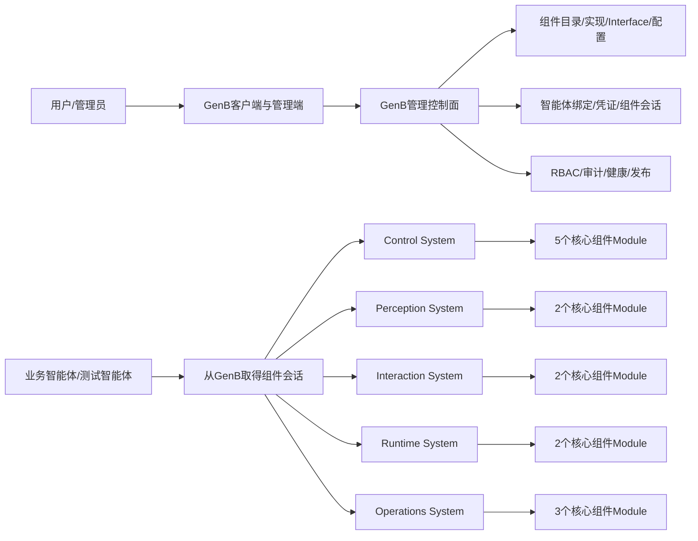
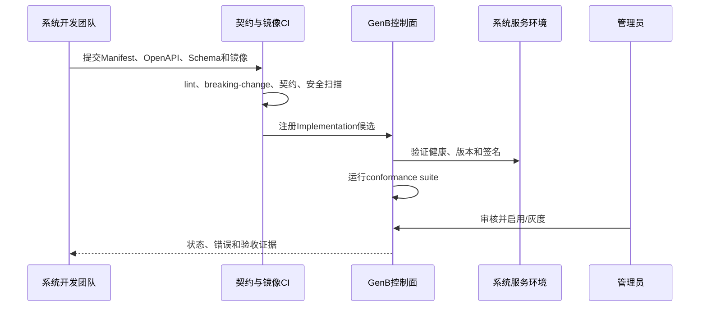
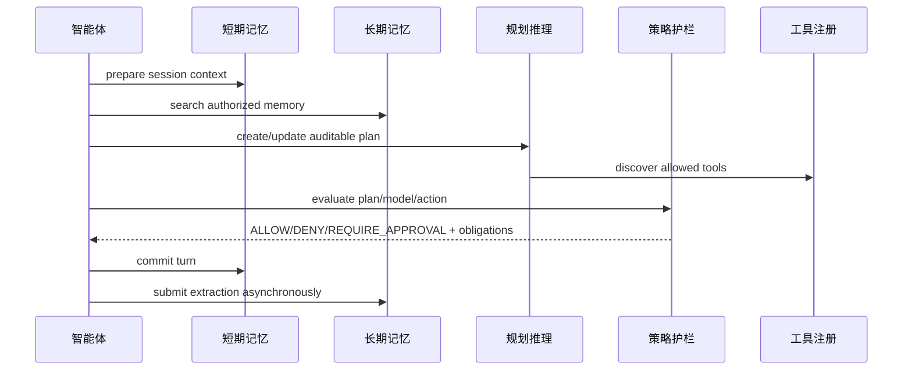
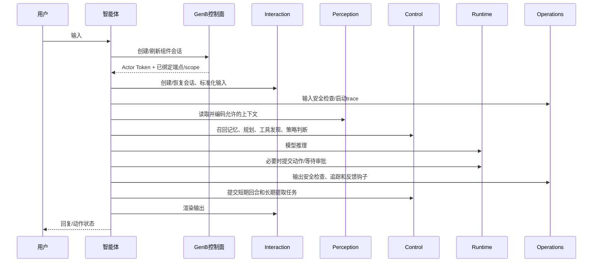

# GenB核心组件平台全栈开发总纲：GenB、五大系统、14个核心组件与智能体

> 文档类型：平台级开发总纲（Master Development Guide）  
> 状态：编码前评审稿  
> 版本：v1.1  
> 更新时间：2026-07-23  
> 总体设计：`docs/design/GENB_CORE_MEMORY_COMPONENTS_DETAILED_DESIGN.md`  
> 一期专项：`docs/development/CONTROL_SYSTEM_MEMORY_IMPLEMENTATION_GUIDE.md`  
> 架构决策：`records/decisions/20260723-ADR-core-component-platform-three-planes.md`、`records/decisions/20260723-ADR-self-hosted-inference-engine.md`  
> 统一术语：`CONTEXT.md`

---

## 0. 文档定位与使用方法

### 0.1 本文解决什么问题

本文是整个核心组件项目的开发总纲，不只是长短记忆开发文档。它同时覆盖：

1. **GenB管理控制面**：目录、实现注册、Interface版本、配置、绑定、凭证、权限、测试、健康和审计。
2. **五大系统执行面**：五个系统服务及其内部14个核心组件Module。
3. **智能体接入与编排面**：智能体如何取得组件会话、解析端点、调用组件、降级和上报反馈。
4. **平台治理面**：公共契约、身份、安全、可观测、发布、兼容、验收和团队协作。

总体设计回答“为什么做、产品边界和最终验收是什么”；本文回答“代码和服务怎么组织、按什么契约开发、如何联调交付”。各系统的专项实施文档继续补充数据库字段、完整OpenAPI和逐文件任务。

### 0.2 文档层级

```text
五大系统/14组件总体设计
└─ 核心组件平台全栈开发总纲（本文）
   ├─ GenB控制面专项实施文档（待编写）
   ├─ Control System专项
   │  └─ 长短记忆一期实施指南（已有）
   ├─ Perception System专项（待编写）
   ├─ Interaction System专项（待编写）
   ├─ Runtime System专项
   │  └─ 最小Inference Engine一期实施指南（已有）
   ├─ Operations System专项（待编写）
   └─ 智能体组件接入专项（待编写）
```

本文是所有专项文档的上位约束。专项可以增加实现细节，但不得擅自改变稳定code、身份边界、注册协议、错误模型和版本策略。

### 0.3 模板依据

| 来源 | 本文采用的部分 |
|---|---|
| [OpenAPI Specification 3.1](https://spec.openapis.org/oas/v3.1.1.html) | Interface、Schema、示例、鉴权和版本化 |
| [RFC 9457 Problem Details](https://datatracker.ietf.org/doc/html/rfc9457) | 统一HTTP错误正文 |
| [The Twelve-Factor App](https://12factor.net/) | 配置、依赖、日志和构建/发布/运行分离 |
| [Kubernetes KEP Template](https://www.kubernetes.dev/resources/keps/5468/) | 生产准备、测试计划、灰度和回滚 |
| [Google SRE Books](https://sre.google/books/) | SLI/SLO、容量、故障演练和运行责任 |

### 0.4 规范用词和设计词汇

- **必须/MUST**：违反即不得合并或上线。
- **应该/SHOULD**：默认遵守，偏离必须记录理由。
- **可以/MAY**：可选实现，不影响平台契约。
- **Module**：系统服务内部拥有明确Interface和隐藏Implementation的深模块。
- **Interface**：调用方真正依赖的表面，包括输入、输出、顺序、错误、性能和安全语义。
- **Seam**：可替换实现的接缝，例如模型、数据库、向量库和消息队列边界。
- **Adapter**：在Seam处满足Interface的具体实现。
- 本文中的“核心组件”是业务产品术语；在代码内部，一个核心组件优先实现为深Module，而不是机械拆成微服务。

---

## 1. 最终开发成果

### 1.1 完成后的平台形态



### 1.2 必须交付的工程能力

| 层面 | 最终交付 |
|---|---|
| GenB | 固定五大系统/14组件目录；组件实现注册；Interface版本；配置发布；智能体绑定；凭证和组件会话；RBAC；审计；健康；测试台；灰度和下线。 |
| 五大系统 | 5个可独立部署的系统服务；内部共14个深Module；统一健康、鉴权、错误、追踪和注册协议。 |
| 智能体 | 标准组件解析器、薄客户端、编排器和降级策略；至少三类测试智能体；业务智能体可按绑定调用。 |
| 公共契约 | OpenAPI、JSON Schema、注册Manifest Schema、错误码、事件信封、契约测试；不包含业务Implementation。 |
| 生产治理 | 版本兼容、服务发现、秘密管理、观测、SLO、容量、备份、灰度、回滚和验收证据。 |

### 1.3 非目标

- 不把GenB变成每次组件调用都必须经过的高频数据代理。
- 不把现有`bank-agent-runtime`嵌入每个智能体；它只作为设计参考。
- 不重新制造一个包含业务逻辑、状态和生命周期的重型“核心组件SDK”。
- 不允许管理员新增第15种业务核心组件；管理员注册的是14种组件的Implementation。
- 不预先把14个组件拆成14个服务。
- 不允许智能体自行声明`userId`、`tenantId`或未绑定的组件权限。

---

## 2. 平台边界和三面架构

### 2.1 GenB管理控制面

GenB拥有“谁可以使用什么能力、使用哪个版本和配置”的事实，但不拥有各组件的业务运行数据。职责包括：

- 固定系统与组件目录。
- 注册、审核、启用、灰度、停用组件Implementation。
- 保存Interface和配置Schema版本。
- 将Implementation和配置绑定到逻辑智能体。
- 发放、轮换、吊销服务凭证。
- 根据用户登录态签发短时Actor Token或组件会话。
- 管理管理员角色、菜单和组件权限。
- 展示健康快照、调用指标和审计入口。
- 提供独立测试台，但测试台调用仍走真实鉴权。

### 2.2 五大系统执行面

系统服务拥有组件的业务Implementation和运行数据。每个服务必须：

- 实现本系统组件Interface。
- 校验服务凭证、Actor Token、组件绑定和scope。
- 只信任签名后的身份Claims，不信任请求正文中的身份字段。
- 使用自己的数据库schema、缓存和外部Adapter。
- 输出统一Problem Details错误、追踪和审计事件。
- 向GenB或监控系统发布健康和版本信息。

### 2.3 智能体接入与编排面

智能体负责业务目标和调用顺序，不拥有组件治理事实。它必须：

- 用GenB生成的稳定`agentId`和服务凭证换取组件会话。
- 从组件会话读取已绑定组件、Interface版本、端点、scope和配置版本。
- 只调用被绑定的组件。
- 向每次调用传递Actor Token、`traceId`、`requestId`和幂等键。
- 对可降级组件执行明确降级；对安全或授权组件不得静默绕过。
- 不复制组件的数据库、秘密过滤和权限规则到智能体代码。

### 2.4 治理面

治理面由契约仓、CI、API Gateway、Secrets Manager、可观测平台和发布流程组成。它为各系统提供标准，但不集中实现全部业务逻辑。

---

## 3. 五大系统与14个固定组件

| systemCode | 系统服务 | componentCode | 中文名 | 责任摘要 |
|---|---|---|---|---|
| `CONTROL` | `control-system-service` | `PLANNER_REASONER` | 规划与推理引擎 | 目标分解、步骤状态、重规划和中止。 |
| `CONTROL` | `control-system-service` | `SHORT_TERM_MEMORY` | 短期记忆/工作台 | 会话内消息、摘要和临时上下文。 |
| `CONTROL` | `control-system-service` | `LONG_TERM_MEMORY` | 长期记忆/知识库 | 用户长期记忆，并逐步演进完整RAG。 |
| `CONTROL` | `control-system-service` | `TOOL_REGISTRY` | 工具注册表 | 工具Schema、版本、scope和健康发现。 |
| `CONTROL` | `control-system-service` | `POLICY_GUARDRAILS` | 策略护栏 | 规划、模型和动作前后的强制策略判定。 |
| `PERCEPTION` | `perception-system-service` | `DATA_CONNECTORS` | 数据连接器与适配器 | 多数据源连接、查询、映射、脱敏和故障隔离。 |
| `PERCEPTION` | `perception-system-service` | `CONTEXT_ENCODER` | 上下文编码器 | 清洗、压缩、编码和预算裁剪。 |
| `INTERACTION` | `interaction-system-service` | `MULTIMODAL_INTERFACE` | 多模态接口 | 文本、语音、图像等输入输出标准化。 |
| `INTERACTION` | `interaction-system-service` | `SESSION_MANAGER` | 会话管理器 | 跨渠道会话创建、恢复、转接和关闭。 |
| `RUNTIME` | `runtime-system-service` | `INFERENCE_ENGINE` | 推理引擎服务 | 模型注册、路由、推理、流式输出和用量。 |
| `RUNTIME` | `runtime-system-service` | `ACTION_EXECUTOR` | 动作执行器 | 授权动作、幂等、重试、补偿和人工介入。 |
| `OPERATIONS` | `operations-system-service` | `OBSERVABILITY_TRACER` | 全链路追踪仪 | 智能体、组件、模型、工具和数据访问链路。 |
| `OPERATIONS` | `operations-system-service` | `SECURITY_FILTER` | 安全过滤器 | 输入攻击、输出敏感信息和不合规内容过滤。 |
| `OPERATIONS` | `operations-system-service` | `FEEDBACK_LOOP` | 反馈闭环控制器 | 反馈、数据集、评估、灰度比较和回退。 |

`systemCode`和`componentCode`发布后不可重命名。展示名称允许国际化，数据库关联和权限表达式只能使用稳定code。

---

## 4. 仓库和工程拓扑

### 4.1 推荐仓库

```text
genb/
├─ gen-b/                              # 已有GenB控制面
│  ├─ gen-b-backend/
│  ├─ gen-b-console/
│  └─ gen-b-client/
├─ core-component-contracts/           # 仅契约、Schema和一致性测试
├─ control-system-service/              # 5个Module
├─ perception-system-service/           # 2个Module
├─ interaction-system-service/          # 2个Module
├─ runtime-system-service/               # 2个Module
├─ operations-system-service/            # 3个Module
└─ core-component-test-agents/           # 测试智能体和E2E场景
```

实际建立新仓库前必须由代码负责人确认组织、语言和CI归属；本文中的名称是稳定基准，不代表仓库已存在。

### 4.2 系统服务内部结构模板

```text
<system>-service/
├─ app/
│  ├─ bootstrap/              # 进程装配、配置加载、生命周期
│  ├─ identity/               # 凭证、Actor Token、scope校验
│  ├─ modules/
│  │  └─ <component>/
│  │     ├─ api/              # HTTP/Event Interface
│  │     ├─ application/      # use case和事务边界
│  │     ├─ domain/           # 规则和值对象
│  │     └─ ports/            # 存储、模型、外部系统Seam
│  ├─ adapters/               # PostgreSQL/Redis/HTTP/Model/Queue
│  ├─ telemetry/              # tracing、metrics、audit
│  └─ shared/                 # 仅真正跨Module稳定的最小基础类型
├─ migrations/
├─ openapi/
├─ tests/
│  ├─ unit/
│  ├─ contract/
│  ├─ integration/
│  ├─ security/
│  └─ performance/
├─ deploy/
└─ README.md
```

### 4.3 拆服务门槛

核心组件先做系统服务内部Module。满足以下至少一项并有测量证据时，才允许单独拆服务：

- 独立容量或延迟SLO无法通过进程内隔离满足。
- 故障必须具有独立blast radius。
- 需要不同技术栈或硬件资源，例如GPU或向量检索集群。
- 团队需要独立发布且共享发布已经成为持续阻塞。
- 数据合规要求独立网络或存储边界。

拆分不得改变`componentCode`和外部Interface语义；调用方通过组件会话解析新端点。

---

## 5. 公共契约仓：可以复用什么

### 5.1 必须包含

`core-component-contracts`只保存：

- 五大系统/14组件稳定code。
- 组件注册Manifest JSON Schema。
- OpenAPI 3.1文档和事件Schema。
- RFC 9457错误扩展字段和错误码目录。
- Actor Token Claims、scope命名规则和请求头约定。
- 统一分页、幂等、trace、健康和版本元数据Schema。
- 组件一致性测试（conformance suite）。
- 可选的纯DTO/HTTP薄客户端生成配置。

### 5.2 禁止包含

- 记忆、规划、策略、模型路由等业务Implementation。
- 数据库连接、全局单例、后台线程或进程生命周期。
- 强制某一种Web框架、ORM或日志框架。
- 隐式读取智能体进程配置或修改智能体全局状态。
- 代替GenB绑定、配置和鉴权的本地规则。

因此“复用”发生在协议和生成客户端层，不是把旧Runtime SDK重新塞进每个智能体。这样不会让每个智能体各自升级一套业务Runtime，也不会让开发难度暴增。

---

## 6. GenB控制面的Module

| Module | Interface | 拥有的数据 | 关键规则 |
|---|---|---|---|
| Core System Catalog | 系统查询 | 五大系统种子数据 | 只随平台版本迁移，不允许页面新增。 |
| Core Component Catalog | 组件查询/状态 | 14组件种子数据 | 只允许改变交付状态和展示信息。 |
| Implementation Registry | 注册/审核/启停实现 | Implementation元数据 | 每个实现必须指向固定componentCode。 |
| Interface Registry | OpenAPI/事件Schema版本 | Interface版本与摘要 | 发布后不可原地修改；破坏性变更升major。 |
| Configuration Registry | Schema、配置、版本、发布 | 配置密文引用和非秘密值 | 版本不可变；秘密只保存引用。 |
| Agent Binding | 绑定/解绑/灰度 | agent-component关系 | 一组件最多一个生效主实现，可有影子实现。 |
| Credential Service | 发放/轮换/吊销 | 哈希、keyId、状态 | 明文只显示一次。 |
| Component Session | 解析可用组件并签Token | 短时会话/签发审计 | 从登录态和绑定生成，不能信任正文userId。 |
| Health Registry | 健康上报/探测 | 健康快照 | 健康不是绑定资格，停用优先。 |
| Testbench | 场景执行/结果读取 | 测试运行元数据 | 使用专用测试智能体和真实调用链。 |
| Audit | 审计检索/导出 | 管理和安全事件 | 不保存密码、token和隐藏CoT。 |
| Release Governance | 灰度/回退/兼容检查 | 发布和路由规则 | 未通过契约和兼容检查不得启用。 |

### 6.1 GenB建议数据表

| 表 | 关键字段 |
|---|---|
| `core_systems` | `id, system_code, name_key, status, sort_order` |
| `core_components` | `id, system_id, component_code, name_key, delivery_status` |
| `component_implementations` | `id, component_id, implementation_code, owner, runtime_type, status` |
| `component_interface_versions` | `id, implementation_id, interface_version, schema_uri, schema_sha256, status` |
| `system_service_endpoints` | `id, implementation_id, environment, base_url, health_url, region, status` |
| `component_config_schemas` | `id, component_id, schema_version, json_schema, status` |
| `component_config_versions` | `id, implementation_id, version, config_json, secret_refs, status` |
| `agent_component_bindings` | `id, agent_id, component_id, implementation_id, config_version_id, rollout, status` |
| `agent_service_credentials` | `id, agent_id, key_id, secret_hash, expires_at, status` |
| `component_health_snapshots` | `implementation_id, environment, checked_at, status, latency_ms, detail_code` |
| `component_test_runs` | `id, agent_id, component_id, scenario_code, status, evidence_uri` |
| `component_audit_events` | `id, actor, action, target_type, target_id, trace_id, result, created_at` |

逻辑外键关系、唯一键、索引、乐观锁和迁移回滚必须在GenB控制面专项中细化。设计文档和 ER 图可以表达外键关系，但实际建表 DDL（包括 Hibernate 自动建表、测试库和手写 SQL）不得创建物理 `FOREIGN KEY`；关联完整性由服务层校验、事务、唯一约束和索引保证。数据库不得保存服务凭证明文或实际secret值。

### 6.2 组件状态

```text
PLANNED → DEVELOPING → VERIFYING → AVAILABLE → DEPRECATED → RETIRED
                              ↘ SUSPENDED ↗
```

- `PLANNED`只能展示说明，不显示伪造的版本、健康或绑定功能。
- `AVAILABLE`必须有已启用Implementation、有效Interface、配置Schema、健康端点和验收证据。
- `SUSPENDED`立即阻止新组件会话，已有短时Token按高风险级别决定是否吊销。
- `RETIRED`只保留历史审计，不允许新绑定。

---

## 7. 组件Implementation注册协议

### 7.1 注册Manifest示例

```yaml
manifestVersion: "1.0"
systemCode: CONTROL
componentCode: SHORT_TERM_MEMORY
implementationCode: control-stm-default
displayNameKey: component.control.shortTermMemory.default
owner: control-system-team
runtime:
  serviceName: control-system-service
  interfaceVersion: "1.0.0"
  protocol: HTTPS
  basePath: /api/v1/control-system/short-term-memory
  healthPath: /internal/health/components/short-term-memory
contracts:
  openapiUri: artifact://contracts/control/short-term-memory/1.0.0/openapi.yaml
  openapiSha256: "<sha256>"
  configSchemaUri: artifact://contracts/control/short-term-memory/1.0/config.schema.json
security:
  requiredScopes:
    - component:short-term-memory:read
    - component:short-term-memory:write
  actorTokenRequired: true
operations:
  timeoutMs: 800
  idempotency: REQUIRED_FOR_WRITE
  dataClassification: CONFIDENTIAL
slo:
  availability: 99.9
  p95LatencyMs: 300
compatibility:
  minimumAgentContractVersion: "1.0"
```

### 7.2 注册流程



启用必须同时满足：Manifest合法、契约不可变、镜像可追溯、健康通过、scope已登记、配置Schema有效、conformance suite通过、负责人明确。

---

## 8. 智能体绑定、身份与组件会话

### 8.1 两类身份

| 身份 | 证明什么 | 推荐载体 | 生命周期 |
|---|---|---|---|
| 服务凭证 | 调用进程属于哪个逻辑智能体 | 每个agentId一份当前有效的`client_id + client_secret` | 默认长期有效，主动轮换或吊销 |
| Actor Token | 本次代表哪个tenant/user/session、允许哪些组件scope | GenB签发的短时JWT | 5—15分钟 |

服务凭证不能代替用户身份；Actor Token不能代替智能体机器身份。用户交互场景必须两者同时成立。

服务凭证不得固化某个组件的授权集合。GenB在换取组件会话时查询当前已启用绑定，将组件和动作scope写入5分钟Actor Token；因此新增/停用绑定立即影响新会话，不要求轮换智能体长期凭证。

后台任务使用单独的`actorType=MACHINE_JOB` Token，并绑定`jobId`、`agentId`、允许scope和有效期；不得伪造用户Actor。

### 8.2 组件会话Interface

```http
POST /api/v1/client/agents/{agentId}/component-session
Authorization: Bearer <user-login-token>
X-Agent-Credential: <one-time-issued-api-key>
Content-Type: application/json
```

```json
{
  "sessionId": "sess-20260723-001",
  "requestedComponents": [
    "SESSION_MANAGER",
    "SHORT_TERM_MEMORY",
    "LONG_TERM_MEMORY",
    "INFERENCE_ENGINE",
    "OBSERVABILITY_TRACER"
  ]
}
```

```json
{
  "componentSessionId": "cs_01J...",
  "actorToken": "<short-lived-jwt>",
  "expiresAt": "2026-07-23T10:15:00Z",
  "components": [
    {
      "componentCode": "SHORT_TERM_MEMORY",
      "implementationCode": "control-stm-default",
      "interfaceVersion": "1.0.0",
      "baseUrl": "https://component-gateway/api/v1/control-system/short-term-memory",
      "configVersion": 7,
      "scopes": ["component:short-term-memory:read", "component:short-term-memory:write"]
    }
  ]
}
```

只返回已绑定、已启用、环境匹配且健康策略允许的组件。`tenantId/userId/agentId/sessionId`进入Token Claims，系统服务从Token读取，不接受客户端用正文覆盖。

一期采用TLS内的API Key直接交换：Key包含可定位的`keyId`，数据库只保存bcrypt哈希，无法也不应使用该哈希验证HMAC请求签名。若改用`X-Agent-Signature`，必须同时升级为私钥签名、mTLS或工作负载身份，不能为签名验证而可逆保存client secret。

### 8.3 绑定生效规则

- 绑定对象是逻辑`agentId`，不是某个容器或代码副本。
- 同一组件的主Implementation只能有一个；影子Implementation不得影响用户结果。
- 配置版本发布后不可原地编辑；修改生成新版本。
- 解绑高风险组件后应立即使相关组件会话失效。
- 端点变化由GenB解析结果或稳定API Gateway路由吸收，智能体不得硬编码IP。

---

## 9. 统一Interface规范

### 9.1 URL和版本

组件数据面基线：

```text
/api/v1/<system>/<component>/<resource-or-operation>
```

major版本位于URL；minor/patch通过契约元数据表达。破坏性变更必须新major并支持迁移窗口。

### 9.2 必须请求头

| Header | 用途 |
|---|---|
| `Authorization: Bearer <actor-token>` | Actor身份、绑定和scope。 |
| `X-Agent-Credential`或mTLS身份 | 逻辑智能体机器身份；一期API Key只用于换取短时组件会话。 |
| `X-Request-Id` | 请求唯一标识。 |
| `traceparent` | W3C Trace Context。 |
| `Idempotency-Key` | 所有创建、提交、执行和删除类写操作。 |
| `X-Contract-Version` | 调用方理解的组件契约版本。 |

### 9.3 成功信封

```json
{
  "data": {},
  "meta": {
    "requestId": "req_01J...",
    "traceId": "4bf92f3577b34da6a3ce929d0e0e4736",
    "componentCode": "SHORT_TERM_MEMORY",
    "implementationCode": "control-stm-default",
    "interfaceVersion": "1.0.0",
    "degraded": false
  }
}
```

### 9.4 错误正文

```json
{
  "type": "https://errors.alaya.example/component-binding-denied",
  "title": "Component binding denied",
  "status": 403,
  "detail": "The agent is not bound to the requested component.",
  "instance": "/api/v1/control-system/short-term-memory/context",
  "code": "COMPONENT_BINDING_DENIED",
  "requestId": "req_01J...",
  "traceId": "4bf92f3577b34da6a3ce929d0e0e4736",
  "retryable": false
}
```

错误不得回显密码、token、连接串、SQL、堆栈、原始模型提示词或隐藏CoT。

### 9.5 通用语义

- 分页优先使用不可变cursor，不使用易漂移的页码处理运行数据。
- 日期时间统一RFC 3339 UTC，展示层转换时区。
- 金额使用十进制定点字符串和currency，不使用浮点数。
- 写操作重复幂等键必须返回第一次的等价结果或明确冲突。
- 超时、限流、重试和降级必须通过字段或错误码可见。
- 所有Schema默认拒绝未知高风险字段；新增响应字段必须向后兼容。

---

## 10. Control System开发基线

### 10.1 Module与最小Interface

| Module | 最小v1 Interface | 关键数据 | 不可绕过规则 |
|---|---|---|---|
| Planner & Reasoner | `POST /plans`、`GET /plans/{id}`、`POST /plans/{id}/observations`、`POST /plans/{id}/cancel` | 目标、步骤、依赖、状态、证据 | 不持久化隐藏CoT；输出可审计计划摘要。 |
| Short-term Memory | `POST /context:prepare`、`POST /turns:commit`、`DELETE /sessions/{id}` | 消息、摘要、TTL、幂等 | 四维身份隔离；秘密不入日志。 |
| Long-term Memory | `POST /memories:search`、`POST /extractions`、`GET/PATCH/DELETE /memories/{id}` | 用户事实/偏好/约束、RAG条目 | 敏感信息拒绝；来源、置信度、删除审计。 |
| Tool Registry | `POST /tools:search`、`GET /tools/{name}/versions/{version}`；管理端注册/下线 | Tool Schema、scope、版本、健康 | 未授权工具不可发现；下线立即阻止新计划。 |
| Policy Guardrails | `POST /decisions:evaluate`、`GET /policies/{version}` | 策略、输入摘要、decision、obligations | `DENY`不可被智能体或其他组件覆盖。 |

### 10.2 组件协作顺序



长短记忆的逐字段、数据库、Redis、模型Adapter和测试规范以一期专项文档为准。

---

## 11. Perception System开发基线

### 11.1 Data Connectors & Adapters

最小v1 Interface：

- `POST /connections:validate`：测试连接配置，秘密仅使用secret reference。
- `POST /queries`：执行受控查询或读取，返回统一Record Batch。
- `GET /queries/{queryId}`：查询异步状态。
- `POST /subscriptions`、`DELETE /subscriptions/{id}`：可选事件源订阅。
- 管理Interface：注册连接器类型、字段映射、限流和数据分类。

Module必须隐藏JDBC、REST、消息队列、文件和遗留协议差异。Adapter负责超时、重试、断路、分页和字段映射；Module负责授权、分类、脱敏和统一结果。

### 11.2 Context Encoder

最小v1 Interface：

- `POST /contexts:encode`：结构化/非结构化数据转标准上下文块。
- `POST /contexts:compress`：按token预算压缩。
- `POST /contexts:rank`：按任务、来源和权限排序。

响应必须携带`sourceRef`、`classification`、`contentHash`、`tokenEstimate`和转换警告。编码器不得提升数据访问权限，也不得在压缩时删除强制合规标记。

### 11.3 数据归属

- 连接器元数据和秘密引用由Perception System拥有。
- 实际业务数据仍归源系统，不默认复制。
- 临时读取缓存必须有TTL、数据分类和删除策略。
- 查询审计记录来源、目的、字段分类和结果数量，不记录全部敏感正文。

---

## 12. Interaction System开发基线

### 12.1 Multimodal Interface

最小v1 Interface：

- `POST /inputs:normalize`：文本、音频、图像或文件转标准输入事件。
- `POST /outputs:render`：标准回复转文本、语音、图表或附件。
- `GET /jobs/{id}`：查询长耗时OCR/ASR/TTS任务。
- 流式Interface：SSE或WebSocket，必须有重连游标和终止事件。

原始媒体使用对象存储引用，不在跨服务JSON中传大段Base64。必须执行文件类型、大小、恶意内容、权限和保留期检查。

### 12.2 Session Manager

最小v1 Interface：

- `POST /sessions`：创建会话并返回稳定`sessionId`。
- `GET /sessions/{id}`：读取允许公开的会话状态。
- `POST /sessions/{id}:resume`：恢复或断点续传。
- `POST /sessions/{id}:handoff`：跨渠道或转人工。
- `POST /sessions/{id}:close`：关闭并触发清理事件。

Session Manager拥有渠道映射、会话状态和转接记录；不直接拥有短期记忆正文。它通过`sessionId`与短期记忆协作，禁止双方互相复制完整状态。

---

## 13. Runtime System开发基线

### 13.1 Inference Engine Service

Inference Engine是深Module：调用方只学习一个稳定Interface，Provider鉴权、厂商字段、SSE差异、结构化输出、路由、限流、重试、用量和错误归一全部隐藏在Implementation中。它提前作为一期基础能力交付，Control System长短记忆不得直连Alaya或模型厂商。

最小v1 Interface：

- `POST /inference`：非流式模型调用。
- `POST /inference:stream`：流式模型调用。
- `POST /embeddings`：向量化。
- `GET /models`：仅返回当前智能体允许使用的模型能力。
- `GET /internal/health/models`：Provider健康、延迟、熔断和降级，仅供内网管理调用。
- 管理Interface：模型Adapter、路由策略、限额和价格元数据。

Adapter策略：

```text
Inference Engine Interface
└─ Inference Engine Module
   ├─ DirectChatProviderAdapter       # 一期主路径
   ├─ DirectEmbeddingProviderAdapter  # 可与Chat使用不同Provider
   ├─ AlayaGatewayAdapter             # 可选兼容/备用
   └─ FakeModelAdapter                # 单元、契约和故障测试
```

Direct Provider是一期主路径；Alaya Model Gateway只是候选Adapter，未通过真实契约测试时不得加入生产路由。Runtime System负责统一请求、结构化JSON、流式协议、中止、路由、超时、限流、重试、熔断、回退、用量和模型错误；智能体和Control System不直接依赖厂商协议。

推荐请求Schema：

```json
{
  "capability": "CHAT",
  "model": "chat-default",
  "messages": [
    {"role": "user", "content": "请提取可长期保存的用户偏好"}
  ],
  "responseFormat": {
    "type": "JSON_SCHEMA",
    "schemaName": "memory_extraction_v1",
    "jsonSchema": {}
  },
  "temperature": 0.2,
  "maxOutputTokens": 1000,
  "timeoutMs": 30000
}
```

推荐响应Schema：

```json
{
  "data": {
    "content": "{\"memories\":[]}",
    "model": "chat-default",
    "provider": "DIRECT_PROVIDER",
    "usage": {"inputTokens": 120, "outputTokens": 20},
    "finishReason": "STOP"
  },
  "meta": {
    "requestId": "req_01J...",
    "traceId": "4bf92f3577b34da6a3ce929d0e0e4736",
    "componentCode": "INFERENCE_ENGINE",
    "interfaceVersion": "1.0.0",
    "degraded": false
  }
}
```

结构化输出至少执行两层校验：Inference Engine验证Provider结果满足调用方Schema；Control System再次验证记忆业务Schema、敏感信息、类型、置信度和持久化规则。

输入必须区分system policy、developer instruction、用户内容和检索内容。日志不得记录秘密或完整敏感Prompt；不得暴露模型隐藏CoT。

模型厂商API Key只保存在Runtime System部署环境或Secrets Manager，GenB只保存`secretRef`。Control System和智能体使用组件服务身份调用Inference Engine，不获得上游密钥。每个Direct Provider进入真实数据联调前必须完成数据出境、训练使用、日志保留、删除政策和费用确认。

一期Inference Engine完成标准：非流式、结构化JSON、流式、Embedding、模型列表、健康和统一错误契约通过；至少一个Direct Provider完成真实Chat/结构化调用，至少一个Provider完成Embedding验证；Fake Adapter覆盖超时、429、5xx、非法JSON、流中断和空向量；Alaya未启用不影响主链路。

### 13.2 Action Executor

最小v1 Interface：

- `POST /actions`：提交已授权动作，必须有幂等键。
- `GET /actions/{id}`：状态和公开结果。
- `POST /actions/{id}:cancel`：可取消阶段中止。
- `POST /actions/{id}:compensate`：支持的动作执行补偿。
- `POST /actions/{id}:approve`：人工审批后继续。

动作状态基线：

```text
PENDING → AUTHORIZING → WAITING_APPROVAL → EXECUTING → SUCCEEDED
                         ↘ REJECTED        ↘ FAILED → COMPENSATING → COMPENSATED
                                              ↘ CANCELLED
```

Action Executor必须再次执行Policy Guardrails和权限检查，不能因为规划器推荐了工具就视为已授权。

---

## 14. Operations System开发基线

### 14.1 Observability Tracer

优先采用OpenTelemetry和W3C Trace Context，通过OTLP Adapter接入现有观测平台，不自研一套不兼容的追踪协议。

最小v1 Interface：

- 数据面以OTLP traces/metrics/logs接收为主。
- `GET /traces/{traceId}/summary`：受权的业务回放摘要。
- `POST /business-events`：补充不适合Span表达的受控业务事件。

必须串联`agentId`、组件code、Implementation、模型、工具和数据源，但身份字段按权限脱敏；不采集密码、token、原始私钥或隐藏CoT。

### 14.2 Security Filter

最小v1 Interface：

- `POST /inspections/input`：提示词注入、越狱、恶意文件和秘密检测。
- `POST /inspections/output`：敏感数据、违规内容、数据外泄检测。
- `POST /inspections/tool-arguments`：动作参数注入和越权检测。
- `POST /reviews`：人工复核和误报回流。

返回`ALLOW/DENY/REDACT/REVIEW`、规则版本、原因码和可执行obligations。调用失败时的fail-open/fail-closed必须由场景风险等级定义；认证、转账等高风险场景默认fail-closed。

### 14.3 Feedback Loop Controller

最小v1 Interface：

- `POST /feedback`：点赞、点踩、修正、投诉和业务结果。
- `POST /evaluation-runs`：离线评估。
- `GET /evaluation-runs/{id}`：指标和版本比较。
- `POST /datasets`、`POST /datasets/{id}/versions`：治理评估数据集。
- `POST /rollout-recommendations`：生成灰度建议，不直接绕过管理员发布。

反馈用途必须透明；训练/评估数据集要有来源、同意、脱敏、保留和删除策略。线上自动优化不得直接改变强制策略。

---

## 15. 智能体工程和调用模型

### 15.1 智能体内部最小Module

```text
agent/
├─ bootstrap/
├─ identity/
│  ├─ service_credential_provider
│  └─ component_session_provider
├─ components/
│  ├─ resolver                 # GenB解析绑定和端点
│  ├─ clients                  # OpenAPI生成或手写薄客户端
│  └─ circuit_breakers
├─ orchestration/
│  ├─ conversation_flow
│  ├─ action_flow
│  └─ degradation_policy
├─ domain/
├─ telemetry/
└─ tests/
```

智能体可以使用不同语言；公共契约仓应能生成语言无关的OpenAPI客户端。生成客户端只处理HTTP、DTO、超时和错误反序列化，业务编排仍由智能体显式实现。

### 15.2 标准端到端流程



### 15.3 降级矩阵

| 组件故障 | 默认行为 |
|---|---|
| Observability不可用 | 本地有界缓冲后重传；高风险动作若审计不可保证则停止。 |
| Security Filter不可用 | 高风险fail-closed；低风险由批准的策略决定。 |
| Short-term Memory不可用 | 明确无记忆模式，当前请求可继续。 |
| Long-term Memory不可用 | 返回空长期上下文并标记degraded。 |
| Perception连接器不可用 | 不编造数据；说明数据源不可用。 |
| Inference主模型不可用 | 按已批准路由切备用模型；无备用则失败。 |
| Policy Guardrails不可用 | 受控动作和敏感输出停止。 |
| Action Executor状态未知 | 不自动重复非幂等动作，先按幂等键查询。 |

### 15.4 测试智能体

至少建立：

1. **Memory Test Agent A/B**：同一代码、不同`agentId`，验证长短记忆和智能体隔离。
2. **Composite Read-only Agent**：串联Interaction、Perception、Control、Inference、Operations，不执行写动作。
3. **High-risk Action Test Agent**：覆盖Policy、Security、Action审批、幂等、补偿和审计。

GenB生成`agentId`、最小项目模板、绑定清单示例和凭证申请；不得把明文凭证写入生成代码。

---

## 16. 配置、秘密和数据留存

### 16.1 配置层次

```text
平台默认值
  → 组件Implementation默认值
    → 配置方案版本
      → 智能体绑定覆盖（仅Schema允许字段）
        → 单次请求参数（仅Interface允许字段）
```

每个最终值必须能解释来源。组件服务不得悄悄读取智能体本地配置覆盖GenB已发布配置。

### 16.2 默认保留时间

所有持久或缓存数据必须声明：

- `retentionPolicy`：保留策略code。
- `ttlSeconds`或`expiresAt`：默认过期。
- `legalHold`：合法冻结时禁止删除。
- `deleteMode`：软删除、硬删除或外部源删除引用。
- `archivePolicy`：是否归档及归档位置。

保留时间允许管理员在组件Schema约束内配置；安全审计、长期记忆、媒体、trace和反馈数据不能共享一个默认值。

### 16.3 秘密

- 密码、API key、client secret、数据库口令和私钥只进入Secrets Manager或部署环境。
- GenB配置只保存`secretRef`和版本，不保存明文。
- 日志、trace、测试证据、记忆、反馈数据集不得包含秘密。
- 凭证明文只在首次发放时显示一次；数据库保存强哈希或公钥。
- 服务间优先mTLS或工作负载身份；本地测试可使用短期client secret。

---

## 17. 数据所有权和一致性

| 数据 | 真源 | 其他系统如何使用 |
|---|---|---|
| 系统/组件/Implementation/绑定 | GenB | 组件会话、事件或受控查询。 |
| 用户、角色、管理员权限 | GenB/Genesis现有身份体系 | Actor Token Claims。 |
| 短期/长期记忆 | Control System | 通过记忆Interface，不直连库。 |
| 连接器配置和读取缓存 | Perception System | 通过连接/查询Interface。 |
| 渠道和会话状态 | Interaction System | 通过Session Interface。 |
| 模型路由/用量、动作状态 | Runtime System | 通过Inference/Action Interface。 |
| trace、安全判定、反馈数据集 | Operations System | 通过观测/安全/反馈Interface。 |

跨系统不得共享数据库表写入。跨系统同步优先通过Interface或版本化事件；事件最终一致性必须有重放、去重和死信处理。

### 17.1 通用事件信封

```json
{
  "specVersion": "1.0",
  "eventId": "evt_01J...",
  "eventType": "component.binding.published.v1",
  "occurredAt": "2026-07-23T10:00:00Z",
  "producer": "gen-b-backend",
  "tenantId": "tenant-001",
  "subject": "agent/agent-memory-test-a",
  "traceId": "4bf92f3577b34da6a3ce929d0e0e4736",
  "dataClassification": "INTERNAL",
  "data": {}
}
```

消费者必须按`eventId`幂等；未知major事件进入隔离队列而不是猜测处理。

---

## 18. 权限模型

### 18.1 管理端权限

建议权限code：

```text
core-system:view
core-component:view
component-implementation:manage
component-interface:publish
component-config:manage
component-binding:manage
component-credential:manage
component-health:view
component-test:execute
component-audit:view
component-release:manage
```

GenB需要增加核心组件菜单和角色权限管理。默认只有管理员拥有写权限；普通授权用户可查看自己有权访问的组件、绑定状态和测试结果，不可发放凭证或修改系统级配置。

### 18.2 数据面scope

格式：

```text
component:<kebab-component-code>:<verb>
```

例如：

```text
component:long-term-memory:read
component:long-term-memory:write
component:action-executor:execute
component:action-executor:approve
```

系统服务必须同时验证：Implementation启用、agent绑定、Actor授权、scope、资源归属和数据分类。任何一项失败均不得调用。

---

## 19. 可观测性和SLO

### 19.1 每次调用的最小属性

- `traceId/requestId/componentSessionId`
- `tenantId`和`userId`的不可逆或受权表示
- `agentId/systemCode/componentCode/implementationCode/interfaceVersion`
- `configVersion`
- `resultCode/retryable/degraded`
- `latencyMs/requestBytes/responseBytes`
- 模型、工具、数据源只记录允许公开的稳定标识

### 19.2 每个组件必须定义的SLI

- 可用率。
- p50/p95/p99延迟。
- 错误率和可重试率。
- 限流、超时和降级率。
- 队列积压和任务年龄（如异步）。
- 数据正确性或业务质量指标。
- 安全阻断、误报和人工复核率（适用组件）。

没有容量测试、SLO、告警负责人和runbook的组件不能从`VERIFYING`进入`AVAILABLE`。

---

## 20. 测试架构

### 20.1 测试金字塔

| 层级 | 必测内容 | 执行位置 |
|---|---|---|
| 单元测试 | Domain规则、状态机、排序、脱敏、预算、幂等 | 各系统仓 |
| Module测试 | Use case与假的Port，验证事务和错误 | 各系统仓 |
| Adapter集成 | PostgreSQL、Redis、模型、外部数据源、队列 | 各系统仓/临时环境 |
| 契约提供者 | 实现满足OpenAPI、错误和安全约定 | 各系统CI |
| 契约消费者 | 智能体薄客户端兼容当前和下一minor | 智能体CI |
| Conformance | 任一Implementation均运行的黑盒测试 | 公共契约CI/GenB |
| 系统E2E | 每个系统内部组件协作 | 系统测试环境 |
| 跨系统E2E | 五系统和GenB/智能体完整业务链 | 平台测试环境 |
| 非功能 | 性能、容量、混沌、安全、恢复、升级 | 上线门禁 |

### 20.2 14组件最低证据

| 组件 | 必须提交的自动化或报告 |
|---|---|
| Planner & Reasoner | 标准计划、观察重规划、取消、无隐藏CoT。 |
| Short-term Memory | 会话连续、跨session/agent隔离、TTL、摘要、幂等、降级。 |
| Long-term Memory | 跨会话召回、敏感拒绝、权限、更新删除、RAG摄取检索引用。 |
| Tool Registry | 注册、发现、授权过滤、升级、下线。 |
| Policy Guardrails | ALLOW/DENY/REVIEW、不可绕过、版本审计。 |
| Data Connectors | 两类数据源、映射、超时、重试、断路、脱敏。 |
| Context Encoder | 结构化/非结构化、预算、保真、排序、分类保留。 |
| Multimodal Interface | 至少一种非文本输入和输出、恶意文件、流式重连。 |
| Session Manager | 创建、恢复、跨渠道转接、并发冲突、关闭。 |
| Inference Engine | 双模型路由、流式、限流、超时、回退、用量。 |
| Action Executor | 幂等、未知结果、超时、审批、取消、补偿。 |
| Observability Tracer | 跨服务trace、回放、脱敏、积压恢复。 |
| Security Filter | 攻击语料、输入/输出/工具参数、误报漏报、fail-closed。 |
| Feedback Loop | 反馈、数据集版本、离线评估、灰度建议和回滚。 |

### 20.3 跨系统验收场景

至少两个真实或高保真银行场景：

- **只读咨询场景**：跨渠道恢复会话→读取客户允许的数据→编码上下文→召回记忆→规划→模型回复→安全过滤→反馈。
- **高风险动作场景**：同上，并包含工具发现→策略拒绝/人工审批→幂等动作→未知结果查询→补偿→全链路审计。

---

## 21. 本地开发与环境

### 21.1 建议端口（编码前确认）

| 服务 | 本地端口建议 |
|---|---|
| GenB Backend | 沿用现有配置 |
| Control System | `8701` |
| Perception System | `8702` |
| Interaction System | `8703` |
| Runtime System | `8704` |
| Operations System | `8705` |
| Test Agent A/B | `8711/8712` |

端口只是本地建议，生产端点由服务发现/API Gateway和GenB注册表管理。

### 21.2 最小本地拓扑

- PostgreSQL：各服务独立schema和数据库用户，禁止共享写权限。
- Redis：短期数据、限流和有界缓存使用不同前缀/逻辑库，生产优先独立实例或集群策略。
- 对象存储：多模态和RAG文档。
- 消息队列：长期提取、异步媒体、动作、反馈和事件；具体产品编码前确认。
- 模型：Runtime System最小Inference Engine、至少一个Direct Provider Adapter、可控Fake Model Adapter；Alaya Adapter可选且默认不进入主路由。
- 可观测：本地OpenTelemetry Collector或测试接收器。

仓库不得提交真实密码。用户提供的本地Redis密码只能进入未提交环境配置或Secrets Manager。

---

## 22. 构建、发布和部署

### 22.1 制品

每个系统服务发布：

- 不可变镜像及digest。
- SBOM和依赖漏洞报告。
- Manifest、OpenAPI、配置Schema及SHA-256。
- 数据库迁移和回滚说明。
- conformance、集成、安全、性能报告。
- 默认dashboard、告警和runbook。

### 22.2 发布顺序

1. 公共契约新增向后兼容版本。
2. 系统服务部署新Implementation但不接生产流量。
3. GenB注册为`VERIFYING`并运行健康/契约/安全测试。
4. 绑定测试智能体，完成系统和跨系统E2E。
5. 按内部用户、百分比或agent allowlist灰度。
6. 观察SLO和业务质量，逐步扩大。
7. 标记旧版本`DEPRECATED`，经过迁移窗口后再`RETIRED`。

### 22.3 回滚

- 配置回滚：绑定恢复到上一个不可变配置版本。
- 路由回滚：GenB/网关把主Implementation切回旧版本。
- 镜像回滚：部署上一digest，Interface仍兼容。
- 数据迁移：expand/contract；未确认可逆时只做向前修复。
- 高风险安全事件：暂停Implementation并吊销相关组件会话。

GenB控制面不可用时，API Gateway和系统服务可在短时间内使用最后有效路由与公钥缓存；不能因此允许新绑定或绕过吊销策略。

---

## 23. 版本与兼容策略

| 对象 | 版本规则 |
|---|---|
| Component Interface | SemVer；破坏性变更升major。 |
| 配置Schema | 独立SemVer；旧配置必须能验证或显式迁移。 |
| Implementation | 不等同Interface版本，可多次发布patch。 |
| 事件 | `eventType`包含major，例如`.v1`。 |
| 注册Manifest | `manifestVersion`独立演进。 |
| Actor Token Claims | `tokenVersion`，验证器支持明确窗口。 |

禁止把响应字段改名、收紧枚举、改变null语义或改变错误状态码当作patch发布。兼容检查必须由CI自动执行。

---

## 24. 团队分工和工作包

### 24.1 责任边界

| 团队 | 主要责任 |
|---|---|
| GenB控制面组 | 目录、注册、配置、绑定、凭证、组件会话、RBAC、UI、审计和发布治理。 |
| Control组 | 5个Control Module及数据。 |
| Perception组 | 连接器和上下文编码。 |
| Interaction组 | 多模态和会话。 |
| Runtime组 | 模型推理和动作执行。 |
| Operations组 | 观测、安全和反馈。 |
| 智能体接入组 | 解析器、薄客户端、编排模板和测试智能体。 |
| 平台/SRE/安全 | 网关、身份、Secrets、CI、监控、容量、发布和事故响应。 |

### 24.2 工作包顺序

| 阶段 | 工作包 | 出口条件 |
|---|---|---|
| 0 | code/术语/ADR/公共Schema | 架构评审通过。 |
| 1 | GenB目录、Implementation、Interface、配置、绑定基础 | 可注册假Implementation并解析。 |
| 2 | 凭证、Actor Token、组件会话、网关和conformance | 测试智能体只能调用已绑定假组件。 |
| 3 | Runtime最小Inference Engine | 统一Interface、Direct/Fake Adapter、结构化输出和Embedding真实验证通过。 |
| 4 | Control长短记忆一期 + Memory Test Agent | 只通过Inference Engine调用模型，一期专项验收通过。 |
| 5 | Control其余3组件 | Control系统验收。 |
| 6 | Perception与Interaction共4组件 | 只读复合场景贯通。 |
| 7 | Runtime完整化与Operations共4个未交付组件 | 双模型治理、高风险动作和Operations治理场景贯通。 |
| 8 | 长期记忆完整RAG | 摄取、检索、引用和治理通过。 |
| 9 | 全量硬化和总体验收 | 14组件全AVAILABLE、两条跨系统E2E通过。 |

各组可以并行开发，但阶段0—2的身份、注册和契约必须先稳定；不能让各系统自行发明不兼容的绑定协议。

---

## 25. 编码启动门禁

以下问题必须在建立对应服务骨架前由负责人书面确认：

- [ ] 五个系统服务分别使用什么语言/框架，谁维护。
- [ ] 新代码采用单仓还是多仓，CI和制品库在哪里。
- [ ] `core-component-contracts`的发布方式和兼容检查工具。
- [ ] API Gateway/服务发现产品及内外网路由。
- [ ] Actor Token签名算法、公钥发布、吊销和时钟偏差。
- [ ] 服务凭证采用client secret、私钥签名、mTLS或工作负载身份的环境矩阵。
- [ ] PostgreSQL schema、账号、备份、RPO/RTO和迁移负责人。
- [ ] Redis生产持久化、集群、隔离和淘汰策略。
- [ ] 消息队列、对象存储、向量库和Secrets Manager产品。
- [ ] Direct Chat Provider和Embedding Provider、官方契约、API凭证、费用和责任人。
- [ ] 模型输入的数据出境、训练使用、日志保留、删除和脱敏合规结论。
- [ ] Alaya是否作为备用Adapter；若启用，其真实鉴权、流式、模型、Embedding和错误契约测试结果。
- [ ] 数据分类、留存默认值、合法冻结和删除责任人。
- [ ] 每个组件的SLO、容量预估、告警负责人和上线环境。

未确认项可以使用fake Adapter开发Interface和领域规则，但不得直接按假设部署生产。

---

## 26. Definition of Done

### 26.1 单个组件完成

- [ ] 固定componentCode和责任边界已评审。
- [ ] Module Interface小而完整，Implementation隐藏在内部。
- [ ] OpenAPI/事件/配置Schema及示例通过lint。
- [ ] 注册Manifest和镜像可追溯。
- [ ] GenB可注册、配置、绑定、授权、测试、停用。
- [ ] 智能体通过组件会话调用，未绑定/越权被拒绝。
- [ ] 数据所有权、保留、删除、秘密和审计明确。
- [ ] 单元、集成、契约、conformance、安全和性能测试通过。
- [ ] SLO、dashboard、告警和runbook可用。
- [ ] 灰度、回滚和兼容迁移完成演练。

### 26.2 单个系统完成

- [ ] 本系统全部组件均达到组件DoD。
- [ ] 组件内部协作和失败隔离通过系统E2E。
- [ ] 服务无跨系统数据库写依赖。
- [ ] 服务级容量、恢复、升级和安全测试通过。
- [ ] 所有组件卡在GenB显示真实Implementation和健康。

### 26.3 整个平台完成

- [ ] 五个系统服务和14个核心组件均为`AVAILABLE`，没有规划占位卡。
- [ ] GenB完成目录、实现、Interface、配置、绑定、凭证、组件会话、权限、测试、健康、审计和发布治理。
- [ ] 至少一个业务智能体通过标准组件会话调用五大系统。
- [ ] 三类测试智能体及隔离、只读、高风险场景全部通过。
- [ ] 两条跨系统银行场景E2E通过并有trace、审计和业务结果证据。
- [ ] Runtime SDK未成为新系统或智能体的强依赖。
- [ ] 安全、容量、备份恢复、灰度回滚、兼容和运维交接完成。
- [ ] 总体设计第27章全验收矩阵逐项关闭。

---

## 27. 首轮开发任务拆解

### 27.1 GenB控制面

1. 幂等迁移五大系统和14组件种子数据。
2. 增加Implementation、Interface、端点、配置、绑定、凭证、健康和测试运行表。
3. 实现管理员RBAC、菜单和审计。
4. 实现Manifest注册、审核、启停和兼容检查入口。
5. 实现配置Schema、不可变版本和发布。
6. 实现绑定和组件会话签发。
7. 管理端实现14卡、详情、实现、配置、绑定、健康、测试台和审计页。

### 27.2 公共契约和基础设施

1. 建立contract仓和code目录。
2. 定义Manifest、Problem Details、Token Claims和事件Schema。
3. 建立OpenAPI lint、breaking change和conformance CI。
4. 建立本地API Gateway、Secrets、OTel和fake service。
5. 建立服务注册到GenB的CI身份。

### 27.3 Runtime System一期

1. 建立`runtime-system-service`骨架和Inference Engine深Module。
2. 发布`/inference`、`/inference:stream`、`/embeddings`、`/models`和内部模型健康Interface。
3. 实现Fake Model Adapter及超时、429、5xx、非法JSON、流中断和空向量测试。
4. 实现至少一个Direct Chat Provider Adapter和一个可相同或不同的Embedding Provider Adapter。
5. 实现服务身份、secretRef、限流、重试、熔断、用量、追踪和统一Problem Details。
6. 在GenB注册Inference Engine Implementation、配置、端点、权限和测试入口。
7. Alaya Adapter作为可选工作包；通过契约测试后才能加入备用路由。

### 27.4 Control System一期

严格按`CONTROL_SYSTEM_MEMORY_IMPLEMENTATION_GUIDE.md`实施：服务骨架、Short-term Memory、Long-term Memory、Runtime Inference Adapter、Redis/PostgreSQL、Memory Test Agent和测试台。Control System不直接实现模型Provider Adapter。

### 27.5 智能体接入

1. 实现服务凭证Provider。
2. 实现组件会话Provider和缓存/刷新。
3. 生成或实现两个记忆薄客户端。
4. 实现显式记忆编排和降级。
5. 配置A/B两个`agentId`验证隔离。
6. 上报trace、安全事件和测试证据。

---

## 28. 评审清单

### 28.1 架构评审

- 是否仍清楚区分GenB控制面、系统执行面和智能体编排面？
- 是否出现GenB高频代理、共享数据库或智能体硬编码端点？
- 是否把业务核心组件误当成必须独立部署的微服务？
- Interface是否比Implementation简单，并隐藏外部产品差异？
- 新抽象是否解决已发生的变化，还是为假设未来增加复杂度？

### 28.2 安全评审

- 机器身份和Actor身份是否同时验证？
- user/tenant/agent/session是否来自签名Claims？
- 未绑定、越权、过期、吊销是否都有拒绝用例？
- 密码、token、原始媒体和敏感Prompt是否可能进入日志、trace、记忆或反馈？
- 高风险策略、安全过滤和审计失败是否fail-closed？

### 28.3 运维评审

- 是否有SLO、容量、告警、runbook、备份和恢复演练？
- 是否可以只回滚配置/路由而不回滚所有服务？
- 数据迁移是否expand/contract，回滚是否真实可行？
- 健康检查是否包含依赖，又不会因非关键依赖造成雪崩？
- 是否能从trace定位到具体agent、组件、Implementation和配置版本？

---

## 29. 专项文档模板

每个系统或组件专项至少包含：

1. 文档定位、上位总纲和有效ADR。
2. 目标、非目标、用户场景和验收。
3. Module Interface、Seam、Adapter和依赖规则。
4. 逐目录/逐文件实施清单。
5. 完整OpenAPI、Schema、错误和事件。
6. 数据模型、索引、迁移、保留和删除。
7. 身份、scope、绑定、秘密和安全威胁。
8. 配置Schema、默认值、版本和动态生效。
9. 单元、契约、集成、E2E、安全和性能测试。
10. dashboard、SLO、告警和runbook。
11. 构建、部署、灰度、回滚和兼容迁移。
12. 工作包、责任人、依赖、风险和Definition of Done。

现有长短记忆实施指南是此模板的第一个专项实例，而不是整个核心组件项目的替代品。

---

## 30. 一句话实施原则

> GenB负责“登记、授权和治理”，五大系统负责“真实实现和运行数据”，智能体负责“按绑定编排调用”；三者共享稳定契约，不共享业务Implementation，也不依赖重型Runtime SDK。
