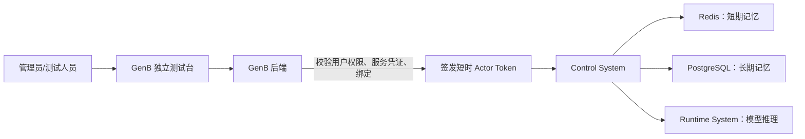

# 核心组件长短期记忆详细测试手册

> 版本：1.0  
> 日期：2026-07-24  
> 适用对象：产品经理、项目经理、管理员、测试人员、开发人员  
> 适用环境：GenB 本地开发环境  
> 页面入口：`http://localhost:9100/genb/core-components`

## 1. 这份手册解决什么问题

这份手册用于验证一期两个真实核心组件：

- `SHORT_TERM_MEMORY`：短期记忆/工作台。
- `LONG_TERM_MEMORY`：长期记忆/知识库。

测试分成两层：

1. **独立测试台**：管理员在页面上人工演示一次真实调用。
2. **测试智能体**：用同一份智能体代码模拟 `memory-test-a` 和 `memory-test-b`，执行连续对话、隔离、越权、脱敏和删除等完整验收。

两层测试不能互相替代。页面测试证明“管理员能操作、链路能展示”；测试智能体证明“真实调用方接入、隔离和安全规则正确”。

## 2. 一次调用实际经过哪些系统



关键点：

- 页面不能直接访问 Redis 或 PostgreSQL。
- GenB 不执行记忆业务，只负责管理、权限、绑定、凭证和调用入口。
- Control System 执行短期与长期记忆业务。
- Runtime System 为摘要和长期记忆提取提供统一模型接口。
- 测试智能体和页面最终调用的是同一套真实组件接口，不存在另一套演示后端。

## 3. 测试前提

### 3.1 必须运行的服务

| 服务 | 本地端口 | 用途 | 必须结果 |
|---|---:|---|---|
| GenB 后端 | `8581` | 登录、权限、绑定、凭证、测试入口 | `/api/actuator/health` 返回 HTTP 200 |
| GenB 管理端 | `9000` | 管理页面源站 | 端口监听 |
| GenB 客户端/同源入口 | `9100` | 登录入口，并代理 `/genb` 到管理端 | 页面能打开 |
| Control System | `18701` | 长短期记忆执行面 | `/health/live`、`/health/ready` 为 `UP` |
| Runtime System | `18704` | 摘要和长期提取 | `/health/live`、`/health/ready` 为 `UP` |
| Redis | `6379` | 短期记忆 | Control ready 显示 `shortTermStore=UP` |
| PostgreSQL | `5432` | 长期记忆 | Control ready 显示 `longTermStore=UP` |

PowerShell 检查：

```powershell
Invoke-WebRequest 'http://127.0.0.1:8581/api/actuator/health' -UseBasicParsing
Invoke-RestMethod 'http://127.0.0.1:18704/health/live'
Invoke-RestMethod 'http://127.0.0.1:18704/health/ready'
Invoke-RestMethod 'http://127.0.0.1:18701/health/live'
Invoke-RestMethod 'http://127.0.0.1:18701/health/ready'
```

### 3.2 必须具备的用户权限

推荐使用管理员账号。至少需要：

- 查看核心组件目录和详情。
- `component.test`：运行独立测试。
- 使用所选智能体的权限。
- 如需自行签发凭证，还需要 `credential.issue`。

页面右上角应显示当前管理员。如果核心组件接口返回 `403`，先确认登录状态和权限，不要通过关闭鉴权解决。

### 3.3 当前已经准备好的绑定

当前开发数据中：

| 组件 | 可选智能体 |
|---|---|
| 短期记忆 | `memory-test-a`、`memory-test-b`、`agent-sdlc-ai-testing` |
| 长期记忆 | `memory-test-a`、`memory-test-b` |

测试文档统一使用：

- 智能体 A：`memory-test-a`
- 智能体 B：`memory-test-b`

A/B 使用同一份代码，但必须使用不同 `agentId` 和不同服务凭证。

## 4. 页面四个输入项分别是什么

| 页面字段 | 从哪里获得 | 代表什么 | 为什么需要 |
|---|---|---|---|
| 绑定智能体 | 从该组件的已启用绑定中选择 | 本次由哪个逻辑智能体调用组件 | 记忆必须按智能体隔离，不能只按用户隔离 |
| 测试会话 ID | 测试人员自行填写 | 一段会话的唯一标识 | 短期记忆按 Session 隔离；长期记忆用它证明可跨 Session |
| 服务凭证 | GenB 为某个智能体签发 | 长期证明调用方确实是该智能体 | 只选择下拉框不能证明调用方身份；组件与动作权限由本次绑定快照生成的 Actor Token 决定 |
| 用户消息 | 测试人员输入 | 本次送入组件的真实测试内容 | 短期记忆保存对话；长期记忆从内容中提取稳定事实或偏好 |

### 4.1 Session ID 填写规则

允许字符：

```text
字母、数字、点、下划线、冒号、连字符
```

长度不超过 128，首字符必须是字母或数字。

正确示例：

```text
manual-st-a-001
manual-lt-write-001
acceptance:20260724:a
```

错误示例：

```text
短期测试1
manual test 1
../manual-test
```

### 4.2 为什么服务凭证提交后会清空

凭证属于密码级敏感信息。页面只把它用于当前请求，提交后立即清空，不保存到：

- 页面状态。
- LocalStorage。
- 测试结果。
- 审计正文。
- 日志。

测试输入框会在每次调用后清空；如果本次刚在页面生成凭证，上方“一次展示”区域会保留到切换智能体或刷新页面，方便继续复制使用。已经交给智能体安全保存的长期凭证无需每次重新签发。

## 5. 如何获取服务凭证

### 5.1 页面生成或轮换（推荐）

1. 在独立测试台先选择“绑定智能体”，例如 `memory-test-a`。
2. 页面自动查询该智能体当前凭证状态。
3. 如果没有有效凭证，点击“生成服务凭证”。
4. 如果已有有效凭证但明文已经遗失，点击“轮换服务凭证”，阅读警告后确认。旧凭证会立即失效。
5. 新凭证只在本次生成后显示一次；点击“复制”，立即写入智能体的 Secret/环境变量。
6. 页面会同时把新凭证自动填入下方测试输入框，可以直接运行测试。

为什么不能点击“查看旧凭证明文”：GenB 数据库只保存强哈希和前缀，和密码一样不能解密还原。页面刷新后只能看到状态与前缀；遗失时必须轮换，不能让后端保存可恢复明文。

每个智能体最多一份当前有效凭证。凭证默认不设到期时间，长期有效直到管理员轮换或吊销。重新生成不是增加第二份，而是原子地吊销旧凭证并生成新凭证。

### 5.2 API 签发（自动化或无页面环境）

打开 PowerShell，不要把真实密码、Token 或返回的凭证复制进文档和聊天记录。

第一步，登录 GenB：

```powershell
$loginBody = @{
    username = 'admin'
    password = '<管理员密码>'
} | ConvertTo-Json

$login = Invoke-RestMethod `
    -Method Post `
    -Uri 'http://127.0.0.1:8581/api/v1/auth/login' `
    -ContentType 'application/json' `
    -Body $loginBody

$headers = @{
    Authorization = "Bearer $($login.data.token)"
}
```

第二步，签发智能体级长期凭证：

```powershell
$body = @{
    agentId = 'memory-test-a'
    name = 'memory-test-a 智能体服务凭证'
} | ConvertTo-Json

$credentialA = Invoke-RestMethod `
    -Method Post `
    -Uri 'http://127.0.0.1:8581/api/v1/service-credentials' `
    -Headers $headers `
    -ContentType 'application/json' `
    -Body $body
```

第三步，直接复制到剪贴板，不在终端显示：

```powershell
$credentialA.data.credentialSecret | Set-Clipboard
```

GenB 的签发接口是 `POST /api/v1/service-credentials`，需要当前管理员具备 `credential.issue` 权限。响应中的 `credentialSecret` 只在签发时返回一次；GenB 后续只保存哈希和前缀，不能恢复这段明文。

### 5.3 为什么 A 和 B 不能共用凭证

服务凭证绑定 `agentId`。页面选择 `memory-test-a`，却粘贴 B 的凭证时，GenB 必须拒绝。

这证明攻击者不能仅修改请求里的 `agentId` 就冒充其他智能体。如果 A/B 共用凭证，智能体隔离测试失去意义。

## 6. 独立测试台入口

1. 打开 `http://localhost:9100/`。
2. 输入账号和密码。
3. 点击“登录并查看我的智能体”。
4. 当前用户拥有管理权限时，点击进入管理端。
5. 也可以在已登录状态直接打开 `http://localhost:9100/genb/core-components`。
6. 左侧点击“智能体中心”。
7. 点击子菜单“核心组件”。
8. 点击“短期记忆/工作台”或“长期记忆/知识库”卡片。
9. 进入详情页后，点击“独立测试台”。

不要在 `9000` 和 `9100` 之间随意切换。日常从 `9100` 同源入口进入，可以保持客户端登录态并通过 `/genb` 访问管理端。

## 7. 页面测试短期记忆

### ST-UI-01：首次写入

目的：证明该 Session 之前没有上下文，本轮可以成功提交两条消息。

操作：

1. 进入“短期记忆/工作台”。
2. 点击“独立测试台”。
3. “绑定智能体”选择 `memory-test-a`。
4. “测试会话 ID”输入一个从未使用过的值，例如：

```text
manual-st-a-20260724-001
```

5. 在 PowerShell 执行：

```powershell
$credentialA.data.credentialSecret | Set-Clipboard
```

6. 点击“服务凭证”，按 `Ctrl+V`。
7. “用户消息”输入：

```text
我偏好低风险、流动性高的理财产品。
```

8. 点击“运行真实测试”。

预期：

| 结果字段 | 预期值 | 说明 |
|---|---:|---|
| 真实组件调用 | 成功 | GenB、身份、绑定、Control、Redis 整条链路成功 |
| 召回上下文消息数 | `0` | 新 Session 在提交前没有历史消息 |
| 提交后消息总数 | `2` | 一条用户消息 + 一条测试回答 |
| 实际服务实现 | `control-short-term-memory-iteration11 · 1.0.0` | 证明实际解析到哪个实现 |
| 发布配置版本 | 当前绑定的发布版本 | 证明执行使用的是绑定配置快照 |
| 测试回答 | 含“已读取0条上下文” | 当前使用确定性回答器 |

为什么第一次必须使用新 Session：如果复用旧 Session，可能已经存在历史消息，无法证明“首次调用为 0”。

### ST-UI-02：同 Session 连续召回

目的：证明短期记忆能读取上一轮对话。

操作：

1. 保持智能体仍为 `memory-test-a`。
2. 保持 Session ID 完全不变。
3. 再次复制 A 凭证并粘贴。
4. 用户消息改为：

```text
请读取刚才的上下文，我的偏好是什么？
```

5. 点击“运行真实测试”。

预期：

| 字段 | 预期 |
|---|---:|
| 召回上下文消息数 | `2` |
| 提交后消息总数 | `4` |
| 测试回答 | 含“已读取2条上下文” |

为什么是 2 和 4：每一轮提交用户和助手两条消息。第二轮开始前有 2 条，提交后累计 4 条。

注意：当前测试回答器只报告读取数量，不会真正回答“你的偏好是低风险”。这个用例验证记忆链路，不验证大模型回答质量。

### ST-UI-03：Session 隔离

目的：证明同一个智能体的新 Session 看不到旧 Session 的短期对话。

操作：

1. 保持 `memory-test-a`。
2. 把 Session ID 改成另一个新值：

```text
manual-st-a-20260724-002
```

3. 再次粘贴 A 凭证。
4. 输入：

```text
新会话能看到上一个会话的内容吗？
```

5. 点击“运行真实测试”。

预期“召回上下文消息数”为 `0`。

这个结果证明短期记忆的隔离键至少包含 Session，而不是把某个用户的所有聊天混在一起。

### ST-UI-04：智能体隔离

目的：证明 B 不能读取 A 的短期记忆。

操作：

1. “绑定智能体”改为 `memory-test-b`。
2. Session ID 使用 A 原来的 `manual-st-a-20260724-001`。
3. 复制并粘贴 B 凭证：

```powershell
$credentialB.data.credentialSecret | Set-Clipboard
```

4. 输入：

```text
memory-test-a 在这个会话中说过什么？
```

5. 点击“运行真实测试”。

预期“召回上下文消息数”为 `0`。

为什么故意使用相同 Session ID：这样可以排除“只是 Session 名字不同”的解释，证明 `agentId` 也参与隔离。

### ST-UI-05：错凭证拒绝

目的：证明请求体中的智能体选择不能绕过服务身份校验。

操作：

1. 页面选择 `memory-test-a`。
2. 粘贴 B 凭证。
3. 输入任意非敏感测试消息。
4. 点击“运行真实测试”。

预期调用失败，出现凭证无效、身份不匹配或 403 类错误；绝不能成功。

## 8. 页面测试长期记忆

### 8.1 页面一次点击做了什么

长期记忆的“运行真实测试”不是单纯搜索，而是：

1. 提交一次长期记忆提取任务。
2. 轮询任务状态。
3. 任务完成后，用本次用户消息作为查询词执行搜索。
4. 展示写入数量、拒绝数量和召回结果。

因此页面适合演示“提取 + 写入 + 召回”闭环，不适合严格证明纯查询、A/B 零命中和删除。

### LT-UI-01：提取、写入和召回

1. 进入“长期记忆/知识库”。
2. 点击“独立测试台”。
3. 选择 `memory-test-a`。
4. Session ID 输入：

```text
manual-lt-write-20260724-001
```

5. 复制并粘贴 A 凭证。
6. 用户消息输入：

```text
我长期偏好稳健型理财产品，风险承受能力较低。
```

7. 点击“运行真实测试”。
8. 等待任务完成，本地通常需要 1～3 秒。

当前本地 Runtime 使用确定性结构化测试结果，预期：

| 字段 | 预期 | 含义 |
|---|---|---|
| 提取任务状态 | `SUCCEEDED` | Worker 完成模型提取和持久化 |
| 提取任务 ID | 非空 | 可以关联任务和审计 |
| 写入记忆数 | `1` | 写入一条允许类型的长期记忆 |
| 拒绝候选数 | `0` | 没有候选被类型、敏感或阈值规则拒绝 |
| 记忆类型 | `USER_PREFERENCE` | 用户稳定偏好 |
| 记忆内容 | `用户偏好稳健型理财产品` | 当前本地确定性夹具内容 |
| 置信度 | `0.95` | 高于当前 `0.8` 阈值 |

### LT-UI-02：跨 Session 演示

1. 保持智能体为 `memory-test-a`。
2. Session ID 改成：

```text
manual-lt-recall-20260724-002
```

3. 再次粘贴 A 凭证。
4. 用户消息输入：

```text
稳健型理财产品
```

5. 点击“运行真实测试”。

预期召回表格仍出现稳健型理财偏好。

为什么换 Session：长期记忆的目标就是跨会话保留稳定事实。短期记忆换 Session 应为 0，长期记忆换 Session 仍应命中。

限制：页面会先再提交一次提取任务，然后才搜索，因此这个用例只能作为跨 Session 演示。严格的“只写 A、只查询 B”必须运行测试智能体脚本。

### 8.2 长期任务状态怎么判断

| 状态 | 含义 | 是否通过 |
|---|---|---|
| `SUCCEEDED` | 提取成功并完成写入 | 通过 |
| `NO_WRITE` | 模型没有返回合格候选 | 链路可能正常，但本用例不通过 |
| `FAILED` | 当前尝试失败，可能重试 | 不通过 |
| `DEAD` | 超过最大尝试次数 | 不通过 |
| 长时间无结果 | Worker、Runtime、数据库或超时问题 | 不通过 |

## 9. 测试智能体是什么

代码位置：

```text
D:\code\opencode\genb\control-system-test-agent
```

它是一个薄 HTTP 调用方：

- 不内置 Redis 访问规则。
- 不内置长期记忆业务规则。
- 不依赖旧 Runtime SDK。
- 不复制两份代码。
- 通过 `AGENT_ID` 和 `SERVICE_CREDENTIAL` 变成 A 或 B。

这能验证真实智能体以后应该采用的调用方式：

```text
用户登录Token + 智能体服务凭证
→ GenB组件会话
→ Actor Token + 服务凭证
→ Control System核心组件接口
```

### 9.1 为什么智能体列表显示 `DRAFT / STOPPED`

当前三个测试记录的实际状态是：

| 智能体 | 业务状态 | 运行状态 | 是否异常 |
|---|---|---|---|
| `memory-test-a` | `DRAFT` | `STOPPED` | 否 |
| `memory-test-b` | `DRAFT` | `STOPPED` | 否 |
| `memory-test-unbound` | `DRAFT` | `STOPPED` | 否 |

原因是它们目前只有 GenB 逻辑身份和组件绑定，没有填写：

- `host`。
- `port`。
- `workDirectory`。
- `startCommand`。
- Docker 部署信息。

`control-system-test-agent` 也是命令行验收程序，不是带 HTTP 端口的常驻智能体服务。因此：

- 不需要先在“智能体列表”点击启动，独立测试台就可以选择 A/B。
- 页面测试时，GenB 后端充当测试编排器，以所选 `agentId` 和服务凭证调用真实组件。
- CLI 测试时，每执行一次命令，就临时创建一个 A 或 B 调用实例，输出结果后进程退出。
- `STOPPED` 只说明没有常驻智能体进程，不说明组件绑定不可用。

### 9.2 当前正确的“启动测试智能体”方式

对于当前 CLI，所谓“启动”就是执行一次命令：

```powershell
& $python -m control_system_test_agent.main `
    --session-id '<本次Session ID>' `
    --message '<本次用户消息>'
```

在执行前通过环境变量决定它是谁：

```powershell
$env:AGENT_ID = 'memory-test-a'
$env:SERVICE_CREDENTIAL = '<A的服务凭证>'
```

切换成 B 不是复制项目，而是：

```powershell
$env:AGENT_ID = 'memory-test-b'
$env:SERVICE_CREDENTIAL = '<B的服务凭证>'
```

### 9.3 如果产品要求它显示“运行中”

那属于另一项开发任务，不能通过修改数据库状态假装完成。至少需要：

1. 给测试智能体增加常驻 HTTP 服务入口和健康接口。
2. 定义聊天/长期写入/长期查询的公开测试 API。
3. 配置 `workDirectory`、`startCommand` 或 Docker 镜像。
4. 在 GenB 部署模块登记真实进程/容器。
5. 用健康检查更新 `runtimeState=RUNNING`。
6. 保持 A/B 为同一镜像、不同环境变量和不同凭证。

一期验收目前不要求这个常驻形态。测试台和 CLI 已经能够验证组件调用；不要仅为了页面显示绿色状态而伪造运行状态。

## 10. 测试智能体手工测试短期记忆

### 10.1 准备环境

```powershell
Set-Location 'D:\code\opencode\genb\control-system-test-agent'

$python = 'D:\code\opencode\genb\gen-o\backend\.venv\Scripts\python.exe'
$env:PYTHONPATH = 'D:\code\opencode\genb\control-system-test-agent\src'
```

登录并读取 Token：

```powershell
$login = Invoke-RestMethod `
    -Method Post `
    -Uri 'http://127.0.0.1:8581/api/v1/auth/login' `
    -ContentType 'application/json' `
    -Body (@{ username='admin'; password='<管理员密码>' } | ConvertTo-Json)
```

设置 A：

```powershell
$env:AGENT_ID = 'memory-test-a'
$env:GENB_BASE_URL = 'http://127.0.0.1:8581/api'
$env:CONTROL_SYSTEM_BASE_URL = 'http://127.0.0.1:18701'
$env:SERVICE_CREDENTIAL = $credentialA.data.credentialSecret
$env:USER_TOKEN = $login.data.token
```

创建唯一 Session：

```powershell
$sessionId = "manual-agent-a-$([DateTimeOffset]::UtcNow.ToUnixTimeSeconds())"
```

第一次调用：

```powershell
& $python -m control_system_test_agent.main `
    --session-id $sessionId `
    --message '我偏好低风险、流动性高的理财产品'
```

预期：

```json
{
  "agentId": "memory-test-a",
  "contextMessageCount": 0,
  "committed": true,
  "warnings": []
}
```

第二次保持相同 Session：

```powershell
& $python -m control_system_test_agent.main `
    --session-id $sessionId `
    --message '请读取刚才的上下文'
```

预期 `contextMessageCount` 为 `2`。

## 11. 测试智能体完整短期矩阵

### 11.1 准备凭证夹具

脚本会轮换并准备：

- A 智能体级长期凭证。
- B 智能体级长期凭证。
- 未绑定智能体凭证。
- A/B 绑定 ID。

凭证输出必须放在 Git 忽略的 `.acceptance` 目录。

```powershell
Set-Location 'D:\code\opencode\genb\control-system-test-agent'
$python = 'D:\code\opencode\genb\gen-o\backend\.venv\Scripts\python.exe'
$env:PYTHONPATH = 'D:\code\opencode\genb\control-system-test-agent\src'
$env:GENB_TEST_USERNAME = 'admin'
$env:GENB_TEST_PASSWORD = '<管理员密码>'

$shortCredentialFile = '.\.acceptance\manual-short-credentials.json'

& $python '.\scripts\provision_live.py' `
    --genb-base-url 'http://127.0.0.1:8581/api' `
    --control-base-url 'http://127.0.0.1:18701' `
    --output $shortCredentialFile
```

如果文件已存在，脚本会拒绝覆盖。这是为了避免不知情地轮换凭证。已有有效文件应直接复用。

### 11.2 执行矩阵

```powershell
$env:REDIS_HOST = '127.0.0.1'
$env:REDIS_PORT = '6379'
$env:REDIS_PASSWORD = '<Redis密码>'
$env:REDIS_DB = '14'

& $python '.\scripts\accept_live.py' `
    --genb-base-url 'http://127.0.0.1:8581/api' `
    --control-base-url 'http://127.0.0.1:18701' `
    --credentials $shortCredentialFile `
    --evidence '.\.acceptance\manual-short-evidence.json'
```

必须全部为 `PASS`：

| 检查项 | 证明什么 |
|---|---|
| `agentAContinuousRecall` | A 同一 Session 能召回上一轮 |
| `sessionIsolation` | A 的不同 Session 隔离 |
| `agentIsolation` | A/B 即使 Session 同名也隔离 |
| `wrongCredentialDenied` | B 凭证不能冒充 A |
| `unboundAgentDenied` | 有凭证但未绑定组件仍不能调用 |
| `disabledBindingDeniedAndRestored` | 停用绑定立即拒绝，测试后恢复 |
| `redisKeysAreHashed` | Redis 键不暴露用户、智能体和 Session 原文 |
| `redisAcceptanceCleanup` | 本次测试新增 Redis 数据已清理 |

## 12. 测试智能体完整长期矩阵

当前 `control_system_test_agent.main` 只提供短期记忆的交互式命令。长期记忆包含异步提取、轮询、纯查询、隔离、敏感拒绝和删除多个阶段，因此当前必须使用本节的 provisioning 与 acceptance 脚本；不要把短期 CLI 的 `--message` 命令误当成长期测试入口。

### 12.1 准备长期凭证

```powershell
Set-Location 'D:\code\opencode\genb\control-system-test-agent'
$python = 'D:\code\opencode\genb\gen-o\backend\.venv\Scripts\python.exe'
$env:PYTHONPATH = 'D:\code\opencode\genb\control-system-test-agent\src'
$env:GENB_TEST_USERNAME = 'admin'
$env:GENB_TEST_PASSWORD = '<管理员密码>'

$longCredentialFile = '.\.acceptance\manual-long-credentials.json'

& $python '.\scripts\provision_long_term_live.py' `
    --genb-base-url 'http://127.0.0.1:8581/api' `
    --control-base-url 'http://127.0.0.1:18701' `
    --output $longCredentialFile
```

### 12.2 执行长期矩阵

```powershell
& $python '.\scripts\accept_long_term_live.py' `
    --genb-base-url 'http://127.0.0.1:8581/api' `
    --control-base-url 'http://127.0.0.1:18701' `
    --credentials $longCredentialFile
```

通过输出：

```text
status=SUCCEEDED cross_session_hits>=1 isolated_hits=0 sensitive_echo=0 soft_delete=true unbound_denied=true
```

| 输出 | 证明什么 |
|---|---|
| `status=SUCCEEDED` | 提取 Worker、Runtime 和 PostgreSQL 链路成功 |
| `cross_session_hits>=1` | A 换 Session 后仍能召回长期记忆 |
| `isolated_hits=0` | B 查询不到 A 的记忆 |
| `sensitive_echo=0` | 输入中的密码没有落库或回显 |
| `soft_delete=true` | 记忆可按业务接口软删除 |
| `unbound_denied=true` | 未绑定智能体被拒绝 |

为什么长期隔离必须用脚本：页面每次运行都会先写再查；如果直接在 B 页面输入相同内容，B 会先写入自己的记忆，无法证明查询结果原本为 0。脚本能做到“只写 A，然后分别纯查询 A 和 B”。

## 13. 页面测试和智能体测试分别能证明什么

| 能力 | 页面独立测试台 | 测试智能体 |
|---|---|---|
| 页面入口和交互 | 能 | 不涉及 |
| 实现/配置/绑定解析 | 能 | 能 |
| 短期连续对话 | 能 | 能，且自动断言 |
| 短期 Session 隔离 | 能 | 能，且自动断言 |
| A/B 智能体隔离 | 可人工演示 | 能严格断言 |
| 错凭证/未绑定 | 可人工做部分负例 | 完整自动矩阵 |
| 长期提取写入 | 能 | 能 |
| 长期跨 Session | 只能组合演示 | 能纯查询证明 |
| 密码脱敏 | 不适合人工判断 | 自动断言 |
| 软删除 | 页面当前没有入口 | 自动断言 |
| Redis 哈希键和清理 | 页面不可见 | 自动断言 |

## 14. 当前测试不代表什么

当前本地 Runtime 使用 Fake/确定性结构化结果，页面和脚本可以证明：

- 接口契约正确。
- 调用链路正确。
- 配置、存储、隔离、权限和审计正确。
- Worker 和重试状态机可以运行。

它不能证明：

- 真实大模型提取质量。
- 真实模型回答质量。
- 生产费用和配额。
- 数据出境、训练和日志保留合规。
- 完整 RAG 文档上传、切片、向量检索和引用回答。

因此测试报告必须写“本地 Fake Provider 契约验收”，不能写成“真实模型生产验收”。

## 15. 测试产生哪些数据

### 15.1 短期记忆

- 写入本机 Redis DB 14。
- 带 TTL，到期自动清理。
- 完整验收脚本会清理本轮新建 Redis 键。
- 人工页面和交互式智能体测试不会立即删除，依赖 TTL。

### 15.2 长期记忆

- 写入远程开发 PostgreSQL 的 `bank_agent_db` schema。
- 涉及 `long_term_memories`、`memory_extraction_jobs`、`memory_extraction_events`、`memory_audit_events`。
- 隔离验收使用唯一测试标识追加数据。
- 删除测试采用业务软删除，不执行物理 DELETE。
- 任务和审计记录会按审计要求保留。

## 16. 测试结束后的凭证处理

智能体的正式长期凭证不应因为一次测试结束就吊销。只有确认这是临时验收凭证且不再交给智能体使用时，才执行吊销：

```powershell
Invoke-RestMethod `
    -Method Post `
    -Uri "http://127.0.0.1:8581/api/v1/service-credentials/$($credentialA.data.id):revoke" `
    -Headers $headers
```

B 凭证：

```powershell
Invoke-RestMethod `
    -Method Post `
    -Uri "http://127.0.0.1:8581/api/v1/service-credentials/$($credentialB.data.id):revoke" `
    -Headers $headers
```

验收凭证文件不要直接删除后重新签发。先确认对应凭证是否还要复用；不再使用时先吊销，再删除本地明文文件。

## 17. 测试证据怎么记录

每次人工验收建议保存下面的信息，不保存密码、Token、服务凭证和用户敏感正文。

```text
测试日期：
测试人员：
环境：本地开发
组件：SHORT_TERM_MEMORY / LONG_TERM_MEMORY
智能体：memory-test-a / memory-test-b
Session ID：
用例编号：
预期结果：
实际结果：
实现编码：
配置版本 ID：
提取任务 ID（如有）：
耗时：
requestId/traceId（如有）：
结论：PASS / FAIL
截图路径：
备注：不得填写凭证明文和密码正文
```

## 18. 常见故障排查

| 现象 | 最可能原因 | 怎么处理 |
|---|---|---|
| 页面核心组件加载失败/403 | 登录 Token 或权限不正确 | 从 `9100` 登录入口重新进入，确认管理员权限 |
| 测试接口 404 | GenB 后端仍是旧进程 | 用当前源码重启 8581 |
| “运行真实测试”不可点击 | 没有已启用绑定 | 到“智能体绑定”检查状态 |
| 服务凭证无效或失效 | 凭证被轮换/吊销、复制错误 | 在页面轮换并把新凭证同步给智能体 |
| A 页面粘贴 B 凭证失败 | 正确安全行为 | 使用与选中 agentId 匹配的凭证 |
| 连接 `18701` 失败 | Control System 未启动 | 检查端口和 `control.stderr.log` |
| 长期 `NO_WRITE` | 模型没有候选或低于阈值 | 检查 Runtime fixture/真实模型结构化输出和发布配置 |
| 长期 `FAILED/DEAD` | Runtime、PG、配置或结构化校验失败 | 查任务状态、健康和脱敏日志 |
| 短期第二轮仍为 0 | Session/智能体变化，或 TTL 到期 | 对比 agentId、Session ID 和凭证 |
| 页面凭证框提交后为空 | 正常安全行为 | 每次运行前重新粘贴 |
| `9000` 与 `9100` 表现不一致 | 直接源站与同源代理登录态不同 | 日常统一使用 `http://localhost:9100` |

## 19. 最小验收结论

只有同时满足下面条件，才能说“本地长短期记忆核心组件测试通过”：

- 页面短期首次调用为 0、同 Session 第二轮为 2、新 Session 为 0。
- 页面长期提取为 `SUCCEEDED`、写入数至少 1、召回列表非空。
- 短期自动矩阵全部 `PASS`。
- 长期自动矩阵输出六项成功结论。
- A/B 不共用凭证，错凭证和未绑定调用被拒绝。
- 密码不落库、不回显，删除走软删除。
- 测试结果没有把 Fake Provider 冒充真实模型生产验收。

## 20. 权威实现位置

- 页面表单：`gen-b/gen-b-console/src/components/core-components/CoreComponentTestForm.vue`
- 页面结果：`gen-b/gen-b-console/src/components/core-components/CoreComponentTestResult.vue`
- GenB 测试运行器：`gen-b/gen-b-backend/src/main/java/com/genb/console/service/CoreComponentTestService.java`
- 测试智能体：`control-system-test-agent/`
- 短期完整矩阵：`control-system-test-agent/scripts/accept_live.py`
- 长期完整矩阵：`control-system-test-agent/scripts/accept_long_term_live.py`
- 一期运行手册：`docs/operation/CORE_COMPONENT_PHASE1_RUNBOOK.md`
