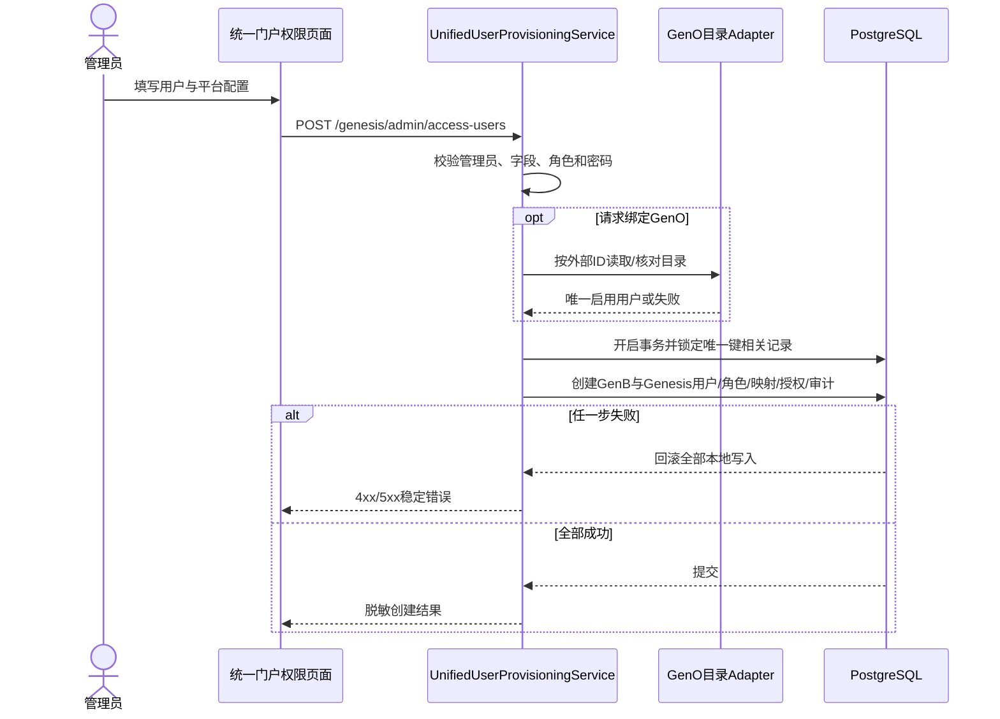

# Genesis 统一模块新增用户功能任务计划

- 日期：2026-08-25
- 状态：本地实现与 Gate A-F 已完成，待独立生产上线审批
- 负责人：Codex 与 GenB 项目负责人
- 范围：GenB 后端、Genesis 统一门户权限管理端、数据库增量脚本、本地与测试环境验证
- 依赖：`records/reports/20260727-REPORT-add-three-genesis-platform-users.md`、`records/reports/20260824-REPORT-add-zhangtao-unified-platform-user.md`

## 背景

当前“统一门户权限”模块只能查询 Genesis 用户、手工同步全部 GenB 用户、编辑 GenC/GenO 映射和授权，不能直接新增统一用户。新增真实人员仍需要人工执行以下链路：

1. 在 GenB `users`、`user_roles` 中创建源用户并保存 BCrypt 密码哈希。
2. 调用全量同步接口建立 Genesis 用户、GenB 映射和授权。
3. 配置 GenC 稳定身份映射、直接访问和平台角色。
4. 从 GenO 实时目录找到唯一同名用户，再写入映射和授权。
5. 分别验证 GenB、Genesis、GenC、GenO。

该流程跨多个入口，容易出现漏配、重复映射和部分成功。目标是在统一模块中提供一个面向管理员的“新增统一用户”入口，把复杂性收进单一深 Module，并通过一个公开 Interface 完成校验、创建、同步、平台授权、审计和事务回滚。

## 当前事实与失败基线

以下事实以 2026-08-25 当前代码为准：

- `GenesisAccessAdminController` 只有用户列表、GenO 目录查询和平台配置三个 Interface，没有创建用户 Interface。
- `GenesisPortalController.syncGenBUsers` 是全量同步，不能表达“只创建一个用户并配置指定平台”的原子操作。
- `GenesisAccessAdminService` 可以维护现有 Genesis 用户的平台映射、直接授权和 GenC 平台角色，但不负责创建 GenB/Genesis 用户。
- `DataInitializer` 只适合基础账号和角色，不应固化真实人员、真实初始密码或所有环境都必须创建的名单。
- GenO 已有 `GenOUserDirectoryClient` 远程目录接缝；生产使用 HTTP Adapter，测试可以使用内存/Mock Adapter。
- GenB 与 Genesis 用户、角色、映射和授权位于同一个 PostgreSQL schema，本地写入可以纳入同一数据库事务。
- GenO 本轮只读取目录并绑定既有用户，不创建或修改 GenO，因此远程读取不能与本地数据库形成分布式事务，但可以在本地事务开始前 fail-closed。
- `ProfileController.changePassword` 当前只更新 GenB `users.password`；Genesis 密码只有再次同步后才会更新。直接增加“首次登录必须改密”会导致两套登录密码不一致。
- `users`、`genesis_users` 当前没有 `password_change_required` 字段。
- `genesis_user_platform_mappings` 只保证一个 Genesis 用户在一个平台有一条映射，尚未从数据库层阻止两个 Genesis 用户同时绑定同一个启用的 GenO 外部用户 ID。
- 管理端已有 `GenesisAccessToolbar`、`useGenesisAccess`、`genesisAccess.js` 和中英文文案，可在现有用户权限页增加创建入口，不需要新增顶级菜单。

必须先建立以下可重复失败基线：

1. `POST /v1/genesis/admin/access-users` 当前不存在。
2. 重复用户名、GenO 缺失/重复/禁用、非管理员创建、事务中途异常均没有统一失败合同。
3. 新用户无法被强制在首次登录后、访问其他业务 Interface 前修改密码。
4. 修改 GenB 密码后 Genesis 密码不会在同一事务中同步。
5. 并发绑定同一 GenO 外部用户 ID 目前只能依赖应用层约定。

未取得上述失败测试或只读证据，不进入实现。

## 假设

- GenB 继续作为人员账号源系统，Genesis 用户由 GenB 用户派生，不建立第二套独立创建源。
- 新增的是人类用户，不支持批量导入、服务账号、机器人账号或外部身份提供商自动开户。
- 初始密码由管理员输入，服务端只接收明文用于一次 BCrypt 编码；请求正文和明文不得记录到日志、审计或响应。
- 为兼容当前团队规则，第一阶段密码长度允许 8–72 个字符；不在浏览器根据姓名自动生成密码，新用户一律标记首次登录必须修改。
- GenC 第一阶段仍只允许一个平台角色，取值为当前启用的 `ADMIN` 或 `USER`。
- GenO 只接受目录返回的稳定外部用户 ID；后端根据 ID 反查并写入用户名，不信任浏览器自行提交的外部用户名、角色或启用状态。
- 本计划只做到本地实现和测试环境验收。生产数据迁移、部署和真实人员创建必须另行审批，并继续受现有容量 Gate 约束。

假设被推翻时，先暂停当前里程碑，更新本计划的 Interface、迁移和 Gate，不以临时代码绕过。

## 决策驱动与方案选择

### 决策驱动

- 管理员只学习一个创建 Interface，不需要了解 GenB/Genesis 内部同步顺序。
- 所有本地数据写入必须原子成功或全部回滚。
- GenO 不可用、目标不唯一或未启用时必须在本地写入前停止。
- 密码只存在于请求进程内和 BCrypt 哈希中；成功响应、错误响应和审计均不返回密码。
- 现有全量同步和现有权限编辑继续兼容，但新增用户页面不再调用它们拼装多步工作流。

### 候选方案

| 方案 | 结论 | 原因 |
|---|---|---|
| 前端依次调用创建、同步、授权多个 Interface | 拒绝 | 浏览器承担顺序和补偿，网络失败会产生部分成功，Interface 浅且难测试。 |
| 把真实人员加入 `DataInitializer` | 拒绝 | 会污染所有环境、固化人员和密码规则，无法安全绑定环境特定 GenO ID。 |
| 继续使用运维 SQL 和人工调用 | 仅保留应急 | 可审计性和可重复性不足，不能支持日常管理。 |
| 新建 `UnifiedUserProvisioningService` 深 Module | 采用 | 单一 Interface 隐藏预检、创建、同步、授权、审计与事务，调用方和测试共享同一接缝。 |

本方案不推翻既有 Genesis/GenC/GenO 架构决策，不需要新增 ADR；若后续改为 LDAP/OIDC 等外部身份真源，再单独立项和新增 ADR。

## 现状到目标变更矩阵

| 对象 | 当前是什么 | 目标是什么 | 解决的问题 | 代价/兼容方式 |
|---|---|---|---|---|
| 管理端 | 只能同步和编辑已有用户 | 一个新增用户对话框 | 避免人工跨入口操作 | 保留现有同步、查询、编辑按钮 |
| 后端创建链路 | SQL + 全量同步 + 两次授权 | 单一创建 Interface | 消除部分成功和顺序泄漏 | 内部复用现有授权规则，不让前端感知 |
| GenO 绑定 | 前端提交 ID/用户名 | 前端只提交目录 ID，后端重新解析 | 防止伪造用户名、角色和状态 | GenO 不可用时 fail-closed |
| 密码状态 | 无首次改密要求 | 新用户默认必须改密 | 降低初始密码长期使用风险 | 旧用户迁移默认 `false` |
| 修改密码 | 只更新 GenB | 同一事务更新 GenB 与 Genesis | 防止两套密码漂移 | 保留现有路径，内部改为统一 Module |
| 外部映射唯一性 | 仅用户+平台唯一 | 启用映射的外部 ID 在平台内唯一 | 防止多人绑定同一 GenO 用户 | 迁移前先扫描存量冲突 |
| 审计 | 创建链路无统一事件 | 记录创建人、目标用户和授权摘要 | 可追溯 | 永不记录密码和 Token |

## 上下文与信任关系

- 管理员浏览器只持有 GenB 管理 Token，提交基础资料、初始密码、全局角色、GenC 选择和 GenO 外部用户 ID。
- GenB 后端验证管理员身份和角色；浏览器传入的角色、GenO 用户名和状态均不是可信事实。
- GenB 后端使用服务器端 GenO 配置访问 GenO 用户目录；共享密钥不进入浏览器、响应或日志。
- PostgreSQL 保存 GenB 用户、Genesis 用户、平台映射、授权和审计；密码字段只保存 BCrypt 哈希。
- GenC 使用 Genesis 稳定用户 ID，不接受浏览器指定外部身份。
- GenO 只提供目录事实和后续 SSO，不在本任务中接收创建或修改请求。



## 目标 Module 与接缝

### `UnifiedUserProvisioningService`

外部 Interface：

```java
UnifiedUserProvisioningResult provision(
    User operator,
    UnifiedUserProvisioningRequest request
)
```

Implementation 负责：

- 管理员授权、字段归一化和角色白名单校验。
- GenO 目录预检与稳定 ID 解析。
- 创建 GenB 用户及全局角色。
- 直接创建对应 Genesis 用户，复制 BCrypt 哈希、基础资料、源用户 ID、全局角色和首次改密状态。
- 建立 GenB 映射与授权。
- 建立 GenC 映射、直接授权和唯一平台角色。
- 建立 GenO 精确映射和直接授权。
- 保存脱敏审计并返回最终快照。

禁止承担：

- 创建或修改 GenO 用户。
- 在日志中输出请求正文、密码、Token 或服务器端共享密钥。
- 部署、Nginx、服务器容量治理或批量用户导入。

### GenO 目录内部接缝

- Interface：沿用现有 `GenOUserDirectoryClient`。
- 生产 Adapter：现有 HTTP 实现。
- 测试 Adapter：内存目录或 Mockito Adapter，覆盖唯一、缺失、重复、禁用、超时和 5xx。
- 该接缝保持为 Module 内部细节，不暴露给创建 Interface。

### `UnifiedPasswordChangeService`

Interface：

```java
void changeRequiredPassword(
    String username,
    String oldPassword,
    String newPassword
)
```

Implementation 在同一事务更新 GenB 与对应 Genesis BCrypt 哈希，清除两边 `password_change_required`。现有 GenB 改密路径和新增 Genesis 改密路径都调用该 Interface，不各自实现密码同步。

### 管理端 Module

- `GenesisUserCreateDialog.vue`：只收集输入、展示服务端校验和确认结果。
- `genesisUserCreateForm.js`：纯函数负责默认值、提交载荷和本地提示，不复制后端授权规则。
- `useGenesisAccess`：增加一个 `createUser` 动作并刷新用户列表；不编排多次后端调用。
- `genesisAccess.js`：只增加单一创建请求。

## Interface 合同

### 创建统一用户

```http
POST /api/v1/genesis/admin/access-users
Authorization: Bearer <GenB admin token>
Content-Type: application/json
```

请求示例仅描述字段，不作为真实密码模板：

```json
{
  "username": "newuser",
  "name": "新用户",
  "email": "newuser@example.com",
  "phone": null,
  "department": "AI平台组",
  "initialPassword": "<由管理员输入>",
  "globalRoleCodes": ["ADMIN"],
  "genC": {
    "enabled": true,
    "platformRoleCode": "ADMIN"
  },
  "genO": {
    "enabled": true,
    "externalUserId": "<从实时目录选择>"
  }
}
```

成功响应只返回：GenB 用户 ID、Genesis 用户 ID、用户名、启用状态、全局角色、首次改密状态，以及 GenB/GenC/GenO 的映射和授权摘要。响应不得出现密码、密码哈希、Token、GenO 共享密钥。

错误合同：

| HTTP | messageKey | 条件 |
|---|---|---|
| 400 | `genesis.user.invalid` | 字段、密码长度、角色组合或平台配置非法 |
| 401 | `auth.unauthenticated` | 未登录或 Token 无效 |
| 403 | `auth.permissionDenied` | 非 `ADMIN`/`SUPER_ADMIN` |
| 409 | `genesis.user.usernameConflict` | GenB 或 Genesis 用户名已存在 |
| 409 | `genesis.user.externalMappingConflict` | GenO 外部 ID 已被其他启用映射占用 |
| 422 | `genesis.user.genOInvalid` | GenO 用户缺失、重复、禁用或角色不符合配置要求 |
| 503 | `genesis.access.genOUnavailable` | GenO 目录超时或不可用 |
| 500 | `genesis.user.provisioningFailed` | 本地事务异常且已回滚 |

创建 Interface 不做静默幂等：重复用户名明确返回 409，避免不知情地覆盖现有密码或权限。数据库唯一约束和事务负责并发下的 at-most-once；页面提交期间禁用按钮。

### 首次改密

- 保留 `PUT /api/v1/client/profile/password`，内部切换为 `UnifiedPasswordChangeService`。
- 新增 `PUT /api/v1/genesis/auth/password`，只接受有效 Genesis Token。
- 两个路径请求均为 `oldPassword`、`newPassword`，成功后两张用户表的哈希和首次改密标志一致。
- 登录响应和 `/auth/me` 增加 `passwordChangeRequired`。
- `PasswordChangeRequiredFilter` 对两类 Token 读取数据库实时状态；标志为 `true` 时，只允许登录、身份查询、改密和退出，其余业务 Interface 返回 HTTP 428 与 `auth.passwordChangeRequired`。
- 不能只依赖前端重定向，避免直接调用后端绕过首次改密。

## 数据与迁移

计划新增增量脚本：

```text
gen-b-backend/src/main/resources/db/V20260825_01__add_unified_user_provisioning_constraints.sql
```

包含：

1. `users.password_change_required BOOLEAN NOT NULL DEFAULT FALSE`。
2. `genesis_users.password_change_required BOOLEAN NOT NULL DEFAULT FALSE`。
3. 为 `genesis_user_platform_mappings(platform_code, external_user_id)` 建立仅约束 `mapping_status='ACTIVE'` 且外部 ID 非空的 PostgreSQL 部分唯一索引。
4. 索引创建前执行只读重复检查；发现存量冲突则 migration fail-closed，不自动删除或合并。
5. 更新空库交付文件 `创建所需表.sql`，保持新环境结构一致。

当前项目没有自动 Flyway 执行链路，因此该 SQL 在本地/测试环境由明确命令执行；生产执行必须进入独立部署计划，先备份并记录校验结果。不得把 `ddl-auto=update` 当作生产迁移证据。

## 安全、故障与并发模型

- BCrypt 输入最大 72 字节；服务端校验字符长度与 UTF-8 字节上限，避免截断产生意外等价密码。
- 初始密码只在 HTTPS 请求和方法局部变量中存在；DTO 的 `toString`、异常信息、审计详情和前端状态日志不得包含该字段。
- 管理端密码输入使用 `type=password`、`autocomplete=new-password`，关闭明文回显默认状态，提交成功立即清空表单。
- 后端从 GenO 稳定 ID 重新解析用户名、启用状态和角色；浏览器数据只用于选择，不作为授权事实。
- GenO 超时上限沿用现有服务器端客户端配置；超时、5xx、空响应全部 fail-closed，不创建任何本地记录。
- GenO 预检在数据库事务之前完成，避免持锁等待远程服务。
- 用户名唯一约束、启用外部映射部分唯一索引和事务共同防止并发重复；约束冲突统一转换为 409。
- 审计记录操作人、目标用户名、全局角色、平台代码和成功时间，不记录初始密码、哈希、Token、共享密钥或完整远程响应。
- 创建失败的日志使用稳定错误码和 request correlation ID，不输出请求正文。
- 不增加缓存；GenO 目录仍实时读取，避免用陈旧状态创建映射。

## 兼容、迁移和退役

- 现有 `GET /genesis/admin/access-users`、`PUT .../platforms/{platformCode}` 和全量同步 Interface 保持兼容。
- 现有用户的 `password_change_required` 迁移默认 `false`，不会突然阻断已有登录。
- 新增用户必须走新的创建 Interface；人工 SQL 只保留故障恢复用途，并在操作手册中标记为非日常路径。
- `DataInitializer` 不增加真实用户。
- 第一阶段不删除“同步 GenB 用户”按钮；待新建功能稳定、确认没有其他合法导入源后再评估是否降级为运维入口。
- 生产发布必须按“数据库向前兼容迁移 → 后端 → 中英文管理端”顺序；旧后端可以忽略新增带默认值字段，支持应用回滚。

## 目标与成功标准

- 管理员能在统一门户权限页一次提交创建新用户，成功后列表立即显示最终 GenB/Genesis/GenC/GenO 状态。
- 非管理员无法创建用户。
- 重复用户名不会修改现有账号的密码、状态、角色或平台权限。
- GenO 缺失、重复、禁用、角色不满足或不可用时，本地数据库新增记录数为 0。
- 任一本地保存步骤抛错时，GenB 用户、Genesis 用户、角色、映射、授权和成功审计全部回滚。
- GenC 开通时使用 Genesis 稳定身份并只分配一个有效平台角色。
- GenO 映射的外部 ID、用户名、启用状态与提交时实时目录一致，且一个启用外部 ID 不能绑定两人。
- 新用户首次登录只能访问改密必需 Interface；改密后 GenB 与 Genesis 均可使用新密码，旧密码在两边均失效。
- 中英文管理端字段、校验、错误和成功提示完整，无中文串进入英文产物。
- 后端全量测试、管理端专项测试、中英文构建和真实浏览器路径全部通过。
- 未记录或输出任何初始密码、密码哈希、Token 或共享密钥。

## 修改范围

### 计划修改

- 后端 controller、DTO、深 Module、实体、repository 查询、密码强制 Filter 和审计调用。
- Genesis/GenB 登录与身份 DTO 的首次改密字段。
- PostgreSQL 增量 SQL 与空库初始化 SQL。
- 管理端新增用户对话框、表单纯函数、composable、请求封装和中英文文案。
- 后端 Interface/事务/安全测试，管理端表单测试和相关操作文档。

### 明确不修改

- 不创建或修改 GenO 用户、密码、角色和数据库。
- 不修改 GenC 用户数据库或 GenC 权限模型。
- 不做 CSV/Excel 批量导入、邮件发送、短信发送、LDAP/OIDC 接入或用户删除功能。
- 不把真实人员名单或密码写入代码、测试夹具、Git、日志和计划。
- 不在本计划中部署生产服务器、修改 Nginx、清理磁盘或绕过容量 Gate。
- 不覆盖工作树中与本任务无关的用户或同事改动，不使用破坏性 Git 操作。

## 交付物

- `UnifiedUserProvisioningService` 及创建 Controller/DTO/结果快照。
- `UnifiedPasswordChangeService` 与首次改密后端强制门禁。
- 数据库增量脚本和更新后的 `创建所需表.sql`。
- `GenesisUserCreateDialog.vue`、表单纯函数和创建动作。
- 中英文文案与双语构建产物验证。
- 后端专项、事务、Controller、安全和回归测试。
- 管理端表单测试、双语构建和浏览器验收证据。
- 操作说明、完成报告；如获批部署，另写部署记录。

## 执行步骤与 Gate

### M0：失败基线与 Interface 合同

1. 保存 GenB 子仓库和父级知识库 Git 基线，识别并保护既有改动。
2. 核对当前用户、角色、Genesis 同步、平台授权、GenO 目录、改密和 Security Filter 行为。
3. 对目标数据库执行只读重复映射查询，确认部分唯一索引能否建立；生产数据库只读检查需单独授权。
4. 新增 Controller 合同失败测试：路径缺失、401、403、400、409、422、503。
5. 新增 Module Interface 失败测试：GenO 缺失时零写入、事务异常时全回滚、重复用户名不覆盖。
6. 固定创建请求、脱敏响应、错误 messageKey、首次改密和审计合同。

Gate A：失败测试稳定为红；Interface、迁移兼容性和生产边界评审通过；GenO 缺失时“写入 0 条”的 fail-closed 行为有自动化证据。

### M1：GenB 与 Genesis 原子创建纵向切片

1. 增加请求/响应 DTO 的 Bean Validation 和用户名、密码、角色归一化。
2. 实现 `UnifiedUserProvisioningService` 最小纵向切片：管理员校验、GenB 用户、全局角色、Genesis 用户、GenB 映射和授权。
3. 复用/提取现有同步规则，避免创建路径与全量同步形成两套角色复制逻辑。
4. 增加重复用户名、非法角色、禁用角色、数据库异常和并发唯一约束测试。
5. 验证结果不包含密码或哈希，日志不打印请求正文。

Gate B：创建 Interface 只用一次调用完成 GenB/Genesis 基础链路；重复和异常场景零覆盖、全回滚；专项与相关同步回归全部通过。

### M2：GenC 与 GenO 平台配置纵向切片

1. 在事务开始前通过 GenO 目录 Adapter 按稳定 ID 做唯一、启用和角色预检。
2. 将现有 GenC 平台角色和授权规则收进创建 Module 内部复用方法。
3. 在同一事务创建 GenC 稳定映射、直接授权、平台角色及 GenO 精确映射、直接授权。
4. 增加部分唯一索引迁移、存量重复检测和 PostgreSQL/H2 兼容测试策略。
5. 覆盖 GenO 缺失、重复、禁用、超时、5xx、ID 已占用，以及 GenC 角色无效场景。

Gate C：所有平台配置要么随用户一起提交，要么全部回滚；GenO 所有负向场景本地零新增；并发外部 ID 冲突稳定返回 409。

### M3：首次登录强制改密与双身份一致性

1. 为两张用户表增加 `password_change_required` 实体字段和迁移。
2. 同步逻辑复制该状态，新建用户固定为 `true`，旧用户迁移为 `false`。
3. 实现 `UnifiedPasswordChangeService`，同一事务更新两边 BCrypt 哈希和状态。
4. 让现有 GenB 改密 Interface 调用统一 Module，并新增 Genesis 改密 Interface。
5. 登录和身份响应增加首次改密字段。
6. 实现 `PasswordChangeRequiredFilter`，对 GenB/Genesis Token 做后端强制 allowlist。
7. 覆盖旧密码错误、弱密码、事务失败、两类 Token、绕过前端直接访问以及改密后旧密码失效测试。

Gate D：新用户在两种登录入口均被限制为仅能改密；一次改密后两种登录均接受新密码、拒绝旧密码；任何一边保存失败时两边哈希和状态不变。

### M4：中英文管理端创建体验

1. 先为 `genesisUserCreateForm.js` 增加纯函数失败测试：默认值、条件字段、密码确认、GenO 必选和载荷脱敏。
2. 在 `GenesisAccessToolbar` 增加“新增用户 / Add User”按钮。
3. 实现创建对话框，按是否开通 GenC/GenO 动态显示角色与目录选择。
4. 目录只展示后端返回的可选信息；提交只发送稳定 ID，不发送目录角色和状态。
5. `useGenesisAccess.createUser` 只调用单一 Interface，成功后清空敏感表单并刷新列表。
6. 增加中文和英文完整文案、错误提示、键盘操作、加载态、防重复提交和窄屏布局。
7. 增加首次改密页面/对话框和路由守卫；后端 428 是最终门禁，前端只负责引导。

Gate E：表单专项测试通过；中文、英文构建通过；管理员可创建，非管理员入口不可见且后端仍返回 403；页面不保留密码字段。

### M5：总验收、文档与交付

1. 执行后端全量 `mvn test`，记录总数、跳过项和耗时。
2. 执行管理端 Genesis 专项 Node 测试及全部现有前端测试。
3. 执行 `npm run build:zh`、`npm run build:en`，扫描英文产物的新增中文残留。
4. 在隔离测试数据中完成管理员成功创建、普通用户 403、重复 409、GenO 不可用零写入、事务故障回滚和首次改密场景。
5. 用真实浏览器验收中文和英文页面：创建、列表刷新、首次登录、强制改密、GenC/GenO 入口。
6. 对日志、Git diff、构建产物和响应进行秘密扫描。
7. 更新 `CURRENT_TASKS.md`、`records/RECORDS_INDEX.md`、项目说明、数据库说明和操作手册，新增完成报告。
8. 使用中文功能说明提交当前授权分支；是否推送和生产部署按当时授权与网络状态执行。

最终 Gate F：所有必须项通过，负向场景有零写入/全回滚证据，中英文真实路径通过，无秘密泄露；未执行生产部署时必须明确写为“本地完成、待独立上线审批”，不能标记生产完成。

## 验证矩阵

| 层级 | 验证内容 | 证据 | 通过条件 |
|---|---|---|---|
| Interface/静态 | 请求、响应、错误、DTO 校验、迁移重复查询 | MockMvc、SQL 检查、`git diff --check` | 合同一致，无密码字段泄漏 |
| Module 专项 | 创建、角色复制、GenC/GenO 配置 | `UnifiedUserProvisioningServiceTest` | 正向通过，所有负向零覆盖 |
| 事务 | 任一步异常、并发重复、密码双写 | Spring 集成测试 | 本地数据全回滚，约束冲突稳定归一 |
| 安全 | 401/403/428、伪造 GenO 字段、绕过前端、日志秘密 | Security/Controller 测试与日志扫描 | 无越权、无绕过、无秘密输出 |
| 回归 | 全量同步、现有权限编辑、现有登录和改密 | 后端全量测试 | 既有用例全部通过 |
| 前端专项 | 表单、条件字段、载荷、防重复提交 | Node 测试 | 全部通过 |
| 双语构建 | 中文/英文管理端 | `build:zh`、`build:en` | 两项成功，英文新增文案无中文残留 |
| 运行态 | 四系统新用户链路和首次改密 | 隔离测试数据、HTTP/浏览器证据 | GenB/Genesis 登录与 GenC/GenO 入口符合配置 |

## 回滚与恢复

- 代码回滚只撤销本任务的精确提交，不覆盖用户或同事的其他工作树修改。
- 两个新增布尔字段有默认值，旧后端会忽略，可在应用回滚时保留，不急于删列。
- 部分唯一索引可在确认旧应用确需容忍重复映射时单独删除，但优先向前修复冲突，不恢复危险重复状态。
- 测试用户清理由专项 SQL 按明确用户名和创建审计 ID 删除，先删除平台角色、授权、映射和 Genesis 用户，再删除 GenB 角色关系及用户；禁止模糊条件批量删除。
- 生产部署若获批，回滚顺序为静态管理端 → 后端 JAR → 必要的兼容性数据修复；数据库新增兼容字段默认保留。
- 创建请求返回成功后不提供自动“撤销用户”按钮，避免把本任务扩大为用户删除与级联恢复功能。

## 风险与阻塞条件

| 风险/阻塞 | 触发信号 | 影响 | 缓解与停止条件 |
|---|---|---|---|
| 存量 GenO 重复映射 | 迁移前查询返回重复外部 ID | 唯一索引不能建立 | 停在 M0，人工确认真实归属，禁止自动合并 |
| GenO 不可用或慢 | 超时、5xx、空目录 | 无法安全绑定 | 返回 503、零写入；不得允许浏览器手填绕过 |
| 密码双表漂移 | 任一登录仍接受旧密码 | 身份不一致 | M3 不通过，禁止发布首次改密功能 |
| 旧客户端不识别 428 | 登录后错误提示不明确 | 用户体验退化 | 后端门禁先测试，管理端/客户端同步增加引导后再启用新用户 |
| `ddl-auto=update` 掩盖迁移缺失 | 本地可用、目标环境缺列 | 部署失败 | 必须以显式 SQL 和 schema 查询作为 Gate |
| 远程 DB 延迟 | 创建事务超过目标时间或锁等待 | 管理页面超时 | GenO 调用移出事务、批量加载关系、设置超时并记录指标 |
| 初始密码规则偏弱 | 管理员输入可预测密码 | 账号风险 | 强制首次改密、限制 8–72 字符、上线前评估随机密码/安全交付 |
| 生产容量 Gate 未通过 | 后端磁盘低于既定水位 | 无法安全部署 | 本计划只完成本地；不得以功能完成绕过生产 Gate |

## 质量与生产就绪

- 本地创建 Interface 在正常本地依赖下目标响应不超过 2 秒；GenO 远程耗时单独记录。
- 数据库事务不包含远程 HTTP 调用，避免长事务持锁。
- 同一用户名和同一启用 GenO 外部 ID 的并发请求最多成功一个。
- 新增错误均有稳定 messageKey 和 correlation ID，日志无请求正文和秘密。
- 本地毕业条件是 Gate A–F 的代码、测试、双语构建和隔离运行态全部通过。
- 生产上线条件还包括：容量 Gate、生产迁移备份、旧 JAR 兼容性、GenO 真实目录、回滚产物和发布授权；本地通过不能替代这些检查。

## 状态与记录规则

- 当前状态为“待执行”；用户确认开始 M0 后改为“执行中”。
- 每次只推进一个未通过 Gate 的里程碑，不提前勾选后续步骤。
- Interface、密码策略、平台角色范围、迁移或生产边界变化时先更新本计划。
- 完成后新增报告；发生部署时另写 `records/deployments/` 记录。
- 所有 Git 提交使用中文功能说明，秘密和真实初始密码永不进入提交。
