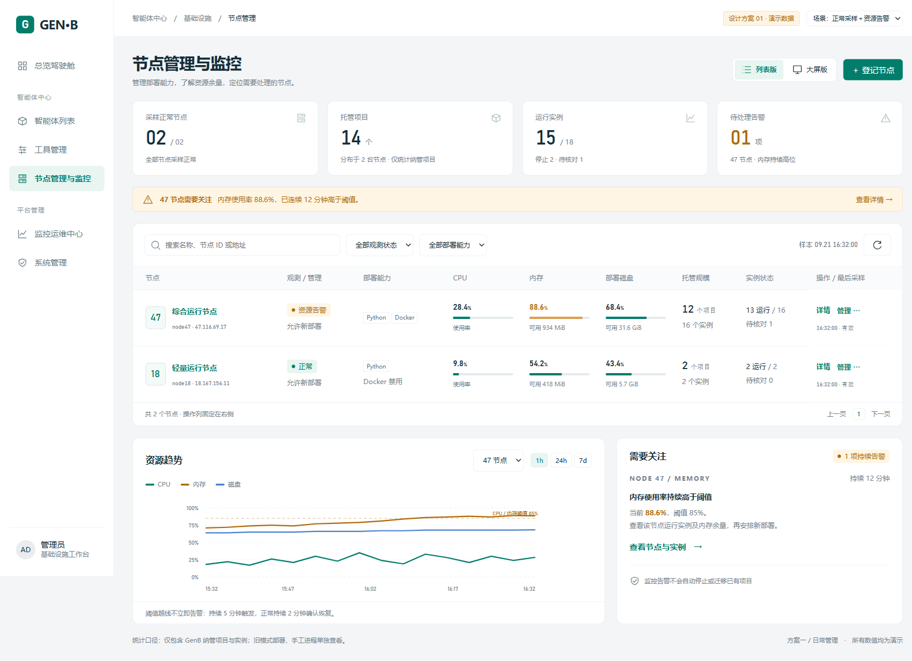
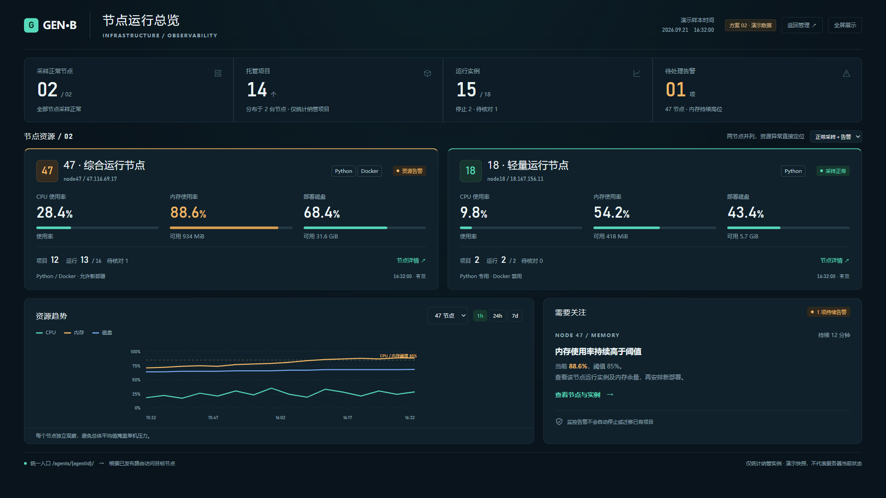

# 节点管理与监控：双版页面方案

日期：2026-09-21。交付为可交互设计原型，未接入生产接口，未修改或发布现有管理端。页面上的容量、项目数、实例数、趋势、告警及时间均为演示数据，不代表当前服务器状态。

## 方案对比

| 对比项 | 方案一：列表工作台 | 方案二：运行监控大屏 |
|---|---|---|
| 主要使用者 | 管理员、开发与运维人员 | 业务经理、值守人员、汇报观看者 |
| 主要问题 | 哪个节点能部署、还剩多少资源、在哪里管理 | 当前整体怎样、哪个节点异常、需要关注什么 |
| 布局 | 左侧导航＋摘要＋筛选表格＋趋势与告警 | 全宽摘要＋两节点资源卡＋趋势与告警 |
| 风格 | 浅色、紧凑、操作清楚；绿色表达正常与主要入口 | 深色、高对比、大数字；琥珀色表达持续资源告警 |
| 操作 | 搜索、能力与观测状态筛选、详情、管理、登记入口 | 切换趋势节点与时间范围、查看详情、全屏、返回管理 |
| 主要屏幕 | 桌面工作台；窄屏由表格内部横向滚动 | 1920×1080 投屏一屏看全；较窄屏改为纵向布局 |
| 适合长期扩展 | 分页管理更多节点 | 优先展示异常节点，节点较多后增加分组或分页 |

推荐同时保留：列表为默认入口，大屏为同一模块的展示视图；共用数据和详情组件。当前只有 18、47 两台服务器，不添加虚构第三节点、地图或吞吐量。

## 方案一：列表工作台

[打开列表版原型](assets/20260921-节点页面双版方案/列表版.html)

1. 顶部四项摘要展示采样正常节点、托管项目、运行实例、待处理告警。异常可优先进入视线。
2. 独立 CPU、内存、部署磁盘列，用数值与细进度条辅助比较；内存、磁盘同时显示可用量。
3. 将观测状态与管理状态分层：资源告警不等于离线，也不等于禁止部署。Python/Docker 能力始终可见，18 明确标示 Docker 禁用。
4. 右侧操作列固定，只保留“详情”“管理”；详情抽屉内分资源、项目、接入三个页签，减少每行按钮堆叠。
5. 趋势与待处理告警并排呈现。点击告警直接打开对应节点的实例页签，方便继续排查。

## 方案二：运行监控大屏

[打开大屏版原型](assets/20260921-节点页面双版方案/大屏版.html)

1. 移除工作台侧栏，给数据留出完整宽度；1920×1080 下无需滚动。
2. 18、47 两张节点卡并列，分别显示三项资源、可用容量、部署能力与运行实例数。避免把不同容量服务器的使用率简单平均。
3. 资源异常用琥珀色边框和数字突出，正常采样用绿色，过期数据变灰并保留最后采样时间；不靠颜色单独表达状态。
4. 趋势可选择节点与 1h/24h/7d 范围；告警卡显示触发原因、当前值、阈值与持续时间。
5. 大屏以观察为主，管理入口返回列表工作台；不把退役、暂停等变更操作放进投屏主界面。

## 共用的信息规则

- 页面摘要基于所有符合权限范围的节点，不能仅合计当前分页。跨节点项目按 agentId 去重，实例按 instanceId 计数。本演示的 14 个项目按两节点不重叠构造。
- 运行数只包含有效观测；演示切换到“18 数据过期”后，确定运行数从 15 调为 13，待核对从 1 调为 3，不把未知显示成停止或零负载。
- 过期资源保留最后值并变灰；历史缺口不连线、不补造数据。采样正常与资源告警可同时存在。
- “允许新部署”属于管理许可，不保证当前容量一定满足部署条件。实际部署还要校验系统保留量、项目上限、端口与本地能力。
- 托管规模仅包含 GenB 管理的项目与实例。原有“旧模式部署”仍保留独立入口，不并入确定运行数。
- 原型的刷新按钮解释固定快照；正式版本沿用现有 30 秒刷新，并显示真实观测时间。原型不伪装实时采样。

## 正式实施时的改造范围

| 层次 | 改造内容 | 现有基础 |
|---|---|---|
| 页面 | 默认列表工作台，增加大屏视图；共享筛选及选中节点 | `gen-b-console/src/components/nodes/NodesPage.vue`、路由 |
| 列表 | 资源独立列、固定操作列、状态分层；保持管理状态筛选，再增加能力与观测状态筛选 | `NodeDirectory.vue` |
| 详情 | 共用抽屉与资源/项目/管理页签，告警可直接定位目标节点 | `NodeDetail.vue`、`NodeMetrics.vue` |
| 数据请求 | 总览、详情、趋势采用共享数据层，取消过期请求，隐藏视图不重复轮询 | `useNodes.js`、现有节点接口 |
| 汇总接口 | 增加或扩展全局摘要：可观测节点、去重项目、各状态实例、未恢复告警 | 当前分页总览不能直接当成全局汇总；告警避免逐节点请求后在浏览器合计 |
| 筛选接口 | 全局执行观测状态、能力筛选，再分页；不可只过滤当前页 | 现有搜索、管理状态分页接口可扩展 |
| 大屏布局 | 新建只读卡片视图；窄屏堆叠，不用整体缩放导致小字难读 | 复用原监控指标与历史数据，不另建采集服务 |

正式页面继续沿用 Vue、Element Plus 和 ECharts。这里的 HTML/CSS/JavaScript 仅用于方案对比，不直接覆盖生产组件。节点执行器、部署协议和网关访问机制不因本次视觉方案调整。

## 原型使用与验证

- HTML、`design.css`、`design.js` 保持在同一目录，直接打开任一 HTML；无需安装依赖，无外部字体或图表网络请求。
- 支持两版切换、列表搜索与能力筛选、空结果、详情页签、关闭/Escape、趋势节点与时间切换、数据过期场景、登记说明和全屏入口。
- 已检查列表 1600px、大屏 1920×1080；大屏在目标尺寸无横向/纵向滚动，列表无整页横向溢出。
- 设计不等于上线；该交付供选择视觉方向和讨论交互，生产接入另按选定方案实施。
