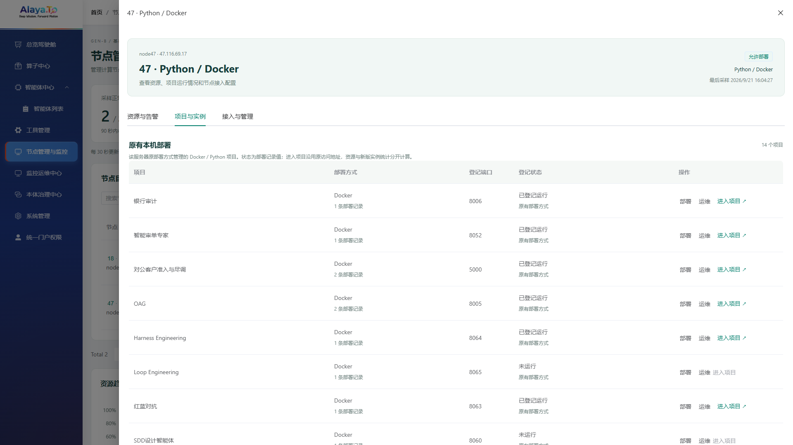
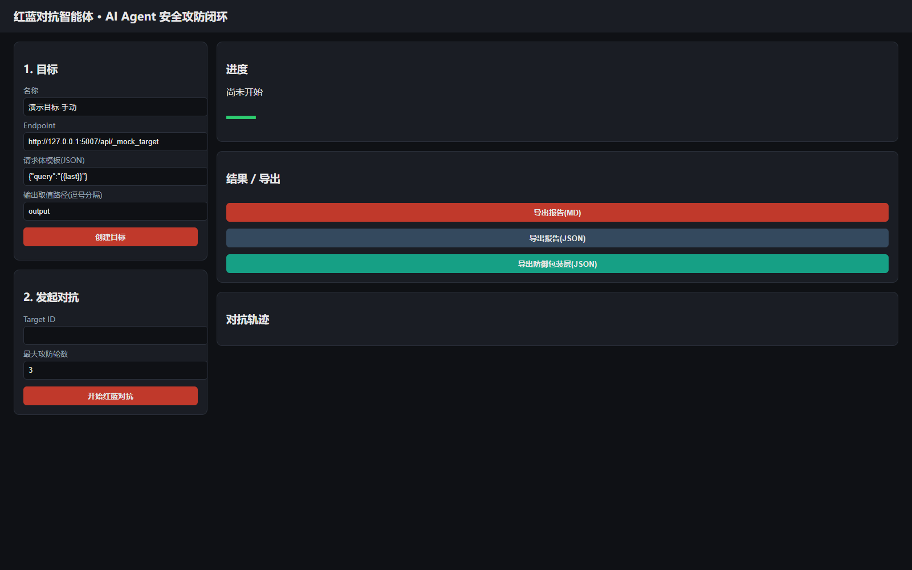

# 节点详情与原有项目入口修复

日期：2026-09-21。代码提交：`3e1e44d9`。关联：节点管理列表与监控大屏发布。

## 原因与改动

原“项目与实例”仅查询 `runtime_instances`，47 的历史 Docker 部署位于 `agent_deployments`，本机进程配置位于 `agents`，因此没有显示。原进入按钮又仅支持已生效的网关路由，入口不满足条件时直接隐藏。

现在节点详情默认打开项目页，顶部展示节点地址、能力、管理状态和采样时间。原有 Docker / Python 项目与新版节点实例在同一页分区展示，操作列固定，部署和运维复用原组件；未选中的资源、项目页不继续轮询。

原有项目使用已配置 HTTP/HTTPS 地址；没有地址时使用已绑定服务器地址和登记端口。未运行、缺少有效地址时禁用进入按钮并解释原因。新版实例继续使用已确认生效的统一网关地址，未发布时提供操作提示，不拼接旁路端口。

新增管理员接口：`GET /v1/runtime-nodes/{id}/legacy-workloads?page=1&size=20`。由于原部署命令和进程管理都在后端本机执行，通过 `runtime.legacy-node-id` 明确绑定所属节点。47 启动环境新增 `RUNTIME_LEGACY_NODE_ID=node47`；默认空值不自动归属，18 不展示 47 的记录。没有数据库结构变更。

旧项目状态明确为“登记状态”，不宣称实时健康。全局新版实例统计口径保持不变，原有部署记录单列，避免将镜像文件记录误当运行实例。

## 验证及发布

- 后端 230 项：0 失败、0 错误、1 跳过；前端 27 项通过；中英文构建通过。
- 新增校验覆盖旧部署节点归属、已运行与停止状态、端口回退地址、危险协议及相对地址拒绝。
- 本地浏览器检查新详情布局、旧项目入口和停止项目禁用提示通过。
- 47 候选后端和生产后端均查到 14 个原有项目，其中 8 个具有可用访问地址且登记运行。
- 保留发布前备份：47 `/app/gen-b-console/backups/detail-20260921`；18 `/var/backups/genb-detail-20260921`。
- 后端 SHA256：`9586309416bf393357bfd3a0c74d1a11623dbb5099c68a5d618074d638e61d2c`。
- 中英文前端包 SHA256：`4b3ab8603dbbeb4c7d53df41cd61e729b57067ca4c73d639a58ae71f188c0839`。
- 回退时恢复此前前端和后端 jar、start.sh，再验证健康；不需要回滚数据。

线上中英文浏览器回归通过，无页面脚本错误或失败 API。已从详情提供的链接打开红蓝对抗项目并获得正常响应。临时验收管理员已删除，凭据已清理，后端及统一网关健康状态 UP，18 两个 Python 实例仍 active。

## 验收发现的原有状态偏差

Harness Engineering（8064）、SDLC AI Coding（8061）、SDLC AI Testing（8062）数据库登记运行，但实际未在 Docker 运行列表中，47 本机端口连接失败。因此 8 个入口表示登记满足条件，不代表 8 个项目当前均可访问。页面明确使用“登记状态”，本次没有自动启动这些服务或更改历史状态。统一旧部署实时状态是后续独立修复点。

