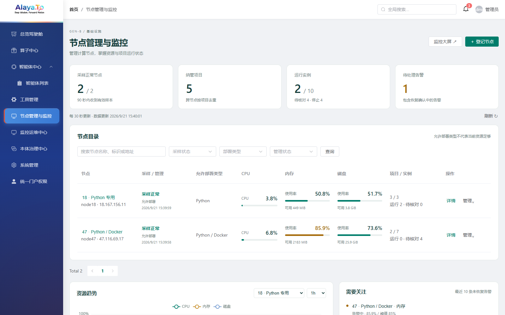
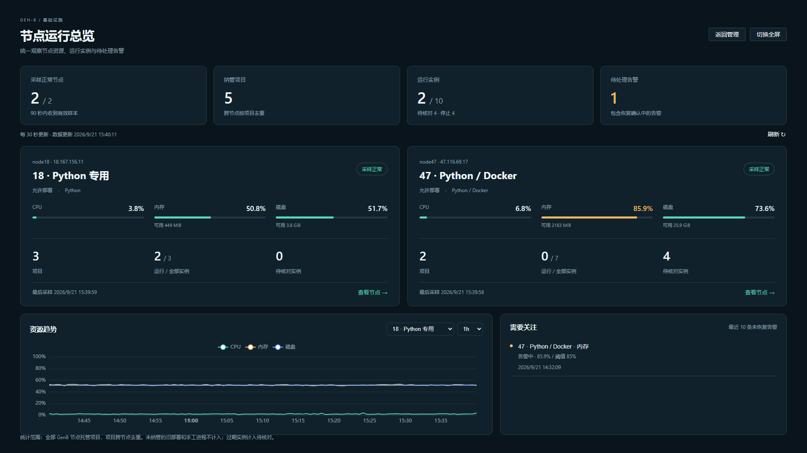
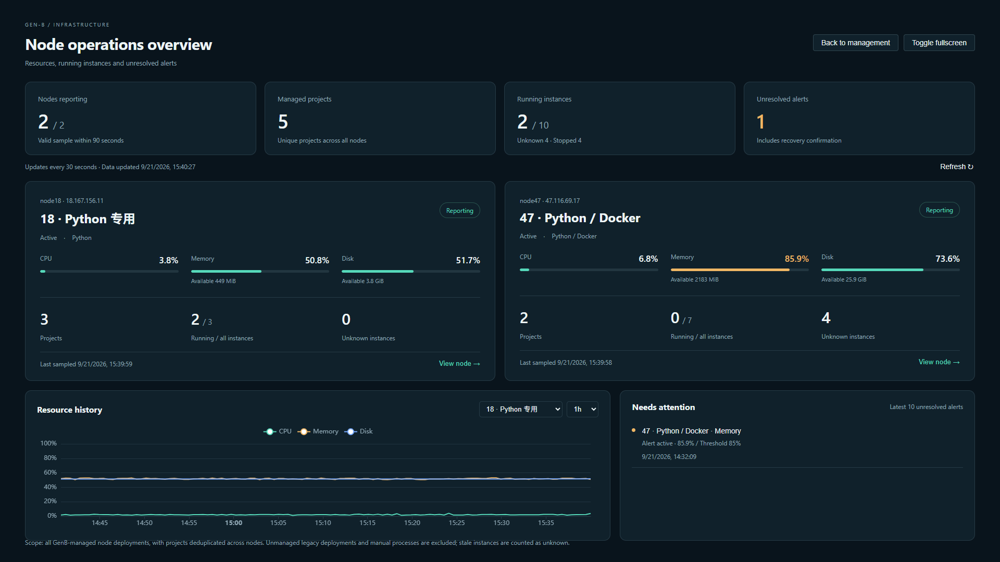

# 节点管理列表与监控大屏发布记录

日期：2026-09-21。状态：开发、部署和线上验证完成。代码提交：`gen-b` 仓库 `1b1281a1`，分支 `shizhenhua`。

## 使用入口

- 中文列表：http://18.167.156.11/genb/runtime-nodes
- 中文大屏：http://18.167.156.11/genb/runtime-nodes?view=screen
- 英文列表：http://18.167.156.11/genb-en/runtime-nodes
- 英文大屏：http://18.167.156.11/genb-en/runtime-nodes?view=screen

需要管理员登录。默认列表，点击“监控大屏”切换。大屏“查看节点”返回工作台并打开节点详情；“返回管理”退出大屏。

## 本次交付

| 内容 | 完成情况 |
|---|---|
| 列表工作台 | 浅色概览、独立 CPU/内存/磁盘列、可用容量、固定右侧操作、搜索和采样/能力/管理状态筛选 |
| 监控大屏 | 深色全宽、两节点卡片、资源趋势、未恢复告警、全屏切换；1920×1080 一屏展示 |
| 全局摘要 | 节点、去重项目、实例状态和未恢复告警；不受列表筛选与分页影响 |
| 真实数据 | 共用现有节点采集数据，30 秒刷新，支持 1h/24h/7d 历史 |
| 异常提示 | 过期资源变灰，更新失败保留并标明旧结果，实例观测过期计入待核对 |
| 管理操作 | 保留登记、编辑、环境检查、暂停、恢复、排空、退役及原详情抽屉 |
| 中英文 | 两个构建均部署并验证 |

后端扩展 `/v1/runtime-nodes/overview`：返回 `summary`、最近 10 条未恢复 `alerts`、趋势节点选项；新增 `observation`、`capability` 参数，在分页之前过滤。摘要按全部节点计算，项目按 `agentId` 去重，运行实例沿用最近 90 秒观测规则。

前端由 `NodesPage` 组合目录、摘要、资源条、大屏节点卡和趋势告警组件，详情复用已有组件。只查询当前页节点的最新资源记录；总览采用批量读取节点、观测、实例，避免按节点重复加载实例。

## 验证结果

- 后端全量回归与新增测试累计 229 项：0 失败、0 错误、1 跳过。新增 3 项覆盖跨节点项目去重、过期实例、筛选后分页、全局摘要和空数据。
- 前端现有 27 项测试全部通过；中文、英文构建成功。构建仍有既有的大文件分块提示。
- 本地浏览器：空结果筛选、筛选后摘要不变、大屏与详情切换、1080p 无滚动、390px 大屏无横向溢出、过期数据及请求失败提示通过。
- 线上浏览器：列表、筛选、真实资源趋势、24h 查询、项目实例抽屉、中文/英文大屏通过；无页面脚本错误和失败 API。
- 先以 47 本机备用端口验证候选后端，再切换生产；数据库核对节点数和去重项目数通过。无数据库结构变更。
- 18 原 FIBO 与隔离单用户演示实例均为 active；后端和统一网关健康接口均 UP。
- 临时管理员验收账号已删除，临时密码和令牌已从验收状态文件清除。

线上验收快照（约 15:40）：2 个节点均正常采样，5 个项目、10 个实例，运行 2、停止 4、待核对 4；1 条未恢复告警。47 节点当时内存使用率约 85.9%，阈值 85%。这些是现有真实观测，页面改版没有清除历史实例或修改告警阈值。旧模式部署和手工进程不在托管项目统计内。

## 发布与回退

- 后端包 SHA256：`8b254efcd1c45b579524dc1a2fb0a8fe78a255185a9e14ac211dd074429e7726`。
- 前端包 SHA256：`cb744c1c3dbbea772d8ad9b2e34800352b7e320c354f728ab83995ab075b65b4`。
- 47 发布目录：`/app/gen-b-console/releases/ui-20260921`；备份：`/app/gen-b-console/backups/ui-20260921`。
- 18 前端备份：`/var/backups/genb-ui-20260921/genb`、`genb-en`。
- 后端保留现有启动环境及网关失效通知配置，发布包使用版本库配置文件，不包含本地私有 `application.yml` 修改。
- 前端先复制静态资源，再原子替换入口文件，保留旧静态资源供已打开页面继续使用。
- 如需回退，先恢复两个前端备份入口及资源，再停止后端、恢复备份 jar、通过原 start.sh 启动并检查健康；无数据回滚步骤。

## 页面证据

浏览器检查记录位于同一 assets 目录的 `ui-production.json`、`ui-local.json`。原双版 HTML 原型保留为设计参考，其中数字仍为演示数据。
