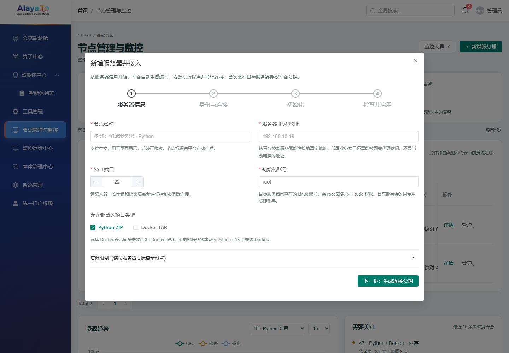
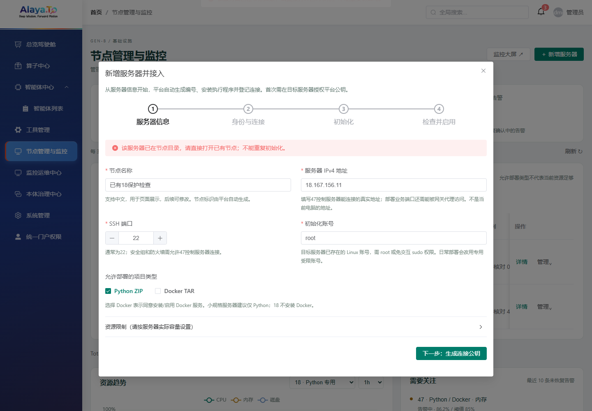
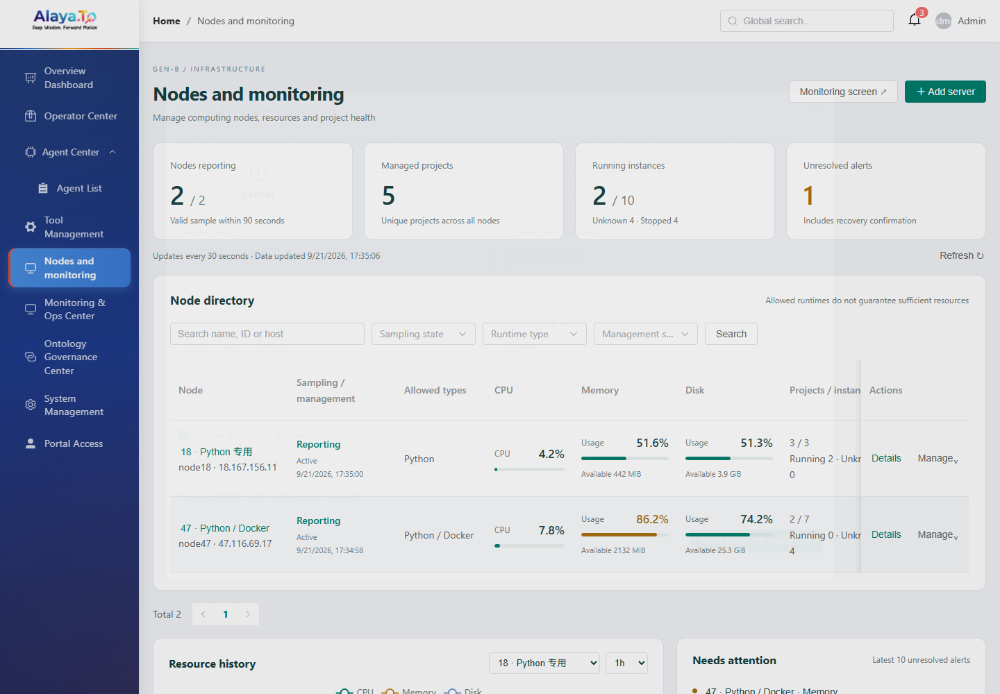

# 页面新增服务器：开发与发布记录

日期：2026-09-21。版本：onboard-20260921。代码提交：`b3b67f4a`。

## 结果

已将节点页面“登记节点”替换为“新增服务器”向导，并部署 47 后端和 18 中英文前端。无需手工填写节点编号和运维 SSH 别名。首次授权采用平台生成公钥，随后核对主机指纹、检查连接、确认安装、检查启用。

完整页面逻辑和提示见 [操作说明](20260921-页面新增服务器-页面逻辑与操作说明.md)。

## 改动范围

- 新增 NodeOnboarding、前端输入验证和双语错误说明。
- 新增管理员接入 API、持久任务、公钥生成、严格主机身份检查、后台安装和结果恢复。
- 复用原节点执行程序；新增受控初始化脚本；RemoteNodeClient 支持平台托管连接。
- 不新增数据库表，不修改既有 18/47 节点程序和业务实例。
- 打包前使用 Git 已跟踪基线 application.yml 替换本地私有配置；未发布工作区无关配置修改。

## 验证证据

| 验证 | 结果 |
|---|---|
| 后端全量测试与打包 | 230 项，失败 0、错误 0、跳过 1；新增两项权限/未启用服务测试后，控制器 14 项再次全部通过并重新打包。 |
| 节点接入脚本 | Linux 上 6 项通过；包含重复恢复、错误参数、指纹门槛、已有节点阻止、修改后重新确认、安装中断及部分安装结果核验。远程 SSH 调用为模拟。 |
| 前端参数测试 | 通过：中文名称、IP/账号/资源限制校验。 |
| 浏览器模拟完整向导 | 通过：错误输入、指纹确认、安装确认、状态轮询、启用；无页面运行错误。 |
| 中英文构建 | 通过；存在原有的大包体积提醒。 |
| 47 预发布与正式 API | 均通过：非法地址拒绝、已有 18 地址冲突、真实密钥生成、重复地址续接、未检查不能安装；测试草稿已删除。 |
| 18 正式浏览器 | 中文与英文向导、重复节点说明、小屏内容宽度检查通过；无页面运行错误。 |
| 既有业务 | 后端和网关健康；node18/node47 采样正常；18 两个原有 Python 实例 active；47 旧项目列表仍 14 项。 |

暂存测试账号已清理，临时密码和令牌已移除。未在真实目标服务器执行初始化命令；测试不会重新安装 18/47。

## 发布文件与备份

- 47 发布目录：`/app/gen-b-console/releases/onboard-20260921`。
- 47 回退备份：`/app/gen-b-console/backups/onboard-20260921`，包含原 JAR 和启动脚本。
- 18 回退备份：`/var/backups/genb-onboard-20260921`，包含原中英文 dist。
- 后端 SHA256：`20725d3f313c0b4f2e460235d2dcf056f0718eb2191c3b4455b8ff5386e4807e`。
- 前端包 SHA256：`9017b32f158ffee84225bb19015f8668628810ebdfbc028a4c188d721ace165a`。
- 新配置：`RUNTIME_ONBOARDING_ENABLED=true`；`RUNTIME_ONBOARDING_SCRIPT=/app/gen-b-console/releases/onboard-20260921/node-runtime/node_onboarding.py`。
- 状态和私钥目录：默认 `/var/lib/genb-onboarding`，不在发布包内，需保护及备份。

回退时恢复旧 JAR、旧 start.sh 和中英文前端；保留持久连接目录。若已启用新托管节点，旧版客户端不识别托管连接文件，应先为它们补齐兼容的 SSH 连接配置再回退，不能只恢复程序后宣称节点连接正常。

## 尚未验证的边界

没有新增可初始化服务器，尚未执行真实新主机的系统软件安装、节点首次启用和端到端项目访问。当前结果不能解释为所有 Linux 发行版已支持，也不能解释为云安全组或网关网络已经自动配置。18/47 已有业务，禁止为了验收新增流程而重装它们。

下一次真实接入验收：在授权的新服务器上确认公钥和指纹 → 初始化 → 启用 → 部署允许类型的最小项目 → 发布统一入口 → 验证账号授权及真实页面/API访问。

## 页面截图

